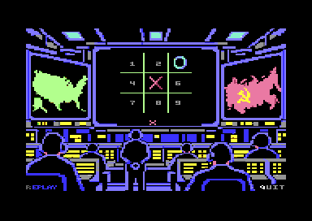
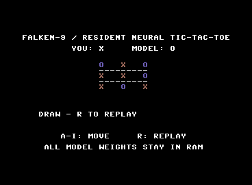
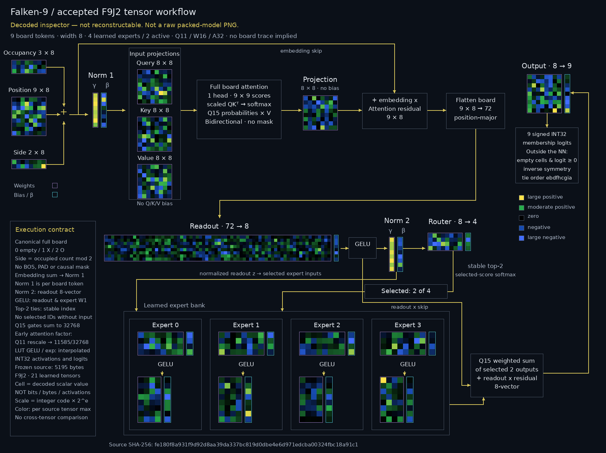
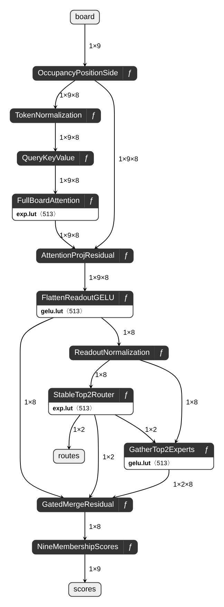

# Falken-9

A new C64-first neural tic-tac-toe policy project. The goal is a compact, RAM-resident model with real attention, learned routing and mixture-of-experts execution—not a stored move table. Crystal-9's published original-model release is preserved separately.

## Current graphical game — application 007



[Application 007](docs/APP_GRAPHICAL_007.md) adds the requested lower/right-aligned
FALCON-9 badge, three decorative light bands, compact REPLAY/QUIT and in-place
replay without a DEN blackout. [Original SID music/SFX](docs/SID_AUDIO.md) continue
through neural computation. M toggles sound. Zero-player mode continuously
replays: every opening executes full inference, with only later-game opening
ties randomized inside the actual inverse-mapped model-approved legal set.
The model is frozen; self-play is not learning or temperature scaling.

The [GitHub-only static launcher](docs/PAGES.md) sends the complete standalone
PRG to TY64 and the exact disk to the existing storage-d64 inspector. It is not
part of the Hub package, and no public GitHub/Pages/Hub publication is enabled.
Numerical, stock-ROM, PCM and browser evidence have separate scopes; see the
application guide for interrupted browser paths and physical-hardware limits.
The [scoped acceptance summary](results/app-007-summary.json) binds the executable,
model, package and native audio captures without publishing private operator logs.

## Historical graphical game — application 004


The [graphical application](docs/APP_GRAPHICAL_004.md) uses the original CP64 artwork,
a static `falken-9` / `v1.0` title badge and independent real-work activity lights.
All three modes work: human/model, two humans and model/model. Title keys are
`1`, `2`, `0` and `I`; game controls are `123 / 456 / 789`, `R` replay and `Q`
title. Every empty square shows a dim 1–9 label, replaced by its X/O mark and
restored on replay. Wait for the ready status and completed redraw before input.

PRG and D64 have separate native-frame checks for complete human/model browser
matches, recovery, terminal locking, replay and INFO/title restoration. The PRG
event log is partial; browser auto results remain unconfirmed. Stock-ROM VICE
passed complete two-human and nine-forward model/model games in both formats.
The final 004 presentation path has a fresh 627-board full-vector parity proof.
The model packet, tag, original art and frozen applications 001/002/003 remain
unchanged. Application 003 omitted empty-cell labels and is superseded by 004.
**Emulator-tested only; no physical hardware or measured performance claim.**

Build the PRG with `.venv/bin/python -m scripts.build_graphical_app` after the
assembler bootstrap below. The local Hugging Face preparation targets exactly
`lewismoten/falcon-9`; it is not publicly uploaded. The expanded package and
transport ZIP have independently executed byte-identical disk rebuilds; see
[release staging](docs/GRAPHICAL_RELEASE_STAGING.md) and
[exact application evidence](results/app-004-summary.json). The stable generated
disk path is `release/falken9-graphical.d64`, an exact copy of final 004.

## Model v1.0.0

The stable release uses the **5,195-byte four-expert integer model**, with two learned router-selected experts active per inference. The complete model stays in RAM during gameplay; there are no per-turn model-data disk loads.



*Actual emulator screenshot supplied by Lewis Moten: a completed human-X/model-O draw. The image is preserved unchanged.*

**Emulator-tested only.** Physical C64/1541 compatibility and performance have not been verified.

The neural core passes all 627 canonical boards; the assembled symmetry/set-selection wrapper passes all 4,520 unique boards through a documented composed proof. The packaged PRG and true-drive D64 both complete draw/win/replay lifecycles under stock-ROM VICE. At the target browser, the PRG also passes complete matches, occupied-input recovery, terminal locking and replay. D64 browser autostart and its opening response pass, but later interaction remains unconfirmed because a host advertising iframe intercepted keyboard events. See [browser acceptance and its format-specific limits](docs/BROWSER_001.md).

Expert count and active top-k remain optimization variables for separate research, not a requirement to keep nine experts. The smaller 4,931-byte mixed-precision candidate passes host gates but is not assembled and is **not** the model-v1.0.0 deployment.

### Numeric controls — application 002

The separate [numeric-controls application](docs/APP_NUMERIC.md) labels the board
`123 / 456 / 789`, accepts **1–9**, and uses **R** for replay. Its public wrapper
result is 1–9 for a model move and 0 for invalid/no result; the learned model and
its internal occupancy encoding are unchanged. Test 001 and `model-v1.0.0` remain
immutable. Application 002 has its own [acceptance record](results/app-002-summary.json);
the browser acceptance described above applies only to 001.

## Model inspection

### Decoded tensor workflow

[](assets/model-v1.0.0-tensor-workflow.svg)

Each heatmap cell is one decoded scalar parameter from the accepted model, not a bit or byte. All four expert banks are shown; only two router-selected experts execute per inference. Color intensity is normalized per source tensor and is not comparable across tensors. This is a documentation inspector, **not a reconstructable model-data PNG**.

[Workflow guide](docs/TENSOR_WORKFLOW.md) · [Zoomable SVG](assets/model-v1.0.0-tensor-workflow.svg) · [Tensor/geometry metadata](assets/model-v1.0.0-tensor-workflow.json)

### Executable ONNX graph

[Download the self-contained ONNX graph](inspection/falken9-model-v1.0.0.onnx) and open it in Netron. This is an **exact-integer inspection representation**, not the compact C64 deployment packet: ONNX Runtime matches the independent integer reference on all 627 canonical boards, with zero score or expert-route differences. History validation, symmetry restoration and final move selection remain outside the graph.

[](artifacts/inspection/netron/falken9-model-v1.0.0.svg)

[Inspection guide](docs/INSPECTION_GRAPH.md) · [Zoomable Netron SVG](artifacts/inspection/netron/falken9-model-v1.0.0.svg) · [Source/tensor manifest](inspection/manifest.json) · [Validation](inspection/validation.json)

## Plan and evidence

- [Plan of action and competing approaches](docs/PLAN.md)
- [Dataset provenance and symmetry findings](docs/DATASET.md)
- [Current stage status](docs/STATUS.md)
- [Trained reference candidates and exhaustive results](docs/TRAINING.md)
- [Arithmetic contract and measured 6502 kernels](docs/ARITHMETIC.md)
- [Read-only C64 RAM audit and provisional allocations](docs/RAM_AUDIT.md)
- [Canonical optimal-set host model](docs/CANONICAL_MODEL.md)
- [Whole-integer direct-conversion experiments and rejected candidates](docs/INTEGER_MODEL.md)
- [Accepted canonical whole-integer reference and range contract](docs/CANONICAL_INTEGER.md)
- [Configurable smaller expert-bank experiments](docs/FLEXIBLE_MOE.md)
- [Exact local constant folding: storage versus computation](docs/LOCAL_FUSION.md)
- [Four-expert whole-integer candidates and mixed-precision inventory](docs/FLEXIBLE_INTEGER.md)
- [Assembled resident attention-block proof and memory map](docs/TARGET_RUNTIME.md)
- [Numeric-controls application, build commands and exact test sequences](docs/APP_NUMERIC.md)
- [Original resident application 001 and architecture](docs/APP.md)
- [Dataset audit](results/dataset-audit.json)
- [Symmetry audit](results/symmetry-audit.json)

## Setup and verify

Python 3.11 or later:

```sh
python3 -m venv .venv
.venv/bin/python -m pip install -r requirements-dev.txt
.venv/bin/python scripts/prepare_dataset.py
.venv/bin/python scripts/audit_symmetry.py
.venv/bin/python -m pytest tests/test_policy.py tests/test_dataset.py tests/test_symmetry.py
```

For assembled kernel tests, install 64tass 1.60.3243 or run the project-local
bootstrap on an apt/dpkg-deb host (no sudo):

```sh
sh scripts/bootstrap_64tass.sh
.venv/bin/python -m pytest -q
.venv/bin/python scripts/benchmark_kernels.py
.venv/bin/python scripts/benchmark_int16_kernel.py
```

The tests and benchmarks use the explicit `TASS64` environment variable, a PATH
assembler, or the ignored project-local bootstrap. They do not require another
model repository to be installed beside Falken-9. The optional historical RAM
audit separately requires a read-only CP64 checkout and its generated maps.

Choose the appropriate PyTorch CPU/CUDA wheel for your training host. Training may use CUDA; deployment targets the C64, not CUDA execution. The dataset preparation/audit tools use only the Python standard library. `--offline` verifies already-downloaded data without network access.

The primary corpus contains 294,778 legal nonterminal histories and 4,520 unique nonterminal boards. All histories reaching the same board have consistent labels. Dihedral canonicalization reduces those nonterminal boards to 627 representatives; preserving the complete optimal move set and restoring original-coordinate tie order is essential. This is an input/label audit, not an accepted neural policy.

The target gate is exact deterministic legal moves under tie order `ebdfhcgia`, evaluated over the complete supported domain using the actual exported arithmetic. Matching host training accuracy alone does not establish packed integer or assembled C64 correctness.

Downloaded data, checkpoints, build products and D64 images are Git-ignored. Reproducible code and concise evidence summaries are tracked. Apache-2.0 applies to project material under the repository license; upstream dataset provenance is retained.
