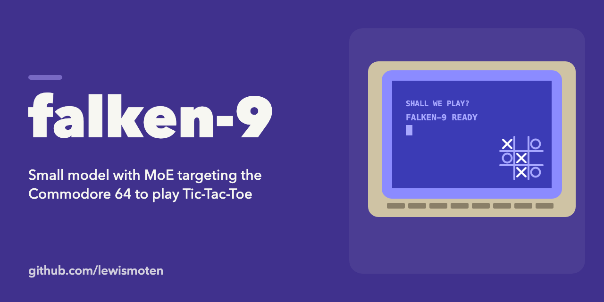
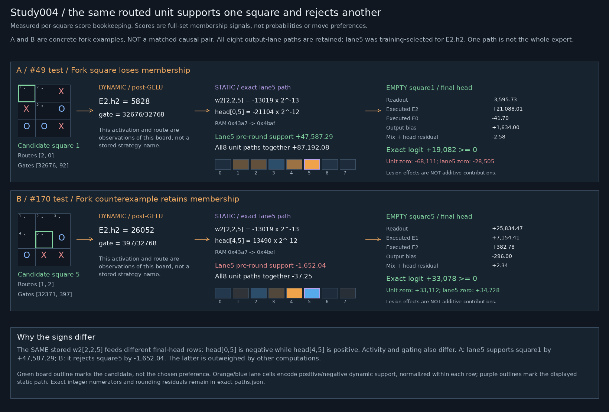

# Falken-9

**A neural tic-tac-toe model designed for the Commodore 64—not merely ported to it.**

Across Palace-9, Crystal-9 and Falken-9, the engineering question is:

> Can a learned attention-and-expert network execute on a C64, play correctly,
> and be small enough to investigate exhaustively?

The experiment does not need to beat a specialized tic-tac-toe solver on speed.
It needs to execute the learned network, verify its play and keep the model small
enough to examine systematically.

Falken-9 takes the C64's arithmetic and memory as design constraints from the
start. Its deployed model packet is **5,195 bytes**, remains entirely in RAM
during play, and retains real
attention, learned routing and two selected experts per move. It is not a stored
move table or a minimax program disguised as a neural network.

- **[Crystal Palace 9 — the C64 game](docs/C64_GAME.md)** — gameplay, music/SFX/animation, opening
  variety, controls, loading and verification boundaries.
- **[Play / inspect on GitHub Pages](https://lewismoten.github.io/falken-9/)** — run the PRG in the external emulator or send the D64 to storage-d64.
- **[Download PRG](releases/falken-9-v1.0.0/falken-9-c64.prg)** · **[Download D64](releases/falken-9-v1.0.0/falken-9-c64.d64)** — accepted binaries committed in this repository; [checksums](releases/falken-9-v1.0.0/SHA256SUMS).
- **[Model research](report.md)** — measured findings, annotated figures,
  archived reports, limitations and next questions.
- **[Model inspection](#model-inspection)** — decoded tensor workflow and exact-integer ONNX graph.
- **[Setup and evidence](#setup-and-evidence)** — source, arithmetic contracts and verification scopes.

## How we got here

These are distinct models and runtime contracts, not interchangeable formats or
successive quantizations of the same weights.

| Stage | What we were learning | Design and tradeoff | Model / repository |
|---|---|---|---|
| **Palace-9** | Train a real causal MoE and make it work through familiar local inference tools. | A from-scratch Qwen2-MoE raw-history completion model with a 261-token byte-level vocabulary, width 36, nine routed experts/top-2 and a shared expert. GGUF delivery proved llama.cpp execution; the F16 release also had local Ollama import/fixture checks. Runtime/tokenizer/format compatibility shaped the design. | [Model](https://huggingface.co/lewismoten/palace-9) · [Repository](https://github.com/lewismoten/palace-9) |
| **Crystal-9** | Make the network leaner around the actual task rather than a general-purpose model-family interface. | A custom 13-token game vocabulary, eight-move context, 32-wide hidden state and nine experts/top-2. Packed INT4 deployment and a custom runtime removed much of the compatibility overhead. **Not a GGUF, llama.cpp or Ollama model.** | [Model](https://huggingface.co/lewismoten/crystal-9) · [Repository](https://github.com/lewismoten/crystal-9) |
| **Crystal Palace 9 / CP64** | Prove the original Crystal-9 neural weights really execute on the C64. | Unchanged INT4 codes and FP16 scales, disk-paged working memory and actual 6502 inference. A complete game established feasibility, but paging and causal-history arithmetic made play slow. This is a game/port, not the Palace-9 model. | [Crystal Palace repository](https://github.com/lewismoten/crystal-palace) · [Crystal-9 model and C64 distribution](https://huggingface.co/lewismoten/crystal-9) |
| **Falken-9** | Train for the C64's arithmetic, RAM and responsiveness from the beginning. | Nine board-square tokens, width **8**, expert hidden width **4**, **four learned experts/top-2**, exact integer execution and complete model residency. Dimensions and precision are search variables, not inherited desktop/GPU assumptions. | This repository · [Game](docs/C64_GAME.md) · [Development plan](docs/PLAN.md) |

### From GPU-friendly dimensions to hardware-first training

Crystal-9's **32-wide state and 32-wide routed expert layer** were a leaner,
regular tensor layout for the training work. This describes layer dimensions,
not a universal rule of "32 weights per node." CUDA execution does not require
every neural layer to have width 32; training convenience is not a C64
architectural requirement.

Falken-9 deliberately stopped treating those dimensions—or nine experts—as
fixed. We searched representation, model/expert widths, expert count/active
count and numerical precision against the whole deployment cost: model data,
scales/tables, executable kernels, scratch RAM and actual target work. The aim
was the smallest practical **verified** design that kept genuine learned MoE and
exact required gameplay, not the lowest nominal bit width or a proof of the
mathematically smallest possible network.

A board-state model removed unnecessary chronological-history work. Symmetry
canonicalization reduced the learned domain to **627 boards**, but required
predicting the **complete optimal set**: inverse-mapping a single canonical move
would violate original-coordinate tie behavior. The wrapper restores that set,
masks occupied squares and applies the documented tie order. Those fixed
operations are separate from what the network learns.

The resulting C64 execution path keeps the full model resident instead of
loading tensors for every turn. **Crystal Palace 9, now powered by Falken-9, is
a short, watchable curiosity rather than a long wait for a neural-computation
proof.** In informal emulator observations, complete AI-vs-AI games lasted just over a minute,
with roughly ten-second thinking intervals kept visibly active by progress feedback,
console animation and sound. An earlier model-backed version took roughly
20 minutes for self-play. These are user-observed emulator impressions across
different models/releases, not a controlled benchmark or physical-C64 timing. The
[game page](docs/C64_GAME.md#how-falken-9-differs-from-the-earlier-cp64-implementation) explains
that boundary and the retained older timing evidence.

## The accepted model

| Property | Deployed contract |
|---|---|
| Model | Frozen `model-v1.0.0`, F9J2 Q11/W16/A32 |
| Encoded packet | **5,195 bytes**, including metadata, coordinate/tie data and numerical lookup tables—not the complete game size |
| Architecture | Width 8 / expert hidden width 4 / four learned experts / top-2 routing |
| Neural computation | Embeddings, normalization, full-board attention, projection/residual, flattened readout, learned routing/gates, selected expert paths and final head |
| Decisions | Exact complete optimal-set membership; deterministic ordinary-mode ties |
| Deployment | Entire model in RAM; no per-turn model-data disk loads; every AI mark executes the model |
| Runtime | Custom target-integer implementation, **not** a GGUF/Ollama deployment |

The 5,195 bytes cover only the model deployment packet; the complete game, 6502
inference runtime, graphics/audio and working memory require additional space.

The model packet SHA-256 is
`fe180f8a931f9d92d8aa39da337bc819d0dbe4e6d971edcba00324fbc18a91c1`.
The original Crystal-9 releases remain separate and unchanged; Falken-9 is a
new hardware-first model, not a relabeling of their weights.

All **627 canonical boards** pass assembled numerical checks. The symmetry/set
wrapper passes **4,520 unique raw boards** through a documented composed proof;
this is not 4,520 separate native game executions. Dataset auditing covers
**294,778 legal nonterminal histories**. Offline minimax supplies labels and
checks, never a hidden gameplay fallback. Exact logits, packed arithmetic,
legal sets, chosen moves, interrupted execution and complete game lifecycles
have distinct evidence gates.

**Emulator-tested only.** Physical C64/1541/SID compatibility and performance
remain unverified. The [game page](docs/C64_GAME.md) separates native, browser,
user acceptance and physical-hardware limits.

## Inspiration and namesake

Inspired by *WarGames* (1983), Falken-9 is named for **Dr. Stephen Falken**, the
fictional researcher who developed Joshua, the AI on the WOPR war-simulation
computer. This project plays **tic-tac-toe only**. Its military setting is
fictional; self-play executes a frozen model and does not learn. The SID score
is original, not a film melody.

The earlier `falcon-9` slug and FALCON-9 badge were a historical spelling inconsistency,
not a different model. The source repository and Hugging Face distribution use
Falken-9's corrected `falken-9` public slug.

[Source repository](https://github.com/lewismoten/falken-9) ·
[Model and C64 distribution](https://huggingface.co/lewismoten/falken-9)

## What have we learned about the network?

The network has context-dependent causal effects, but no established "fork
expert," "block neuron" or complete symbolic strategy circuit. Stored weights
stay fixed; activations, routing and contributions vary with the board.

[](report.md)

*The same stored path supports one fork square and opposes another through
different final-head rows. This measured example is not a strategy detector.*

[Read the research report](report.md) for exact-integer reconstructions,
interventions, counterexamples, all annotated figures and archived studies.

## Model inspection

[](assets/model-v1.0.0-tensor-workflow.svg)

Each heatmap cell is one decoded scalar parameter, not a bit or byte. All four
expert banks are shown; only the two router-selected experts execute per
inference. Color normalization is per tensor and cannot be compared across
tensors. Static weights and input-dependent activity are different quantities.
This inspector is not a reconstructable model-data PNG.

[Workflow guide](docs/TENSOR_WORKFLOW.md) ·
[Zoomable SVG](assets/model-v1.0.0-tensor-workflow.svg) ·
[Geometry metadata](assets/model-v1.0.0-tensor-workflow.json)

The [self-contained ONNX graph](inspection/falken9-model-v1.0.0.onnx) is an
exact-integer inspection representation for Netron, **not the compact C64
packet**. ONNX Runtime matches the integer reference on all 627 canonical boards
with no score or expert-route differences. Input validation, symmetry restoration
and final move selection remain outside the graph.

[Inspection guide](docs/INSPECTION_GRAPH.md) ·
[Manifest](inspection/manifest.json) · [Validation](inspection/validation.json)

## Setup and evidence

For dataset preparation and host policy checks, use Python 3.11 or later:

```sh
python3 -m venv .venv
.venv/bin/python -m pip install -r requirements-dev.txt
.venv/bin/python scripts/prepare_dataset.py
.venv/bin/python scripts/audit_symmetry.py
.venv/bin/python -m pytest tests/test_policy.py tests/test_dataset.py tests/test_symmetry.py
```

Choose an appropriate PyTorch CPU/CUDA wheel for the training host. Dataset
preparation/auditing uses the standard library; `--offline` checks cached data
without downloading. Training can use CUDA; C64 deployment does not.

Assembled tests/builds require pinned **64tass 1.60.3243**, available through
`scripts/bootstrap_64tass.sh` on an apt/dpkg-deb host without sudo. Tests honor
`TASS64`, PATH or the project-local assembler. The graphical build also needs
the hash-verified frozen packet; a docs checkout alone does not supply ignored
model/evidence artifacts. Run legacy artifact-producing tests in an isolated
workspace: some regenerate earlier numbered outputs. Do not overwrite frozen
releases to run a newer check.

### Build the current C64 game

The accepted model and runnable PRG/D64 are committed under
`releases/falken-9-v1.0.0/` and also distributed on Hugging Face. After setting up
the development environment above, copy the frozen packet into the builder's
historical input location and check its digest:

```sh
.venv/bin/python -m pip install Pillow==13.0.0
mkdir -p artifacts/flexible-integer/q11-w16-a32-early-interp
cp releases/falken-9-v1.0.0/model.f9j \
  artifacts/flexible-integer/q11-w16-a32-early-interp/model.f9j
printf '%s  %s\n' \
  fe180f8a931f9d92d8aa39da337bc819d0dbe4e6d971edcba00324fbc18a91c1 \
  artifacts/flexible-integer/q11-w16-a32-early-interp/model.f9j | sha256sum --check
bash scripts/bootstrap_64tass.sh
.venv/bin/python scripts/build_graphical_app.py
```

The graphical011 builder writes its PRG and matching build metadata under
`build/graphical/`. Use the committed
[ready-to-run D64](releases/falken-9-v1.0.0/falken-9-c64.d64) if you do not
need to rebuild. No ROMs, private paths or training checkpoints are required by
the graphical build; full historical research tests have separate prerequisites.

- [Development plan and acceptance contract](docs/PLAN.md)
- [Dataset provenance](docs/DATASET.md) / [audit](results/dataset-audit.json)
- [Symmetry contract](docs/CANONICAL_MODEL.md) / [audit](results/symmetry-audit.json)
- [Training approaches](docs/TRAINING.md) / [configurable MoE search](docs/FLEXIBLE_MOE.md)
- [Integer candidates, rejected conversions and byte inventories](docs/FLEXIBLE_INTEGER.md)
- [Arithmetic](docs/ARITHMETIC.md) / [assembled numerical runtime](docs/TARGET_RUNTIME.md)
- [Original integrated application](docs/APP.md) / [numeric controls](docs/APP_NUMERIC.md)
- [Current game and historical application guides](docs/C64_GAME.md)
- [Local release staging](docs/GRAPHICAL_RELEASE_STAGING.md) / [deployment plan](docs/DEPLOYMENT_PLAN.md)
- [Public site builder and HF-first deployment](docs/PAGES_PUBLICATION.md)
- [Launcher and storage-d64 transport details](docs/PAGES.md)
- [Historical stage status](docs/STATUS.md)

## Publication and research source

- [Publication layout and local preparation](publication/README.md): lean Hub
  model/game/report payload versus the source repository and Pages site.
- [Research source inventory](research/README.md) and
  [reproduction guide](docs/RESEARCH_REPRODUCTION.md): original probes, audits,
  tests and model-free numerical evidence for studies003–016. The portable method
  subset is separate from full historical/model-dependent acceptance.
- [Original music preview and recording provenance](assets/audio/README.md):
  downloadable OGG recorded from the accepted game under VICE, not a physical SID.

Some linked documents record earlier development gates; their then-current
"not yet integrated" limits are historical, not a replacement for the current
game/research overview. Downloaded data, checkpoints, logs, build products and
**D64 images are Git-ignored**. The minimal game package is separate from the
research archive. Apache-2.0 applies to project material the owner is authorized
to license; artwork/third-party terms
and provenance remain intact in [LICENSE](LICENSE) and [NOTICE](NOTICE).
