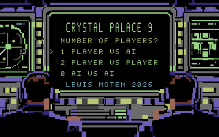
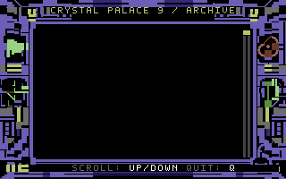
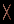

# Original CP64 game art

These are **unmodified original Crystal Palace 9 / CP64 sources**, imported from
upstream commit `97399bbed57caf63df3be6f4b910deaaaec13951`. Every imported byte was
also compared with the minimal Hugging Face upload source copy and with the
upstream Git commit. `provenance.json` records original paths, byte lengths,
SHA-256 values, upstream identity, and the original compiler's hash. The source
project and adapted compiler use Apache-2.0; see the repository-root `LICENSE`.

Only eight authoritative indexed PNGs, the charset ID contract, title selection
metadata, board layout, and original plane-hash manifest were imported. No ROMs,
generated review images, generated binary planes, model weights, archive text,
or unrelated CP64 runtime code are required. `cp64-manifest.json` is a byte-exact
copy of upstream `assets/manifest.json`, not a new Falken-9 artwork authority.

| Original title source | Original INFO source |
| --- | --- |
|  |  |

| Original logical X | Original logical O |
| --- | --- |
|  |  |

The original title/INFO wording is deliberately retained here. Falken-9 badges,
model-specific INFO text, controls, and selection changes belong to separately
reviewed application overlays, never edits to these imported originals. The
one-player title planes include upstream's JSON-defined hotkey/highlight color
normalization, so they are not simply a color-for-color PNG raster copy.

## Build interface

From the repository root, with Python 3.11 or later and **no third-party build
dependencies**:

```sh
python scripts/compile_graphics.py --output build/graphics
python -m pytest tests/test_graphics_assets.py -q
```

```python
from pathlib import Path
from scripts.compile_graphics import compile_assets
paths, metadata = compile_assets(Path("build/graphics"))
packed = paths["packed"]       # build/graphics/graphics.bin
layout = paths["metadata"]     # build/graphics/graphics.json
```

The return value is `(dict[str, Path], dict)`. Logical path keys are `charset`,
`title_screen`, `title_color`, `info_screen`, `info_color`, `board_bitmap`,
`board_screen`, `board_color`, `packed`, and `metadata`. The CLI prints the same
interface as JSON, converting paths to strings. Outputs are ignored under
`build/`; no sibling checkout, Git repository, installed image library, or
network is consulted. Source-integrity failures occur before output writes;
compiled entry planes and all-X/all-O reference planes are also checked against
the original manifest before the packed transport is written.

## Packed runtime ABI: `falken9-graphics-v1`

`graphics.bin` is headerless, contiguous, **18,164 bytes** (`$46f4`), SHA-256
`7041dcd2c43e5e530c42bf1647395eb59e5c230ac4ebe0050425a81c0d4f1254`.
`graphics.json` describes every region's zero-based packed `offset`, `length`,
and SHA-256. Offsets are file/source-relative, **not C64 load addresses**. The
first eight regions are:

| Region | Packed offset | Length | Visible destination |
| --- | ---: | ---: | --- |
| `charset` | 0 | 2048 | `$3000` (title/INFO only) |
| `title_screen` | 2048 | 1000 | `$0400` |
| `title_color` | 3048 | 1000 | `$d800` |
| `info_screen` | 4048 | 1000 | `$0400` |
| `info_color` | 5048 | 1000 | `$d800` |
| `board_bitmap` | 6048 | 8000 | `$2000` |
| `board_screen` | 14048 | 1000 | `$0400` |
| `board_color` | 15048 | 1000 | `$d800` |

The remaining regions are sparse per-cell X/O patches, **not** full-screen mark
states. `metadata["cells"]["a".."i"]["square"]` gives numeric row-major squares
1–9. Each cell has independent `bitmap`, `screen`, and `color` descriptors:

- `destination_base`: `$2000`, `$0400`, or `$d800`;
- `destination_offsets`: ordered offsets relative to that destination plane;
- `offsets_region`: a packed region containing those offsets as unsigned
  **16-bit little-endian** words;
- `values["x"]` / `values["o"]`: packed region names containing one byte for
  every corresponding offset, in exactly the same order.

For each selected cell/plane/mark:

```python
plane = metadata["cells"][cell]["planes"][plane_name]
values_region = metadata["regions"][plane["values"][mark]]
for i, offset in enumerate(plane["destination_offsets"]):
    ram[plane["destination_base"] + offset] = source[values_region["offset"] + i]
```

A 6502 runtime reads the packed offset words instead of parsing JSON; its build
step can generate pointers/counts from these descriptors. Counts are
`len(destination_offsets)` (also the value region's `length`), not fixed-size
rectangles. Each plane's write set is disjoint between board cells. The crops
are the union of exact differences from the blank board for X and O, deliberately
excluding empty shared character rows. This replaces upstream's broad 100-byte
bitmap / 16-byte attribute crops, which can repaint neighboring cells. Therefore
legacy `game/cells/*` transport hashes are intentionally **not** this ABI's
transport hashes; final all-X/all-O planes remain source-exact.

Upstream's O stamp has a preserved palette limitation: unaligned placements in
A/B/D/E/G/H remap a few secondary pixels between C64 colors 13 and 14 because
Color RAM supplies one accent per destination character cell. Tests explicitly
lock those decoded original-reference pixels. Geometry, transparency, primary
ink, and the original all-O plane digests are preserved; this import does not
silently repaint that behavior.

## VIC and backing-RAM ownership

`metadata["vic"]` supplies the bank, registers, and named-region destination
copies. VIC bank 0 requires `$dd00 & 3 == 3`; preserve the upper CIA2 bits and
configure its low two data-direction bits as outputs.

| View | `$d011` | `$d016` | `$d018` |
| --- | --- | --- | --- |
| Title / INFO | `$1b` | `$08` | `$1c` |
| Multicolor game | `$3b` | `$18` | `$18` |

Border/background are black. Bitmap selectors 0/1/2/3 resolve respectively to
background / screen high nibble / screen low nibble / Color RAM; one logical
pixel is two horizontal display pixels. Bitmap byte offset is
`((y // 8) * 40 + x_logical // 4) * 8 + y % 8`.

The visible charset `$3000..$37ff` intentionally aliases the active bitmap
`$2000..$3f3f`: **copy the complete blank bitmap on every game entry**, and
restore the charset on title/INFO entry. The packed immutable backing image has
no prescribed CPU address: the integrating application must allocate it clear
of code, model, stack, and live planes. If backing RAM lies under BASIC ROM,
save `$01`, bank out BASIC while leaving KERNAL and I/O enabled for interactive
copies, then restore the exact saved value. If other ROM/I/O windows are used,
provide explicit safe banked read staging. Flat-memory host tests do not prove
hardware banking safety. Do not treat a successful copy as proof of those
application-owned memory lifetimes.

## Verification boundary

Strict RED → GREEN slices exercised missing compilation, packed layout,
source-integrity rejection, reference-digest rejection, isolated reproducible
builds, and VIC metadata before their implementations. The bounded suite checks
all source mutations, source-exact entry/reference hashes, gapless packing and
little-endian offset tables, disjoint cell write sets, title/INFO decoding, all
single-cell marks, and continuous reverse-order all-X/all-O/mixed sequences.
The isolated build runs with `python -I -S` and compares all output bytes from
two fresh destinations. These are compiler/reference-plane tests, **not** an
assembled renderer, emulator, disk, browser, or physical-hardware acceptance.
