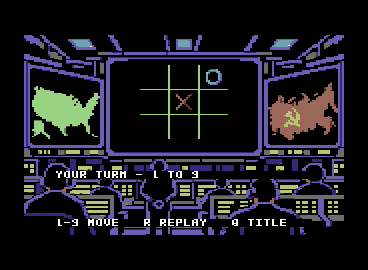

# Graphical application 003

Application `003-graphical` adds the original Crystal Palace 9 / CP64 title,
INFO frame, multicolor board and marks to the accepted resident Falken-9 model.
It is a new application, not a new model. The 001/002 frozen directories and
`model-v1.0.0` remain unchanged.



**Emulator-tested only.** No physical C64/1541 compatibility or performance
acceptance is claimed. Target-browser input used trusted browser-generated
key-down/key-up events, not a physical keyboard.

## Controls

- Title: `1` human X versus model O, `2` two humans, `0` both sides neural.
  Return starts the selected mode; cursor up/down changes selection.
- `I` opens this application's model information; `Q` returns to title.
- Game: row-major `123 / 456 / 789`; `R` restarts the selected mode; `Q` returns
  to title. Invalid/occupied input does not request inference.
- At the title, `Q` ends the session on an explicit reset/reload screen. It does
  not return to BASIC. Reset or reload the program to restart.
- Wait for the ready/terminal status before pressing another key. Rendering and
  inference are synchronous, IRQ-protected work; cancellation and queued input
  during those intervals are not supported. A short browser key pulse during
  redraw may be lost. The completed two-human browser test waited for each
  redraw; a too-fast initial probe is retained separately as incomplete evidence.

The subdued lower-right `falken-9` / `v1.0` badge has no key binding, highlight,
selection or animation. Only the four reserved decorative cells below the
board change during inference. Their changing subsets are activity, not a
percentage or a claim of measured time remaining.

## Small user test

1. Load `falken9-003-graphical.d64` with Auto Start. Allow the actual disk load
   to finish; the original title and dark-blue model badge must appear.
2. `I`, then `Q`: INFO identifies F9J2, 5,195 bytes, four experts/two active,
   Q11/W16/A32 and emulator-only acceptance. Title art must restore unchanged.
3. `1`, then `5`. The human center X appears before inference. Wait for
   `YOUR TURN - 1 TO 9`; the model O is in square 3. Decorative lights change
   only while real computation is executing.
4. Try `5` and `0`: `INVALID / OCCUPIED`, with no new marks or inference.
5. Enter `2`, `4`, `9`, `7`, waiting for each completed turn. Final board is
   `OXO / XXO / XOX`, with `DRAW - R REPLAY / Q TITLE`.
6. `R`, then `1`, `2`, `4`, waiting each turn: final board is
   `XXO / XO. / O..`, with `O WINS - R REPLAY / Q TITLE`. Terminal move input
   cannot add another mark. `Q`, `I`, `Q` must restore both views.
7. Optional: title `2`, then `1,4,2,5,3`, waiting for redraw each time: X wins.
   Return to title and choose `0`: both sides execute neural inference and draw.

These complete human/model sequences, invalid recovery, terminal locking,
replay and title/INFO restoration passed separately for PRG and D64 in the
requested browser. D64 two-human X victory also passed. The final browser auto
capture was lost when its isolated browser session reset during review; auto
mode's complete nine-forward draw is instead verified in both stock-ROM VICE
formats. Do not transfer that VICE result into an unobserved browser claim.

## Identity

- D64: `6e4bc914d04ec14dc66abdbaf1e2db2d99cfa59a253b476437a06ed5b4283b58`
- PRG: `09e877d74e5e830910be6d475679f1d64a40e0eec456d49b61191736e91778fb`
- Model: `fe180f8a931f9d92d8aa39da337bc819d0dbe4e6d971edcba00324fbc18a91c1`
- Unchanged core image:
  `838aa62a854aa58bd603c7525b52dc67c4c4b01ea0f50f58982475959ec61961`

PRG size is 48,774 bytes; D64 is 174,848 bytes. The descriptive public game disk
is an exact copy of this numbered test disk, not a different executable.

## RAM/VIC ownership

| Region | Owner/lifetime |
| --- | --- |
| `$0400..$07e7` | Active screen attributes or character IDs |
| `$0800..$1d7e` | Immutable accepted neural code |
| `$2000..$3f3f` | Active game bitmap |
| `$3000..$37ff` | Title/INFO charset; aliases inactive game bitmap |
| `$4000..$544a` | Original 5,195-byte model packet |
| `$6000..$6d9f` | Live neural activations/vectors |
| `$7000..$70ff`, `$7200..$75ff` | Neural ABI/control/vector reservations |
| `$7800..$78ff` | Application state and saved KERNAL workspace |
| `$8000..$9d35` | Application, relocated orchestration, font and mark patches |
| `$a000..$c684` | 9,861-byte compressed immutable artwork backing |
| `$d800..$dbe7` | Active Color RAM |

VIC bank 0 is selected without changing the upper CIA2 bits. Title/INFO use
`D011=1B`, `D016=08`, `D018=1C`; game uses `3B`, `18`, `18`. Each transition
restores its full active planes. The PRG never loads through I/O or KERNAL ROM.
UI reads below I/O bank out BASIC only and restore the exact CPU port; KERNAL
and I/O remain visible. Keyboard IRQ scanning runs outside protected work;
`$20..$7f` is saved/restored around inference, and UI pointers `$f7..$fe` are
preserved around rendering. No IRQ handler or timer is replaced.

The original neural core has no callback. The builder therefore relocates a
bounded set of its orchestration bodies and inserts a state-preserving activity
call at real subroutine boundaries. The arithmetic subkernels, model, semantic
operation order and complete vectors remain unchanged. This is explicitly a
separate executed path, not acceptance inferred from core identity alone.

## Verification and source

[Machine-readable summary](../results/app-003-summary.json) binds exact bytes:

- All 627 canonical boards executed through presentation orchestration with
  every saved intermediate, route and logit equal to the frozen original path.
  Emulator-visible writes are audited; code, model and backing art are immutable.
  Activity writes are restricted to four cells plus independent UI state; its
  callback preserves A/X/Y/P/ZP and has a bounded cycle test.
- The 4,520-board assembled wrapper is a composed proof using the 627 executed
  neural checkpoint fixtures, not 4,520 additional neural forwards. Internal
  occupancy `0/1/2`, letter chronology and tie order `ebdfhcgia` are unchanged;
  public result remains 1–9 / 0 invalid.
- The PRG and extracted D64 PRG execute continuous INFO/title, human/model draw
  and loss, two-human X/O/draw, nine-forward auto draw, replay and recovery.
- Stock-ROM VICE autostarts the PRG and genuine 1541 D64 separately, executes
  16 live forwards per lifecycle, compares complete human/model logits with
  Py65, checks stack/IRQ/port restoration, and retains actual framebuffer PNGs.
- Browser verification compares 29 native board-frame crops with the original
  compiled board/mark pixels, checks actual status glyph pixels and exact
  title/INFO restoration, and retains trusted non-repeat events and selected
  file Web Crypto hashes. Numerical proof and browser interaction are distinct.
- Regression run: 164 passed, 3 optional skips, 677 subtests passed. One old
  default-release test is deliberately deselected because it rewrites frozen
  002 evidence. New graphical lifecycle and packaged extraction gates replace
  that operation for this release. All 176 earlier frozen files remain identical.

Build the PRG without modifying earlier disks:

```sh
sh scripts/bootstrap_64tass.sh
.venv/bin/python -m scripts.build_graphical_app
.venv/bin/python -m pytest tests/test_graphical_app.py tests/test_graphics_assets.py
```

This writes `build/graphical/falken9-003-graphical.prg`. New executable bytes
must receive another unused numbered release; do not overwrite frozen 003.
The prepared upload's standalone `reproduce.py` rebuilds both PRG and D64 from
its shipped packet, source and pinned assembler, without this development
checkout or a sibling project. See [staging guide](GRAPHICAL_RELEASE_STAGING.md).

Original indexed artwork is unmodified under [assets/game-art](../assets/game-art/README.md).
The compiler's metadata hashes describe that original source compilation;
application badge/INFO/quit overlays and compressed planes are separately
reproducible builder derivatives bound by the final executable hash. ChatGPT
assisted art generation; Lewis Moten performed manual GIMP cleanup/layout.
See [NOTICE](../NOTICE) and [LICENSE](../LICENSE). Public packages contain no
ROMs, environments, private endpoints, raw logs or redundant source archives.

Hugging Face target is intentionally `lewismoten/falcon-9`; game/model naming
remains Falken-9. This is local preparation only, not a public Hub publication.
