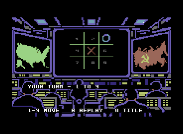
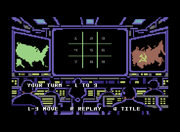

# Graphical application 004 — visible square labels

Application `004-graphical` corrects 003's missing empty-square numbers without
changing the original indexed artwork, neural core, 5,195-byte model or
`model-v1.0.0`. Frozen 001/002/003 artifacts remain byte-identical.

**Emulator-tested only.** No physical C64/1541 compatibility or calibrated
performance claim. Public Hugging Face upload is not yet authorized.

## Numbering and footprint

Empty cells show small dim gray `123 / 456 / 789` labels. Occupation draws the
original X/O art instead, removing the number; replay restores empty labels.
The 3×5 logical-pixel glyphs occupy one black-padded 8×8 physical-pixel VIC cell.
Each logical multicolor pixel is two physical pixels wide. Selector `01` uses
the matched screen attribute's high nibble (gray 12); Color RAM is unchanged.
This is not an ASCII write into a bitmap screen.

Declared screen-cell columns are 16, 20, 23, at rows 5, 8, 11, in row-major order.
The bitmap address is `$2000 + cell*8`, paired with `$0400 + cell`. Complete
footprints are inside the source layout's grid-free cell rectangles. They never
overlap neighbors, borders, status, controls, activity or neural state. The
builder retains these declarations in `build.json`; original indexed PNG/JSON
sources and their compiler/provenance hashes remain unchanged.

The assembled regression failed on the original missing bitmap bytes before the
fix. Independent expected digit masks then pass all nine empty placements,
each cell as either X or O, partial/full boards, replay and title/INFO return.
Exact expected planes are source art plus declared number/mark overlays, not
bare blank art. The actual browser frame comparison follows the same contract.

## Small user test

Load `falken9-004-graphical.d64` with Auto Start and wait for the title. The static
lower-right badge says `falken-9` / `v1.0`. `I`, `Q` visits INFO and restores title.

- Title `2`: all nine gray numbers must be visible. Use `1,4,2,5,3`, waiting for
  every completed redraw: numbers disappear as X/O is placed and X wins.
  `R` restores all nine numbers. `Q` returns to title.
- Title `1`, then human `5`: X appears at center before inference; O responds
  at square 3. Remaining cells retain numbers. Try occupied `5` and invalid `0`:
  `INVALID / OCCUPIED`, no extra marks or model request.
- Continue `2,4,9,7`, waiting for `YOUR TURN` each time: `OXO / XXO / XOX`, DRAW.
- `R`, then `1,2,4`, waiting each turn: `XXO / XO6 / O89`, O WINS. Here 6, 8, 9
  are still-empty numbered cells, not model tokens. Terminal numeric input adds
  no marks. `R` restores all labels; `Q,I,Q` restores title and INFO.
- Optional title `0`: both sides execute neural inference and draw. This is
  separately verified in stock-ROM VICE, not a completed browser-auto claim.

Rendering and inference are synchronous. Wait for the ready/terminal status
and completed redraw before another short key pulse; work cannot be cancelled
and pulses during protected work can be lost. Activity lights show changing
subsets at real work boundaries, not percentage or time remaining. Title `Q`
ends on an explicit reset/reload screen, not BASIC.

## Identity and proof scopes

- PRG: 48,774 bytes,
  `fe69d8352784313b6e048e0e9d3fa34ae0599b16eec1bc788c80ad68b54b268d`.
- D64: 174,848 bytes,
  `83c53aaaddb4dd0961c5c834a453e629e033fa25688d5b0dad9fd9b9f0150905`.
- Model: 5,195 bytes,
  `fe180f8a931f9d92d8aa39da337bc819d0dbe4e6d971edcba00324fbc18a91c1`.
- Unchanged core image:
  `838aa62a854aa58bd603c7525b52dc67c4c4b01ea0f50f58982475959ec61961`.

[Machine-readable004 evidence](../results/app-004-summary.json) binds the new
executable, not relabeled003 runs:

- Fresh 627 canonical presentation-path forwards: every retained intermediate,
  route and logit equals the original core; immutable code/model/art and bounded
  activity writes audited. Fresh composed 4,520-board wrapper gate, not 4,520
  neural reruns. Internal occupancy, symmetry, chronology and tie order unchanged.
- Packaged PRG and D64-extracted PRG each complete human/model draw and loss,
  two-human X/O/draw, nine-forward neural/neural draw, invalid recovery, replay
  and continuous title/INFO transitions. Sixteen real neural calls per lifecycle.
- Stock-ROM VICE PRG and genuine1541 D64 autostart independently complete the
  same matrix, compare full human/model logits and verify stack/IRQ/CPU port and
  immutable code/model. Actual final004 title/gameplay/INFO/draw/activity captures.
- Browser PRG and D64: 35 exact native board-frame crops total, including all
  labels, partial/full marks and replay, plus actual status glyph comparisons
  and pixel-identical title/INFO restoration. Selected browser files have exact
  Web Crypto hashes. D64 has the complete human/model event audit. PRG has
  complete native draw/loss and two-human-X-win frames, but its event log was
  last saved at replay before connection loss. A separate premature-redraw retry
  is retained as unaccepted evidence. Neither browser auto result was captured;
  D64 browser two-human result also remains unconfirmed.
- Applicable regression: 167 passed, 2 historical optional ROM skips, 1 named
  exclusion, 677 subtests passed. Excluded
  `test_release_manifest_binds_composed_wrapper_games_and_disk` because it
  rewrites frozen002 evidence. Final004 stock-ROM gates ran separately. Four
  release tests passed with the pinned assembler after the guide update.
- Clean staged and extracted final-ZIP source rebuilds reproduce complete PRG,
  D64, model and core byte-for-byte. The minimal source inventory is33 files.
  Rebuild evidence is distinct from live emulator and numerical acceptance.

RAM/VIC ownership and original art provenance are as in the
[historical003 architecture](APP_GRAPHICAL.md#ramvic-ownership), except the
application/code/patch interval now ends at exclusive `$9e50`. Compressed backing
and live model ranges are unchanged; all executable bytes remain below I/O.

## Build and package

`sh scripts/bootstrap_64tass.sh` then
`.venv/bin/python -m scripts.build_graphical_app` creates
`build/graphical/falken9-004-graphical.prg`. Do not overwrite frozen numbered
artifacts; any later executable change requires a new unused number.
`release/falken9-graphical.d64` is a byte-identical current disk alias.

The expanded upload and descriptive transport ZIP are prepared locally for
exactly `lewismoten/falcon-9`. Project/model name remains Falken-9. The delivered
`reproduce.py` consumes only its staged model/source and pinned assembler; no
sibling checkout, training checkpoint or ROM is needed. See the
[staging guide](GRAPHICAL_RELEASE_STAGING.md). No Hub publication has occurred;
the user's disk test and explicit authorization remain required.
