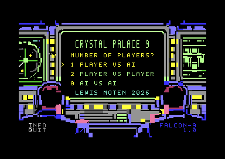
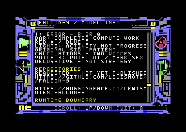

# Graphical application 007

Emulator-tested only. Physical C64/1541 operation and listening acceptance are unverified. The frozen model-v1.0.0 and applications 001–006 remain separate immutable artifacts.

## What changed

- FALCON-9 occupies zero-based title row 22, column 30; dark-blue 1.0 occupies row 23, column 35, right-aligned with the brand. Imported base art is unchanged.
- Three reviewed console-button bands (character rows 16, 19, 21) animate bounded, pseudo-random subsets at real computation checkpoints. Explicit selector/attribute masks exclude people, borders, meter and footer. They are decorative, not model interpretations or a constant-rate clock.
- Compact REPLAY and QUIT use paired native bitmap/screen/color footprints. Active REPLAY is subdued; terminal results brighten it. R is still functional midgame. Q returns from game to title, not BASIC.
- Replay restores compact immutable mark/label footprints in place, including meter, status, lights, footer and history reset. Executed R-dispatch regressions assert no DEN-off writes or full-plane decompression. Initial view transitions still compose complete planes with DEN disabled.
- Original SID music and prioritized SFX remain live during synchronous neural work. See [audio contract](SID_AUDIO.md).
- [GitHub-only launcher and existing disk inspector](PAGES.md) are separate from the model-host upload.

## Controls

Title: 1 human/model, 2 two humans, 0 continuous neural auto, up/down and Return, I for INFO. Board: row-major 123 / 456 / 789, R replay, Q title. INFO: up/down scroll, Q title. M toggles sound. Title Q ends the session at a reset/reload screen and silences SID.

Wait for ready/terminal status and completed redraw before manual input. Keyboard scanning is not performed inside protected neural work; Q/R/M are supported at safe between-turn/result boundaries, not immediate mid-forward cancellation.

## Continuous model demonstration

Every zero-player mark, including every opening, follows a real successful full frozen-model policy_request. First-game opening and all subsequent non-opening turns use the published deterministic tie order. Later games sample uniformly from the actual inverse-mapped, legal original_set, optionally excluding the preceding opener only when another approved candidate exists. This is randomized approved-set tie-resolution, not temperature scaling: the BCE-with-logits membership scores are not calibrated categorical preferences. No score, candidate set, fallback opening, or winning policy is hardcoded.

The opening PRNG is independent of decorative lights and SID. Sampling is bounded, seedable, and errors rather than manufacturing a move. The actual result holds for 100 PAL / 120 NTSC raster frames before an automatic in-place replay. This is a frozen-model demonstration, not learning. Human modes remain manual.

Native stock-ROM PRG and true-1541 D64 evidence each records three complete games, nine real neural requests per game, and safe Q. A separate 40-game fixture-composed lifecycle test is explicitly not another 360 real forwards. Existing 627-forward stage/route/logit parity is flat emulation; separate adversarial ROM-framed IRQ tests cover 24 representative boards, not the exhaustive domain with every possible interrupt timing.

## Acceptance boundaries

Final candidate PRG SHA-256: ccfe6c5d03ef51c72cd6ca6bab7bc803e1d9e25b132b1c1509e303143dc0b953.
Final D64 SHA-256: afb4f5788d6bfe87e0bb09427f91d7428dd8ffb2d7fe5ac7d7fe67a17624b3dc.

The self-contained 50,066-byte PRG embeds all model/art/INFO/music data. D64 contains that exact PRG. Ordinary gameplay and lifecycle tests observe no secondary in-game KERNAL LOAD/OPEN. Initial emulator/C64 loading is a separate boundary.

Stock-ROM PAL PRG, PAL true-drive D64 and NTSC PRG pass complete human/model draw and model-win games, two-human win/draw, replay, INFO/title restoration and a nine-forward auto draw with audio enabled. Independent continuous tests cover three full auto games per format. Actual VICE WAV/register traces cover idle music, full inference and SFX for both standards; numeric waveform checks are not a claim that anyone listened.

At c64online, the exact PRG has complete human/model draw/loss, two-human win/draw, replay/INFO recovery, one complete auto draw, automatic replay and three captured plies of the next game. The exact D64 autostarts, completes a human/model draw and terminal replay, then reaches a partial second game. Later captures were interrupted by browser transport loss ("no close frame received or sent"); uncaptured D64 loss/recovery and a second complete browser auto game remain unconfirmed. No game-byte workaround or inferred success is substituted for that host/session failure. Browser-dispatched trusted events are not physical-keyboard acceptance.

The local Pages launcher sent exact final bytes to live TY64 and the live storage-d64 receiver. TY64 rendered the standalone title and a human/model reply. The inspector rendered the directory/sourceName and its native parser extracted the exact PRG. Its current UI displays zero declared blocks while the actual file chain and c1541 directory count are 198; that external inspector behavior is not changed here.

## Reproduce and inspect

Build with the existing pinned 64tass/Python environment:

    .venv/bin/python -m scripts.build_graphical_app
    node --test tests/pages-launcher.test.mjs
    .venv/bin/pytest -q -k 'not test_release_manifest_binds_composed_wrapper_games_and_disk'

The excluded legacy release test can rewrite frozen 002 outputs; it is not a new-feature exclusion. The numbered Hub package contains a minimal expanded source tree, exact PRG/D64, model and existing inspection assets, checksum inventory and an independent reproducer. Pages HTML/JS and private WAV/monitor/ROM evidence do not enter that package. Public Hub/GitHub/Pages publication remains pending authorization.
