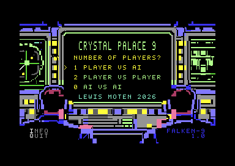
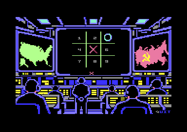
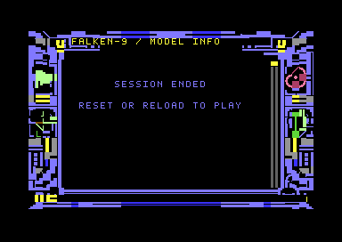
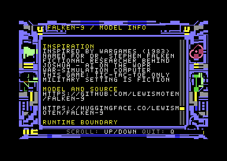
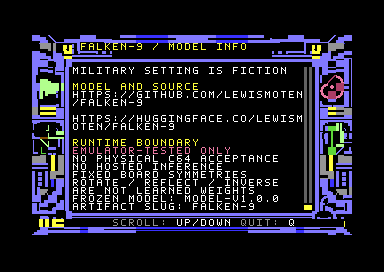

# Crystal Palace 9 — powered by Falken-9

**Crystal Palace 9** is the game: the same artwork, now with sound and a resident
**Falken-9** neural model. Original SID music, distinct sound effects, animated
console lights and continuous AI-versus-AI replay accompany genuine inference.
**Emulator-tested only.** Physical C64, 1541 and SID compatibility and performance
are unverified.

The earlier `falcon-9` slug and **FALCON / FALCON-9** labels were a historical spelling inconsistency,
not a different model. **Falken-9** and `falken-9` are the model name and repository
slug. Graphical011 uses the corrected **FALKEN-9** badge.

[Project and model lineage](../README.md) ·
[Model research](../report.md)

*Actual graphical011 title screen in native VICE. Crystal Palace 9 remains the
game title; FALKEN-9 identifies the resident model.*

*Actual graphical011 output, not a rendered mockup. The screenshot provenance
binds these captures to their executable; see the evidence section below.*

## Download and run

Download the self-contained [PRG](../releases/falken-9-v1.0.0/falken-9-c64.prg)
or matching [D64](../releases/falken-9-v1.0.0/falken-9-c64.d64) from GitHub, or
use the [Pages launcher](https://lewismoten.github.io/falken-9/): **Run PRG**
sends the verified PRG to the external TY64 emulator; **Inspect D64** sends the
verified disk to Lewis Moten's storage-d64 inspector. Pages serves both files
directly; it does not fetch them from Hugging Face at launch time.

The [Hugging Face distribution](https://huggingface.co/lewismoten/falken-9)
also includes these unchanged binaries, the model packet, game guide, screenshots,
illustrated findings report and SHA-256 inventory; assembly, build instructions,
tests and probes stay in GitHub. The packet is not a Transformers or
GGUF/Ollama model; no hosted inference service is required.

The [source repository](https://github.com/lewismoten/falken-9) includes the
broader development and research documentation. Its
[GitHub-only launcher / storage-d64 integration](PAGES.md) is separate from the
minimal C64 distribution.

The self-contained PRG and D64 carry the same game. Initial loading is separate
from gameplay; model data is not fetched from disk between turns. With a D64
mounted, autostart its first program; the standalone PRG can be loaded directly
by a compatible emulator.

## Controls and quitting

| View | Controls |
|---|---|
| Title | **1** human X/model O; **2** two humans; **0** continuous model/model; up/down + Return; **I** INFO; **Q** quit |
| Board | **1–9**, row-major `123 / 456 / 789`; **R** replay after a finished human game; **Q** return to title |
| INFO | Up/down scroll; **Q** return to title |
| Sound | **M** mute/unmute at normal input boundaries |

Replay is available after a terminal result in human/model or two-human mode;
continuous model/model mode starts its next game automatically.

Wait for ready status before placing a human mark. Q is specially captured
while inference is busy; other controls are not promised asynchronous handling.
The game latches Q and unwinds at a safe computation checkpoint,
restoring normal application state without committing the canceled move.
Cancellation is not instantaneous.

Holding Q cannot immediately quit the menu you just restored. Release it, then
press Q again at the title to end the session and silence SID. The sampler's
supported boundary is stock ROM/no cartridge/default keyboard state; arbitrary
IRQ extensions, simultaneous joystick-2 input and keyboard ghosting are not
promised supported configurations. See
[`quit_capture.asm`](../src/app/quit_capture.asm) and
[real-key verification harness](../scripts/verify_quit_keys.py).

### Ending the session

*Q on the title screen ends the session and displays “SESSION ENDED / RESET OR
RELOAD TO PLAY.” This is distinct from leaving a game to return to the title.
The screenshot is an actual native VICE capture of graphical011;
see the provenance and acceptance boundaries below.*

## Inspiration and namesake

Inspired by *WarGames* (1983), Falken-9 is named for **Dr. Stephen Falken**, the
fictional researcher who developed Joshua, the AI on the WOPR war-simulation
computer. The console and continuous self-play evoke that fictional setting.
This project plays **tic-tac-toe only**; it is not a warfare simulator or military
system. Its model is frozen, so playing more games does not teach it anything.
The music is an original SID composition, not a film melody.

## How Falken-9 differs from the earlier CP64 implementation

[Crystal Palace 9 / CP64](https://github.com/lewismoten/crystal-palace) proved that
an unchanged [Crystal-9](https://github.com/lewismoten/crystal-9) packed neural
model could execute on a C64. It used the original INT4 codes and FP16 scales,
paging model data from a 1541 disk into a limited working area. This was a real
inference implementation, not a policy lookup. Making it work exposed the cost
of its causal-history computation, fixed-point arithmetic and repeated disk
transfers. Fitting a small model file and making a responsive game were different
problems.

Falken-9 reverses the design question: **what model can we train and verify for
this machine, rather than what machine resources can we find for an already
chosen model?** Across Palace-9, Crystal-9 and Falken-9, the engineering question
is whether a learned attention-and-expert network can execute correctly on a
C64 and remain small enough for exhaustive investigation of a stated finite
domain—not whether it beats a specialized solver on speed. Width, expert count, expert hidden size, representation and
precision became search variables. The goal was exact gameplay with genuine
learned MoE, a completely resident model and less work per move—not retaining
32-wide tensors or simply minimizing the number of bits per stored weight.

The practical difference is the experience of watching self-play.
In informal emulator observations, complete AI-vs-AI games lasted just over a minute,
with roughly ten-second thinking intervals accompanied by visible activity and sound.
It is now a quick curiosity to watch play, rather than a long wait to see
whether something will happen. The earlier model-backed game took approximately
20 minutes. This is a user-observed comparison between different models
and application revisions, **not a controlled benchmark or a physical-C64 speed
measurement**. The older CP64 017 timing record reports approximate manual laps
summing to 19:22, with early-click uncertainty; it is not a measurement of every
later Crystal Palace release. No precise speedup multiplier is claimed.

The C64-first model and execution path retain neural computation rather than
replacing it with minimax. These observations do not isolate a single cause of
the difference in elapsed time. Audio, graphics and animation
make the result a more polished game; they do not explain away the inference
cost or count as a neural speed optimization.

## The model that actually plays

| Property | Deployed model |
|---|---|
| Packet | F9J2, **5,195 bytes**, loaded once and retained in RAM |
| Representation | Nine board-square tokens, occupancy/position/side features |
| Model width / expert hidden width | **8 / 4** |
| Experts | **4 learned experts; top 2 selected and executed per inference** |
| Computation | Embeddings, normalization, full-board attention, projection/residual, flattened learned readout, router/gates, expert paths and final head |
| Arithmetic | Target-defined integer Q11/W16/A32; signed 32-bit final scores and wider intermediate accumulation where required |
| Output meaning | Membership in the complete optimal-move set, not a calibrated categorical preference |
| Per-turn model loading | None |
| Model version | Frozen `model-v1.0.0`; research does not modify it |

Packet SHA-256:
`fe180f8a931f9d92d8aa39da337bc819d0dbe4e6d971edcba00324fbc18a91c1`.

Every AI mark follows a real full inference. There is no hidden minimax player,
board-to-move lookup, scripted opening or heuristic recovery move. Offline
minimax supplies training/evaluation labels only. Fixed history validation,
canonicalization, inverse coordinate mapping, legal masking and tie resolution
are explicit application operations, not learned strategic recognizers.

This is a newly trained hardware-first model, **not the original Crystal-9
weights compressed again**, and not a GGUF/Ollama model. The 5,195-byte packet is
model deployment data only: the complete game, 6502 inference runtime, graphics/audio
and working memory require additional space. Smaller host
candidates exist, but are not silently substituted for the accepted C64 model.
See [integer model inventory](FLEXIBLE_INTEGER.md),
[assembled numerical proof](TARGET_RUNTIME.md) and
[original application integration](APP.md) for their distinct acceptance stages.

## How the first marker is chosen

Continuous self-play should not show the same deterministic game indefinitely.
The variety comes from resolving **real model-approved opening ties**, not from
bypassing inference:

1. On the first game in a self-play session, execute full inference and use the
   ordinary deterministic tie order. The opening is reproducible.
2. On later games, execute full inference again on the empty board. Mask illegal
   squares and restore the **complete** recommended set to screen coordinates.
3. Use the opening sampler on that actual approved set, excluding the immediately
   preceding opening square **only if another approved square is available**.
   Its rejection step is designed to remove modulo bias under an ideal candidate
   source; the accepted fixed-seed generator does **not** establish uniform or
   independent opening frequencies. No unapproved square is introduced.
4. After that opening, use deterministic model selection for every remaining
   move. Human/model games retain deterministic selection as well.

The frozen empty-board forward approves all nine squares. That observation does
not authorize skipping the next forward or caching an opening recommendation.
The opening sampler is bounded and seedable, has independent state from music
and decorative animation, and reports failure rather than inventing a fallback.
It can repeat an older opening later; the rule prevents immediate repeats when
possible, not an exhaustive nonrepeating schedule. The same opening still has a
deterministic continuation. Self-play is **not learning**.

These are independent membership scores, so treating them as categorical logits
and applying temperature would change the output contract. The sampler instead
chooses among moves the executed model actually approves. Implementation:
[`auto_demo.asm`](../src/app/auto_demo.asm) and
[`graphical_game.asm`](../src/app/graphical_game.asm).

## Music, effects and animation

- **Patient Calculations** is an original, restrained SID score: two voices for
  the slow melody/bass, with a third reserved for prioritized finite effects.
  No film/game tune is copied.
- Selection, INFO scrolling, thinking activity and successful X/O placements
  have effects; X and O use distinct timbres.
- Music continues during synchronous neural work. **M** toggles sound at normal
  input boundaries. Audio and opening randomness have separate state.
- Three console-light bands animate bounded subsets at computation checkpoints.
  They are decorative activity, **not a display of firing weights, strategic
  recognition or percentage completion**. The separate work meter tracks
  completed computational stages, not a guaranteed wall-clock countdown.
- Replay restores board/label footprints in place rather than blacking out and
  redrawing the whole view. REPLAY brightens after a human-mode result; the gray Q in the dark-blue QUIT
  control remains distinct.

## Revision history and verification boundaries

The [SID design report](SID_AUDIO.md) describes the original 007 audio boundary;
its cycle counts and no-keyboard-sampling wording are historical, not a claim
about the complete 009 IRQ service. Application 009 adds the separate Q sampler
and safe cancellation without changing the accepted 008 music/SFX tables.

Cancellation is not instantaneous:
the slowest tested PAL path reached the fully restored menu in approximately
1.23 emulated seconds, not a universal physical-keyboard bound.

### Current graphical011 captures

The [graphical011 screenshot provenance](../assets/screenshots/application011-provenance.json)
records the source executable, capture method and input scope for these native
PAL VICE images. Keyboard-queue injection is not physical-keyboard acceptance;
XTest evidence applies only where explicitly recorded. Captures do not establish
browser, physical-C64, real-drive or physical-SID acceptance.

Graphical011 corrects the FALKEN-9 badge, repository spelling and the
gray Q / dark-blue UIT treatment. The model packet, artwork and sound remain
unchanged. Application010 captures are historical and are not current-release
screenshots or acceptance of graphical011 executable bytes.

Application 008 strengthened weak navigation/mark envelopes; Lewis confirmed
the sounds were audible. Application 009 introduced busy-inference Q capture;
Lewis confirmed Q worked during self-play.

**Measured variety and its limit.** Host analysis of the accepted source finds
nine opening branches, nine distinct raw games and seven whole-game symmetry
classes; all nine draw after nine marks. They visit only 37/627 canonical
nonterminal boards, so continuous self-play is not exhaustive testing. The
fixed `$A7` seed produces a nonuniform 248-event opening cycle after one transient
transition in host emulation. It avoids immediate repeats but is not a fair or
independent random schedule. See [study015 and its sampler qualification](../report.md#self-play-variety-is-not-exhaustive-model-coverage).
This is not a new native C64 replay or a change to the accepted game.

Evidence has several different scopes:

- **User acceptance:** Lewis confirmed that application **010** "looks good for
  c64." This records acceptance of the delivered revision; the report does not
  specify an exact platform or input sequence and is not expanded into a
  physical-hardware or exhaustive browser-test claim. The accepted executable
  is historical; only the frozen model is shared with graphical011.

- **Historical application010 evidence:** that revision updates INFO and release-facing
  documentation. Native
  stock-ROM tests read back all **51** scroll positions of its **68-line** INFO
  content and capture the lineage, inspiration and bottom pages. Complete D64
  human/model games and three continuous self-play games exercise the unchanged
  gameplay; fresh actual-matrix Q tests cover cancellation and held-key release.
  These are emulator results, not a new browser or physical-hardware claim.

- Full assembled numerical checks cover **627 canonical boards**, with exact
  stages, routes and scores. The full-set wrapper gate expands those numerical
  results across **4,520 unique raw boards**; this is a composed proof, not 4,520
  separately timed native game runs.
- **Historical stock-ROM VICE evidence** covers complete matches and lifecycle behavior. Application
  009 adds real XTest/CIA Q down/up tests for PAL/NTSC and true-drive D64 paths,
  held-key suppression, fresh-title-Q shutdown and cancellation without a mark.
- Prior browser captures remain tied to their actual application revisions;
  Lewis's Q and sound confirmations are user acceptance, not exhaustive browser
  or physical-hardware coverage.
- **Physical Commodore 64, 1541 and SID compatibility/performance remain untested.**

The [007 guide](APP_GRAPHICAL_007.md) and older
[004 guide](APP_GRAPHICAL_004.md) remain historical records, including their
then-current limitations. They are not rewritten to imply later tests happened
earlier. [Artwork/third-party terms](../NOTICE) remain intact; the WarGames-style
setting is fictional presentation, not an operational military system.
