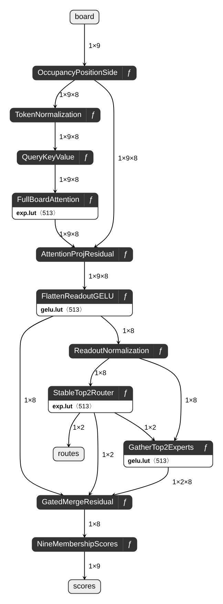

# Exact-integer ONNX inspection graph

[Open/download the ONNX](../inspection/falken9-model-v1.0.0.onnx) · [manifest and all 21 tensor lineages](../inspection/manifest.json) · [runtime proof](../inspection/validation.json) · [zoomable native Netron SVG](../artifacts/inspection/netron/falken9-model-v1.0.0.svg)



This is a **derived inspection graph**, not the 5,195-byte C64 deployment packet. It expresses the accepted packet's integer forward pass using executable, standard ONNX operators; it is **not** a float approximation, policy table, or opaque custom-op sketch. All weights are embedded in the ONNX; **there is no external-data companion**.

The accepted source is `artifacts/flexible-integer/q11-w16-a32-early-interp/model.f9j`, SHA-256 `fe180f8a931f9d92d8aa39da337bc819d0dbe4e6d971edcba00324fbc18a91c1`. The 86,511-byte inspection ONNX has SHA-256 `0e92767ffdae27b9cbd7682583839d4541419fb9bedf47dfaec73a0b00ee5160`.

## Executed and checked

- `onnx.checker.check_model(full_check=True)` passed with ONNX 1.23.2.
- ONNX Runtime 1.31.1, `CPUExecutionProvider`, executed the delivered ONNX over **all 627 canonical nonterminal boards**.
- Against the independent Python arbitrary-integer `scalar_oracle` in `tests/test_canonical_integer_model.py`: **5,643 score values and 1,254 expert-route IDs compared; zero differences**, maximum absolute score error 0.
- Complete optimal membership sets: **zero errors on all 627**. Externally restoring symmetry gives zero set/move errors for 4,520 reachable boards and zero indexed errors across 294,778 legal histories. This is indexing/restoration from board-dependent neural outputs, **not 294,778 ONNX history-wrapper calls**.
- The repository suite passed: **122 tests, 2 skipped, 677 subtests**. The three inspection tests include a regression for signed rounding above the 32-bit accumulator boundary.

These results establish finite-domain parity of ONNX outputs/routes with the independent integer oracle. They do **not** independently execute or certify the assembled 6502 program, arbitrary malformed inputs, physical C64 hardware, or a floating-point training checkpoint.

## Input and output boundary

| Name | Type/shape | Meaning |
|---|---|---|
| `board` | INT64 `[1,9]` | Canonical occupancy: 0 empty, 1 X, 2 O, row-major squares a–i. |
| `scores` | INT64 `[1,9]` | Signed, INT32-domain Q11 membership scores. An empty square with score ≥ 0 belongs to the learned optimal set. |
| `routes` | INT64 `[1,2]` | Selected expert IDs in score-descending order; lower index wins exact router ties. |

The caller must supply a reachable, canonical, nonterminal board. Domain and game-history validation are **preconditions**, not validation logic inside this graph. History parsing, canonical symmetry, inverse move-coordinate symmetry, occupancy masking and final `ebdfhcgia` tie-order choice remain outside ONNX. There is no fallback when the learned set is empty.

## Arithmetic and hierarchy

The top-level graph contains 11 expandable ONNX local functions. These are portable `FunctionProto` bodies, not external/custom runtime kernels. Netron's **ƒ** affordance opens each body; clicking nodes exposes initialized weights, dimensions and tensor values. The small overview intentionally collapses arithmetic detail without removing it from the ONNX.

1. Occupancy + position + parity-side embedding.
2. Exact integer token normalization: rounded mean/variance, epsilon 42, **31 unrolled integer bit tests for exact floor-isqrt**, learned affine and INT32 saturation.
3. Learned Q/K/V projections, with INT64 `Mul` and `ReduceSum` rather than integer `MatMul`.
4. **Full nine-token board attention**, not causal attention. Early-round scaling, accepted interpolated exponential LUT, Q15 normalization with remainder assigned to the first argmax, weighted V.
5. Learned attention projection + token residual.
6. Flatten 72 → 8 readout, bias, interpolated integer GELU.
7. Exact integer readout normalization.
8. Learned four-expert router, stable top-2 mask, softmax of **only selected scores**.
9. **Gather selected expert weights before computing** 8 → 4 → 8 MLPs. All four experts' parameters are present, but only two selected expert vectors execute. Physical expert matrix layout is `[expert,input,output]`, unlike the other linear matrices' `[output,input]` layout.
10. Q15 gated merge + readout residual.
11. Nine signed membership outputs.

Every original tensor is retained by name as an INT64 initializer with its decoded integer codes. Matrix per-output binary exponents are represented by exact integer multiplier/divisor initializer arrays; both accepted 513-entry LUTs are embedded. The manifest includes all **21** original tensors, shapes, packet precision, exponents, code hashes and initializer names, plus SHA-256 for source arithmetic, decoder, independent oracle and exporter files.

Rounding is nearest with halfway cases **away from zero**, implemented with absolute values, positive integer division and an integer comparison-derived sign. A concrete runtime issue was found during TDD: ONNX Runtime 1.31.1 CPU `Sign(INT64)` returned −1 for positive 2,290,000,000 in a minimal executed reproducer. The export avoids `Sign` entirely using `Less`/`Where`; the regression exercises positive/negative large accumulators and halfway cases. No float fallback was needed.

## Reproduce

From the repository root, after the normal development environment is installed:

```sh
.venv/bin/python -m pip install -r requirements-inspection.txt
.venv/bin/python scripts/export_inspection_graph.py
.venv/bin/python -m pytest tests/test_inspection_graph.py -q
.venv/bin/netron inspection/falken9-model-v1.0.0.onnx --host 127.0.0.1 --port 18081
```

The exporter verifies the immutable packet digest, emits a self-contained ONNX, reloads the delivered bytes, executes exhaustive validation, and writes `inspection/validation.json` and `inspection/manifest.json`. The independent scalar oracle is imported from the shipped test suite; this command is intended for the full repository, not an isolated copy of the exporter.

## Rendering provenance

The PNG/SVG above are **actual native Netron 9.3.4 exports of this ONNX**, not a separately drawn workflow. The PNG is 648 × 1750; the SVG's native layout is 324 × 875. The [full interface capture](../artifacts/inspection/netron/netron-interface.png) and [machine-readable provenance](../artifacts/inspection/netron/provenance.json) identify renderer/browser versions, ONNX digest, output hashes and visual checks.

The ONNX was served by a loopback-only Python Netron server. Exports used Netron's own `view.export()` SVG serializer and PNG encoder, with the unmodified export blobs saved to disk. Wait for the **visible, laid-out graph** before exporting: populated DOM text alone can precede layout and produce a blank/incorrectly sized export. Final images were parsed, dimensions checked and visually inspected; the entire chain, routes output, residual branches and untruncated stage labels are present. The expert function was also opened in Netron to confirm its real Gather-before-Mul/ReduceSum body is accessible.
