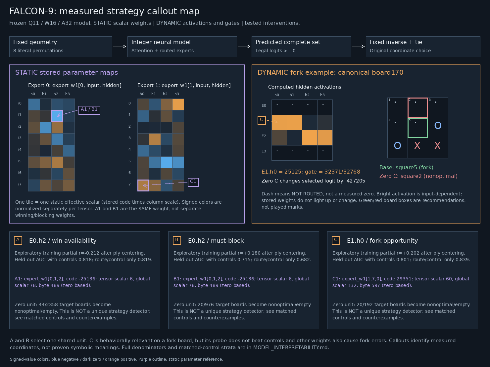
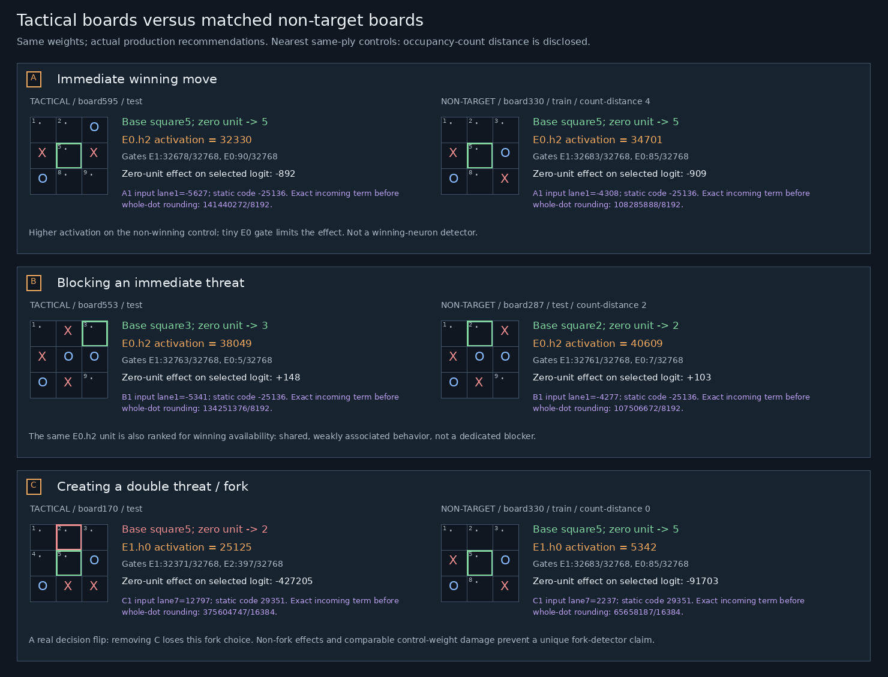
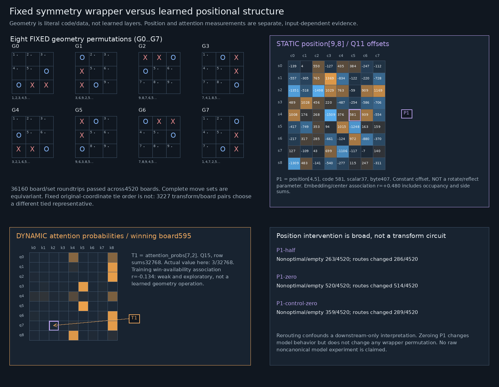

# Frozen-model strategy probing

## What we actually found

A reproducible CPU-only study of the deployed 5,195-byte INTEGER model found
behaviorally relevant components, but **not a clean winning/blocking/fork neuron**.
The strongest finite example is expert **E1 hidden unit h0**: removing its
activation turns one genuine winning fork recommendation into a losing move.
That is a causal effect on this model, not a unique semantic label for the unit.
Other boards and matched-parameter controls supply important counterexamples.

Stored weights are static. What changes with a board is activation, attention,
expert routing/gating and downstream contribution. The figures distinguish these
rather than suggesting that parameter bytes light up or change. No game HUD,
release tensor, model tag or original artwork was changed for this study.



[Zoomable SVG](../assets/interpretability/strategy-circuit-map.svg) ·
[Board comparisons](../assets/interpretability/strategy-board-comparisons.png) ·
[Board-comparison SVG](../assets/interpretability/strategy-board-comparisons.svg) ·
[Symmetry/position map](../assets/interpretability/symmetry-position-map.png) ·
[Symmetry SVG](../assets/interpretability/symmetry-position-map.svg) ·
[Exact map metadata](../assets/interpretability/maps.json)

## Scope, provenance and reproduction

Authoritative results: `artifacts/interpretability/study-002/` (study-001 is the
preserved initial exploration, not the final report). The final run has:

- 4,520 distinct legal nonterminal boards and 627 canonical equivalence classes.
- Before probing, all627 host forwards matched the hash-verified saved baseline:
  **13,167 stage-vector comparisons**, including routes, gates and logits.
  Expert-ID diagnostic banks were compared to the original selected-slot layout.
- Original-coordinate predicted complete sets matched independent offline minimax
  on all4,520 boards. There is no diagnostic/minimax fallback in inference.
- 55 treatment runs, each executing627 exact integer host forwards, then composed
  into4,520 wrappers:34,485 treatment forwards. These are **not55 independent
  discoveries**:50 distinct intervention specifications produce48 distinct logit
  outcomes. A/B select the same unit/parameter, and all selected training-median
  baselines are0, duplicating zero-ablation behavior.
- 3,410 exploratory per-unit associations;480 validation/test probe metric rows.
- All67 files in the frozen005 upload tree plus the original model packet
  remained byte-identical. Private numbered005 artifacts/downloads are checked
  again in the final deployment handoff. Research is separate from that package.

Model SHA-256:
`fe180f8a931f9d92d8aa39da337bc819d0dbe4e6d971edcba00324fbc18a91c1`.
Frozen core SHA-256:
`838aa62a854aa58bd603c7525b52dc67c4c4b01ea0f50f58982475959ec61961`.
The model remains `model-v1.0.0`; the005 UI source is commit
`3849d0721f099c73172c7f8cf131a1e6fb181d18`. Individual analysis-source and original
627 fixture digests are in `study-002/summary.json`. The map metadata binds the
model, study summary and renderer source hashes.

From this checkout, with the pinned original packet and hash-verified cached627
records in `artifacts/runtime/full-forward/q11-w16-e4/`:

```sh
.venv/bin/python -m pip install -r requirements-interpretability.txt
OMP_NUM_THREADS=1 OPENBLAS_NUM_THREADS=1 .venv/bin/python \
  scripts/model_strategy_study.py --output artifacts/interpretability/reproduced
.venv/bin/python scripts/render_strategy_maps.py \
  --study artifacts/interpretability/reproduced --output build/strategy-maps
.venv/bin/python -m pytest tests/test_strategy_diagnostics.py -q
```

The study does not bootstrap missing original packets/checkpoints or silently
replace them with synthetic responses; fixture SHA mismatches fail closed.
Python3.11.16, NumPy2.4.6, PyTorch2.14.0+cu130 and Pillow13.0.0 were used. Despite
the installed wheel's CUDA suffix, all inference tensors are CPU-only and no
CUDA context was initialized. There was no training, GPU job, process termination
or release-weight mutation. A fresh separate run reproduced **all14 study files
and all7 map files byte-for-byte**, including NPZ/PNG/SVG, with one CPU thread;
see `artifacts/interpretability/reproduction.json`.

## Independent labels

Labels are computed from geometry/legal occupancy, not from model activations,
selected experts or predictions. X=1, O=2, empty=0; side to move follows legal ply.
All tensor/expert/unit/square-array indices below are zero-based; displayed
recommendations use human squares1–9 (`123 / 456 / 789`).

- `wins`: legal empty squares completing a line for the side to move.
- `opponent_wins`: empty squares completing the opponent's line in a hypothetical
  opponent placement on the current board. Threat labels need not wait a turn.
- `must_block`: **no own immediate win and exactly one opponent winning square**.
  This identifies an immediate blocking obligation, not a promise that the whole
  position can be saved from a later forced loss. Multiple threats are separate.
- Geometric `forks`: non-winning placements leaving at least two distinct
  immediate winning squares. `has_fork` additionally requires no current own
  immediate win and no current opponent immediate threat, avoiding that priority
  confound. Opponent fork opportunities use the same geometry and priority filter.
- `fork_prevention_squares`: when there are no immediate wins/threats but the
  opponent has fork opportunities, our placement allows no immediate opponent win
  and every opponent reply that does not concede our immediate next-ply win leaves
  fewer than two opponent immediate winning squares. At least one such reply is
  required. This bounded definition includes forcing a blocking reply; it is not
  a claim of complete strategic fork prevention in every future continuation.
- Center ownership/emptiness, own/opponent corner and edge counts, and move count
  are retained as positional labels/controls. Full examples and counterexamples
  are in `canonical-labels.json`, `cases.json` and `counterexamples.json`.

| Label | Canonical positives /627 | Raw-board positives /4520 |
|---|---:|---:|
| Own immediate win |321|2358|
| Opponent immediate win |440|3238|
| Must block |133|976|
| Opponent double threat |138|1008|
| Fork opportunity |26|192|
| Opponent fork opportunity |54|378|
| Bounded fork prevention |53|370|
| Center owned |173|1252|
| Center opponent-owned |190|1385|
| Center empty |264|1883|

## Probes and controls: decodable is not decision-critical

The design separates representation readout from probe capacity with control
labels, motivated by Hewitt and Liang's control-task methodology; this is an
adaptation to legal boards, not a replication of their linguistic experiment.[1]
Behavioral interventions are evaluated separately, in the spirit of component-
level circuit investigations; this study does **not** establish a faithful,
complete or minimal circuit of the kind those investigations evaluate.[2]

Seed1729, stratified by ply:372 canonical training boards,121 validation,134 test.
Every rotated/reflected board inherits its canonical fold; probe fitting uses
only the627 unique representatives, so symmetry duplicates cannot leak between
splits. This is **probe-held-out**, NOT model-held-out generalization: the deployed
model was already fitted/audited on this finite domain. It cannot establish
novel-game or out-of-distribution understanding.

Fixed L2 least-squares linear readouts use strength10, training-only standardizing
and a fixed0.5 threshold. No hyperparameter/threshold search uses the test set.
Controls include ply one-hot, own/opponent corner/edge counts and center ownership;
side/legal-player correlations are determined by ply. Additional baselines are
raw occupancy one-hot and actual per-expert gates/routing. Shuffled labels are
permuted **within ply**, intentionally preserving ply predictability; shuffled
AUC therefore need not be0.5. The center-label probes are partly tautological
because center ownership is a control; their perfect result is a sanity check,
not evidence of a learned center circuit.

Test support is75 own-win positives,20 must-block positives and only6 fork
positives out of134. The following is a bounded excerpt; `probes.csv` reports all
families/labels/splits, prevalence, confusion counts, majority accuracy, precision,
recall, F1, balanced accuracy and AUROC. Family rows include occupancy/ply controls.

| Task | Readout features | AUROC | Balanced accuracy | F1 | Within-ply shuffled AUROC |
|---|---|---:|---:|---:|---:|
| Own win | controls |0.811|0.716|0.740|0.655|
| Own win | readout GELU |0.812|0.743|0.752|0.657|
| Own win | route/gate |0.841|0.750|0.761|0.663|
| Own win | expert hidden |0.811|0.726|0.741|0.647|
| Must block | controls |0.680|0.607|0.345|0.584|
| Must block | readout GELU |0.768|0.599|0.323|0.542|
| Must block | route/gate |0.736|0.607|0.345|0.542|
| Must block | expert hidden |0.757|0.607|0.345|0.531|
| Fork | controls |0.849|0.500|0.000|0.683|
| Fork | readout GELU |0.818|0.500|0.000|0.755|
| Fork | route/gate |0.760|0.500|0.000|0.801|
| Fork | expert hidden |0.760|0.500|0.000|0.829|

The fork threshold readouts predict no positives, and expert-hidden shuffled AUC
exceeds the actual AUC. With six test positives this is a strong warning against
announcing a fork detector, not proof that fork information is absent.

Per-unit ranks center activations and labels **within training ply**, then compute
correlation; inactive expert units are excluded from these ranks rather than
mistaken for measured zeros. Occupancy counts are not fully regressed out of
these exploratory ranks. Probe/control and intervention matching address some,
not all, of that confounding. There are3,410 exploratory ranks with **no
multiplicity-corrected discovery or significance claim**. Rankings are selected
on training data; the full family grid and unfavorable controls are retained.

### Router enrichment is not an expert's job description

Unadjusted training enrichment on only15 canonical fork-positive boards:
E1 is routed on11/15 (73.3%) versus41.5% of357 fork-negative boards; E2 is also
routed on11/15 versus55.7%. Mean gate fractions are0.275 versus0.120 for E1,
and0.552 versus0.340 for E2. Ply/occupancy and canonical structure may explain
part of this. E0 is actually less often routed on own-win-positive training
boards (44.8% versus53.9%). `experts.csv` retains denominators and mean gates for
all four experts, both label values and every task; no expert is named a
winning, blocking or fork specialist.

## Stable callout legend

| Callout | Exact object | What is supported |
|---|---|---|
| A | E0.h2 activation, after expert GELU | Weak negative own-win training association; same unit as B |
| B | E0.h2 activation | Weak positive must-block association, not a dedicated blocker |
| C | E1.h0 activation | A tested fork-board decision flip, with non-fork effects and poor specificity |
| A1/B1 | `expert_w1[0,1,2]`, tensor scalar6, global scalar78, packet bytes489–490; code-25136, scale2^-13 | Static incoming scalar to the shared A/B unit; A1 and B1 are identical |
| C1 | `expert_w1[1,7,0]`, tensor scalar60, global scalar132, bytes597–598; code29351, scale2^-14 | Static incoming scalar to C; a matched-magnitude control is at[1,4,0] |
| P1 | `position[4,5]`, tensor/global scalar37, bytes407–408; Q11 code581 | Constant center-position offset, not a geometry transform |
| T1 | `attention_probs[7,2]` | Dynamic Q15 attention edge, weak exploratory win association |
| G0..G7 | Eight wrapper permutations | Fixed geometry, never learned weights |

Global scalar numbering follows the serialized tensor order, excluding header,
geometry bytes, descriptors/scales and lookup tables. Byte offsets are zero-based
in the original F9J2 packet; tests read the actual signed16 scalar at each offset.
The figures use per-tensor effective-value normalization for static color maps,
not cross-tensor magnitude comparison. Blue is negative, orange positive, dark
zero. A dash in a dynamic expert row means **not routed**, not an observed zero.

A/B's ply-centered correlations are-0.212/+0.186; C's is+0.202. Their single-unit
readouts **with controls** have test AUROC0.818/0.715/0.801, while route/control-only
readouts give0.819/0.682/0.839. Thus A and C add no demonstrated improvement over
those controls. Conditional on the expert actually being routed, C has only4
positive test examples among53 and still has zero threshold recall. Do not read
one attractive illustration as a validated standalone detector.

## Actual board comparisons



Each tactical board is selected among actual model recommendations that really
win/block/fork; it is not merely a board with that label. Illustrative controls
have the same ply and routed expert, then nearest occupancy-count controls;
L1 count distances are **A4, B2, C0** (not exact matching for A/B). The whole-domain
causal comparisons below instead use exact matching strata and disclose coverage.
Training/validation/test status is printed on each illustration.

- **A, board595:** `..O / X.X / O..`, X recommends square5, an immediate win.
  E0.h2=32,330 but gate E0 is only90/32,768. On non-winning board330 the same
  unit is **higher**,34,701, with gate85/32,768. Zeroing changes the selected
  logit by-892/-909 and does not change either move. Bright activation alone
  neither diagnoses winning nor measures its influence after gating.
- **B, board553:** `.X. / XOO / OX.`, X recommends square3, blocking O's
  displayed3/5/7 diagonal (zero-based indices2,4,6). E0.h2=38,049; on non-target board287 it is40,609.
  E0 gates are5/32,768 and7/32,768. Zero-unit effects on the selected logits are
  +148/+103; both recommendations stay optimal. A and B are the same component.
- **C, board170:** `... / ..O / OXX`, X recommends square5, creating two
  immediate threats. E1.h0=25,125; E1 gate32,371/32,768. Zeroing C changes the
  selected logit by-427,205 and changes square5 to square2. Independent offline
  minimax gives these continuations values **+1 and-1** respectively: a forcing
  win becomes a forcing loss under best subsequent play. No actual game outcome
  was substituted for this offline evaluation. On count-matched non-target
  board330, C=5,342 and zeroing shifts the selected logit by-91,703, but square5
  remains optimal. That is a concrete causal contrast, not proof of a fork neuron.

The map metadata contains actual normalized input lanes, preactivations, gates
and exact static-code × input numerators/denominators. An incoming term is shown
**before whole-dot rounding**; it is not an independently rounded additive logit
contribution. The displayed selected-logit change is an actual zero-unit
intervention effect through downstream integer computation.

## Causal interventions and counterexamples

Copies only: all8 readout-GELU units, all8 norm2 units,16 routed expert-hidden
units individually, each of4 expert outputs, selected half-dose and training-
median replacements, one bounded pair, individual stored-parameter zero/half
changes and same-row/scale near-magnitude parameter controls. P1 has its own
same-position near-magnitude control. No combinatorial search or retraining.
Integer ties-away-from-zero rounding, lookup interpolation, clamping, stable
routing/gates and complete-set/original-coordinate tie behavior are unchanged.
All55 runs observed zero saturation events. Zeroing expert hidden/output occurs
**after routing**, so those experiments cannot test router necessity; upstream
readout/norm/position interventions can reroute and are reported separately.

A failure means selected move is outside the independent optimal set, or the
learned set is empty (no fallback). It is not an observed complete-game loss.
`set_errors` separately counts wrong complete sets even when the selected move
remains optimal. `move_changes` includes changes between equally optimal moves.
Signed margin is min(required optimal logits, negated nonoptimal legal logits),
relative to classification boundary0, in raw logit units—not probabilities.

Exact matching strata: ply, own/opponent corner counts and center ownership.
Within each stratum, non-target error rates are weighted to the target stratum
counts. **Both matched target and control rates use the same covered strata**;
coverage is shown, rather than comparing all targets with a smaller control pool.
These are exhaustive finite-domain descriptive rates, not independent samples
or population-generalization confidence claims.

| Intervention / task | Failures on all4520 | Target failures | Matched target / non-target failure rate | Target coverage |
|---|---:|---:|---:|---:|
| E0.h2 zero / own win |72/4520|44/2358|2.36% /0.64%|1866/2358|
| E0.h2 zero / block |72/4520|20/976|0.88% /2.26%|908/976|
| E1.h0 zero / fork |66/4520|20/192|10.87% /5.78%|184/192|
| E1.h0 half / fork |32/4520|16/192|8.70% /0.93%|184/192|
| A1 zero / own win |44/4520|20/2358|1.07% /1.93%|1866/2358|
| C1 zero / fork |80/4520|20/192|10.87% /2.67%|184/192|
| C1 matched control zero / fork |44/4520|24/192|13.04% /1.80%|184/192|

There is dose-sensitive fork relevance for E1.h0, but the matched scalar control
causes **more** fork failures than C1 itself. A1 is not win-selective under the
matched comparison. B's unit is not block-selective. These are explicit negative
results against assigning unique symbolic meanings to the highlighted weights.
Counterexamples for every damaging treatment are retained in `counterexamples.json`.

Whole-expert output ablations cause497/198/869/498 failures out of4520 for
E0/E1/E2/E3. Those broad effects are not evidence of strategy-specific experts.
For example, readout unit0 zero changes routes on1407/4520 boards and norm2
unit0 zero changes routes on1346/4520. The bounded A/C pair zero causes146/4520
failures, with no route change. There is interacting/distributed influence, but
this finite study has **not identified a complete distributed circuit** either.

## Symmetry: fixed code, not learned transformation weights



`src/app/wrapper.asm:10` evaluates8 literal geometry permutations, keeps the
lexicographically smallest board and retains the first transform on ties.
`wrapper.asm:76` inverse-gathers the **complete nonnegative-logit set**, masks
occupied cells and only then applies original-coordinate tie order `ebdfhcgia`.
The tensor packet also serializes81 fixed wrapper bytes (72 permutation entries
plus9 tie entries); those bytes are not learned parameters.

All36,160 board/transform move-set and board-inverse roundtrips pass. Yet3,227
board/transform pairs have a different deterministic chosen-move representative
than rotating the original choice: fixed original-coordinate tie order is not
geometrically equivariant. A center-X board, for example, recommends square3;
rotating that recommendation may give square9 while the unchanged board still
recommends square3. This is compatible with exact equivariance of the complete
optimal set. None of these operations is implemented by a learned rotate layer.

There is canonical positional structure inside the learned model: combined
center embedding lane5 has ply-centered own-center correlation+0.480. But the
embedding sums occupancy, position and side, so that correlation does not mean
constant P1 detects center ownership. Zeroing just `position[4,5]` causes520/4520
failures and514/4520 route changes; half-dose gives263 failures/286 route changes;
a same-position control causes359 failures/289 route changes. These are broad
upstream effects, not proof of a transform circuit. T1 attention edge[7,2] has
weak negative win association r=-0.134; on winning board595 it is3/32,768.
No raw noncanonical NN or off-distribution transformation experiment is claimed.

## Supported versus speculative

Supported: exact static scalar addresses, actual input-dependent activations and
gates, the C-board win-to-loss recommendation flip under a copy ablation,
whole-domain dose/control effects, shared rather than uniquely strategy-specific
components, and fixed external symmetry operations with complete-set roundtrips.

Not supported: a named winning neuron, dedicated blocker/fork expert, unique
fork weight, learned rotate/reflect/inverse layer, human-like understanding,
probe generalization beyond the model's fitted finite domain, or a faithful/
complete/minimal strategy circuit. Small positive-class counts, one split/seed,
observational confounds, ablation-induced distribution shift, redundant pathways,
rerouting and exploratory multiplicity remain limitations. More targeted
activation patching/mediation or stronger class-balanced probes could be future
experiments; they were not silently included or claimed here.

The005 upload package, numbered downloads and original model remain frozen.
Public publishing still requires user testing and explicit authorization.

## Sources

[1] https://aclanthology.org/D19-1275 — Designing and Interpreting Probes with Control Tasks
[2] https://arxiv.org/abs/2211.00593 — Interpretability in the Wild: a Circuit for Indirect Object Identification
