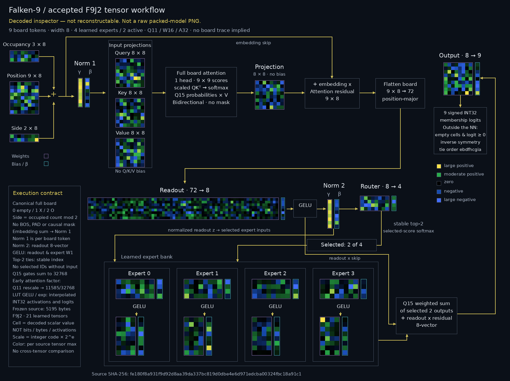

# Accepted F9J2 tensor workflow



[Zoomable SVG](../assets/model-v1.0.0-tensor-workflow.svg) ·
[Structural metadata](../assets/model-v1.0.0-tensor-workflow.json)

**Decoded inspector — not reconstructable. Not a raw packed-model PNG.**
This is derived documentation, not a runnable model, a teacher FP32 checkpoint,
an activation trace, or physical-hardware evidence. Runtime tables and coordinate
wrapper bytes have provenance digests but are not drawn as learned tensors.

## Frozen source and decoding

- Artifact: `artifacts/flexible-integer/q11-w16-a32-early-interp/model.f9j`
- Magic `F9J2`; **5195 bytes**
- SHA-256: `fe180f8a931f9d92d8aa39da337bc819d0dbe4e6d971edcba00324fbc18a91c1`
- E4/K2, width 8, expert hidden width 4; Q11/W16/A32; signed INT32 output.

The generator decodes the accepted packet descriptors and INT16 payload with
Python `struct`, without loading training weights or re-quantizing. It refuses
any other source digest and rechecks the source after rendering. Semantics were
checked against `canonical_integer.py`, `integer_model.py`,
`canonical_integer_export.py`, `integer_export.py`, and `flexible_model.py` in
`falken9/`. No model, runtime, training, or frozen game data was changed.

Every cell represents **one scalar parameter** decoded exactly as
`integer_code × 2^e`, not a bit, byte, packed code, activation, or board state.
JSON preserves original codes, binary exponents, decoded values, physical
indexes, source shapes, per-cell geometry, descriptor/payload offsets and
SHA-256 digests, and image hashes for all 21 tensors.

## Colors and orientation

Colors normalize by **maximum absolute decoded value of each complete source
tensor**, not globally. All four expert slices share their parent tensor's scale;
color intensity is **not comparable across tensors**. Signed piecewise-linear
stops: large negative/bright blue, negative/blue, zero/black, moderate
positive/green, large positive/yellow. Purple borders identify weights (including
LayerNorm γ); cyan borders identify biases (including β).

Ordinary linear weights display `[output,input]`. Physical expert weights store
`[expert,input,output]`; their slices are **transposed** to `[output,input]` for
display. Each bias column aligns vertically with its weight's output rows.
Norm γ and β also align per feature lane. Expert boxes derive their width and
height from the measured W1/b1 and W2/b2 extents, with a clear GELU/arrow gutter.

## Faithful execution flow

1. History-to-board construction and canonical symmetry selection happen before
   the NN. Its input is nine occupancy tokens (0 empty, 1 X, 2 O); side is occupied
   count modulo 2. There are no BOS/PAD tokens or history padding.
2. Occupancy + absolute position + side embeddings **add** to 9×8. The first
   LayerNorm acts per token; its learned γ and β are shown.
3. Bias-free Q/K/V projections feed one-head **full bidirectional board
   attention**, no causal mask: scaled QKᵀ, Q15 softmax, weighted V. Early integer
   arithmetic uses rounded Q11 rescale then 11585/32768; interpolated exp/GELU
   lookup tables remain the runtime contract, not replacement float inference.
4. Bias-free projection + the original embedding residual yields 9×8.
   Position-major flatten gives 72; learned 72→8 readout + bias and GELU gives `x`.
5. Norm 2 gives `z`. Learned 8→4 router + bias chooses stable top-2 (lower expert
   index wins ties); **selected-score Q15 softmax** gives the two gates.
   “Selected: 2 of 4” declares policy, never specific IDs for an unspecified board.
6. Each selected expert consumes `z`: W1 8→4 + bias, GELU, W2 4→8 + bias. All four
   learned banks are drawn; runtime evaluates only two. Gate-weighted outputs
   merge and add the **pre-Norm-2 readout `x`**, not `z`.
7. Output 8→9 + bias gives nine signed INT32 membership logits. Empty-cell
   filtering at logit ≥ 0, inverse symmetry, and original-coordinate tie order
   `ebdfhcgia` belong to the **outside-NN wrapper**.

Attention scores, probabilities, and gates are computation labels, not invented
heatmaps. Only learned parameter tensors get cell grids.

## Source inventory

Physical source shapes below are unchanged by expert display transposition.
All parameter codes are INT16; embeddings and affine vectors use exponent −11.

| Tensor | Physical shape | Scalars | Binary exponent axis |
|---|---:|---:|---|
| `position` | 9 × 8 | 72 | tensor |
| `expert_w1` | 4 × 8 × 4 | 128 | expert/output |
| `expert_b1` | 4 × 4 | 16 | tensor |
| `expert_w2` | 4 × 4 × 8 | 128 | expert/output |
| `expert_b2` | 4 × 8 | 32 | tensor |
| `occupancy.weight` | 3 × 8 | 24 | tensor |
| `side.weight` | 2 × 8 | 16 | tensor |
| `norm1.weight` | 8 | 8 | tensor |
| `norm1.bias` | 8 | 8 | tensor |
| `query.weight` | 8 × 8 | 64 | output-row |
| `key.weight` | 8 × 8 | 64 | output-row |
| `value.weight` | 8 × 8 | 64 | output-row |
| `projection.weight` | 8 × 8 | 64 | output-row |
| `readout.weight` | 8 × 72 | 576 | output-row |
| `readout.bias` | 8 | 8 | tensor |
| `norm2.weight` | 8 | 8 | tensor |
| `norm2.bias` | 8 | 8 | tensor |
| `router.weight` | 4 × 8 | 32 | output-row |
| `router.bias` | 4 | 4 | tensor |
| `output.weight` | 9 × 8 | 72 | output-row |
| `output.bias` | 9 | 9 | tensor |

**1405 scalars**, displayed exactly once across **33 panels**.

## Reproduce and verify

```sh
.venv/bin/python scripts/render_tensor_workflow.py
.venv/bin/python -m pytest tests/test_tensor_workflow.py -q
```

Requires Pillow and DejaVu Sans at the font path recorded in JSON. No dependency
upgrades are performed. The 1740×1300 PNG and vector SVG use the same geometry
stream; SVG scalar-index attributes support inspection. Fonts are 15–26 px.

Focused tests independently traverse packet descriptors/payloads and check every
scalar, expert transpose, cell coverage, PNG pixel colors, SVG scalar colors,
inventory, architecture, safe connector lanes, labels versus grids, measured
expert containment, changed-source rejection, versioned filenames, and
byte-identical regeneration. Native-size visual review covered the reference
and rendered workflow, Q/K/V bounds, both normalizations, and all four expert
panels. Subsequent small label/border corrections are covered by measured-bound
tests; the release integrator should inspect the final complete image before
tagging. Audit results live in `artifacts/inspection/tensor-workflow/`.
