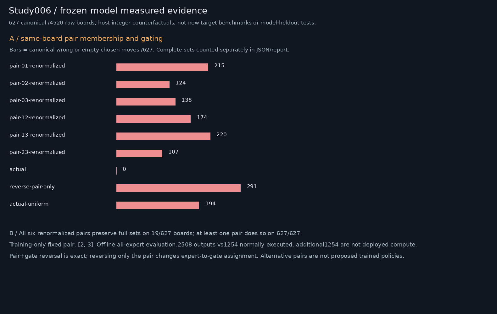
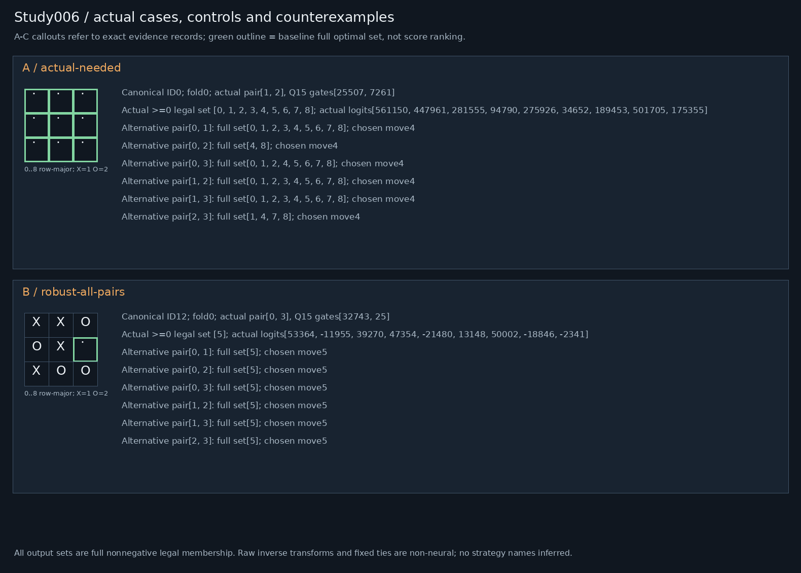

# Study006 — Router usefulness: membership, order and gates

Frozen5195-byte packet SHA-256 `fe180f8a931f9d92d8aa39da337bc819d0dbe4e6d971edcba00324fbc18a91c1`. Host-only analysis. No deployed model/game changes.

## Gates and interpretation
Exact replay:627 actual-target fixtures,13167 complete stage vectors,5643 logit scalars. Composed complete-set/legal/tie outcomes exact on4520 raw boards. This reuses saved target evidence, not new target execution/performance. Additional unselected experts evaluated offline only; baseline observation placeholders are not measured zero activity. Selected zero gate remains a real executed expert.

Scores encode >=0 optimal-set membership, not categorical preferences or probabilities. Wrapper canonicalization, legal masking, full-set inverse and raw tie order are fixed non-neural. All finite boards were previously trained/audited;372/121/134 folds are probe/selection confirmation, not novel-domain generalization. Interventions are OOD and preserve native integer rounding, clamps and accumulation. No strategy labels inferred from damage.

## Pair controls and findings
Same-board expert outputs remain fixed for all six declared pair memberships. Each pair is ordered by receiver router score (low-ID ties), then receives native selected-score renormalization, receiver actual slot gates or uniform gates. Reversing pair and gates jointly is a pure-order control; reversing only pair is a gate-assignment intervention. Natural donors match fold, ply/side and own/opponent corner-edge-center counts; unmatched receivers remain no-op and coverage is separately reported in donors.json. Gate donors with same ordered route separate gating from pair choice.

Actual gates:0/627 errors. Uniform actual pair:194/627; pair-only reversal:291/627. All six renormalized pairs exactly preserve full sets on19/627 boards; at least one pair on627/627. Best/worst are hindsight outcome bounds, not alternative trained policy choices. Training-selected fixed pair[2, 3], confirmation metrics below.

| Intervention | Empty | Nonoptimal nonempty | Full-set changes | Optimal tie changes | Raw chosen errors /4520 |
|---|---:|---:|---:|---:|---:|
|actual|0|0|0|0|0|
|reverse-pair-and-gates|0|0|0|0|0|
|reverse-pair-only|147|144|467|58|2154|
|actual-uniform|86|108|359|48|1420|
|pair-01-renormalized|89|126|352|36|1615|
|pair-01-actual-slot|113|126|370|31|1779|
|pair-01-uniform|54|180|499|57|1729|
|pair-02-renormalized|69|55|245|35|934|
|pair-02-actual-slot|65|65|265|35|984|
|pair-02-uniform|61|158|459|73|1616|
|pair-03-renormalized|48|90|253|30|1043|
|pair-03-actual-slot|47|95|270|35|1076|
|pair-03-uniform|65|156|414|51|1665|
|pair-12-renormalized|104|70|314|70|1262|
|pair-12-actual-slot|111|71|325|66|1335|
|pair-12-uniform|130|147|483|50|2035|
|pair-13-renormalized|90|130|321|22|1623|
|pair-13-actual-slot|80|134|322|32|1602|
|pair-13-uniform|119|166|486|57|2102|
|pair-23-renormalized|22|85|192|7|737|
|pair-23-actual-slot|20|91|195|10|760|
|pair-23-uniform|90|135|401|73|1563|
|natural-alternative-pair-donor|61|98|273|37|1223|
|natural-alternative-pair-renormalized|47|72|214|28|967|
|natural-alternative-pair-actual-slot|63|104|278|37|1289|
|natural-same-pair-gate-donor|3|13|38|6|127|
|natural-same-pair-gate-renormalized|0|0|0|0|0|
|natural-same-pair-gate-actual-slot|0|0|0|0|0|

### Matched tactical versus neutral confirmation (training-selected fixed pair)
Repeated donors/neutral boards are not independent. Zero matched support remains unavailable; matching is not relaxed.

|Task|Fold|Positive candidates|Matched pairs|Unique neutral|Positive errors|Neutral errors|
|---|---:|---:|---:|---:|---:|---:|
|has_win|0|181|98|30|21|9|
|has_win|1|65|13|9|1|0|
|has_win|2|75|23|12|2|3|
|must_block|0|91|52|32|12|10|
|must_block|1|22|6|6|1|1|
|must_block|2|20|2|2|0|0|
|has_fork|0|15|4|2|1|0|
|has_fork|1|5|1|1|0|0|
|has_fork|2|6|4|3|0|0|

The matched contrasts quantify selective task effects relative to broad damage, but do not establish a named detector or causal strategy circuit. Offline all-expert computation2508 vs1254 normal outputs is additional work.

## Reproduction and evidence
Run `OMP_NUM_THREADS=1 OPENBLAS_NUM_THREADS=1 PYTHONDONTWRITEBYTECODE=1 PYTHONPATH=/home/ai/falken9-strategy-study-003 /home/ai/falken-9/.venv/bin/python research678_run.py 006 --out <fresh-directory>`. This historical interpreter path supplies dependencies only. Local falken9/scripts imports must resolve inside the isolated snapshot. verification-study006.json records fresh-directory byte equality and preservation. Bundles exclude model binaries, ROMs, secrets, environments and caches; a hash-matching original packet and target fixtures are prerequisites. No external writes or notifications.
