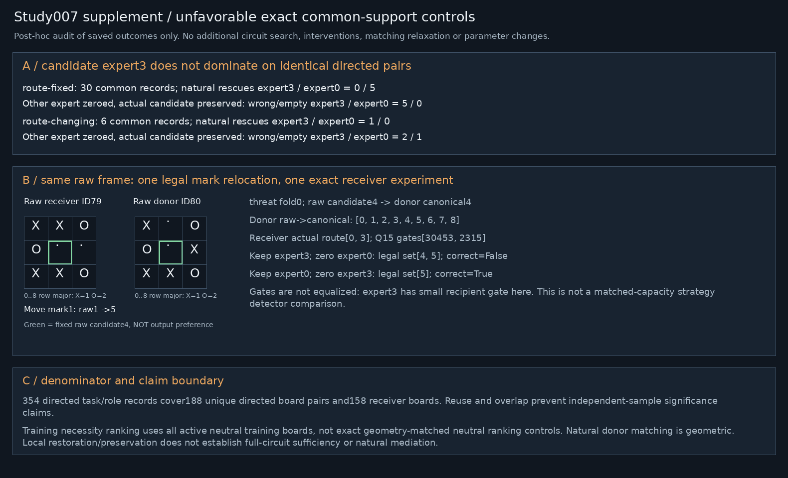

# Study007 common-support clarification

This is a descriptive post-hoc audit of saved outcomes, with no new experiments or expanded candidate search.

[
  {
    "contract": "route-fixed",
    "common_directed_records": 30,
    "candidate": {
      "natural_rescues": 0,
      "natural_new_damage": 0,
      "preservation_failures": 5
    },
    "control": {
      "natural_rescues": 5,
      "natural_new_damage": 0,
      "preservation_failures": 0
    }
  },
  {
    "contract": "route-changing",
    "common_directed_records": 6,
    "candidate": {
      "natural_rescues": 1,
      "natural_new_damage": 0,
      "preservation_failures": 2
    },
    "control": {
      "natural_rescues": 0,
      "natural_new_damage": 0,
      "preservation_failures": 1
    }
  }
]

The candidate expert3 does not consistently outperform the cyclic control expert0 when compared on identical directed board-pair/task/fold records. Route-fixed:30 common records, candidate/control preservation failures5/0; natural rescues0/5. Route-changing:6 common records, preservation failures2/1, natural rescues1/0. Different original population counts must not be read as a candidate/control efficacy comparison. Gates remain recipient actual gates and differ greatly across expert IDs; this is not matched-capacity isolation.

354 outcome records cover188 unique directed board pairs and158 unique receiver boards; tasks/roles/reused pairs are not independent. REPORT007's selection sentence uses “matched-neutral” imprecisely: training necessity ranking actually uses the active neutral training pool, not exact geometry matching. Exact geometry matching applies to the natural relocation donor contrasts. Use this explicit correction when integrating. The original per-stage files/ZIP remain unchanged and verifiable.

The two boards in original cases007 are each in their own canonical frame; this supplementary B panel instead displays the actual narrow contrast in one common raw frame. Green in supplementary B means the fixed raw candidate, not predicted choice. Latent expert output vectors have no square axis to remap. No named strategy circuit or natural mediation established.
