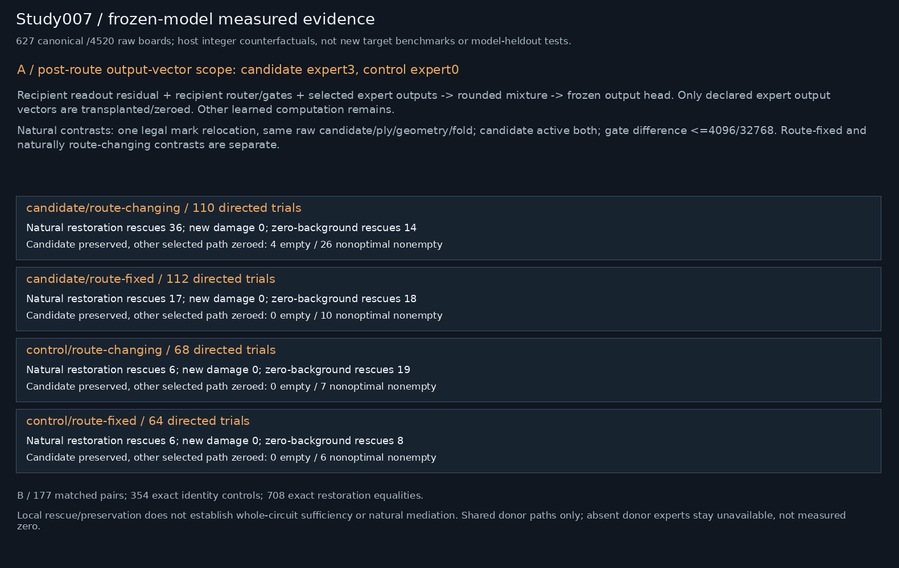
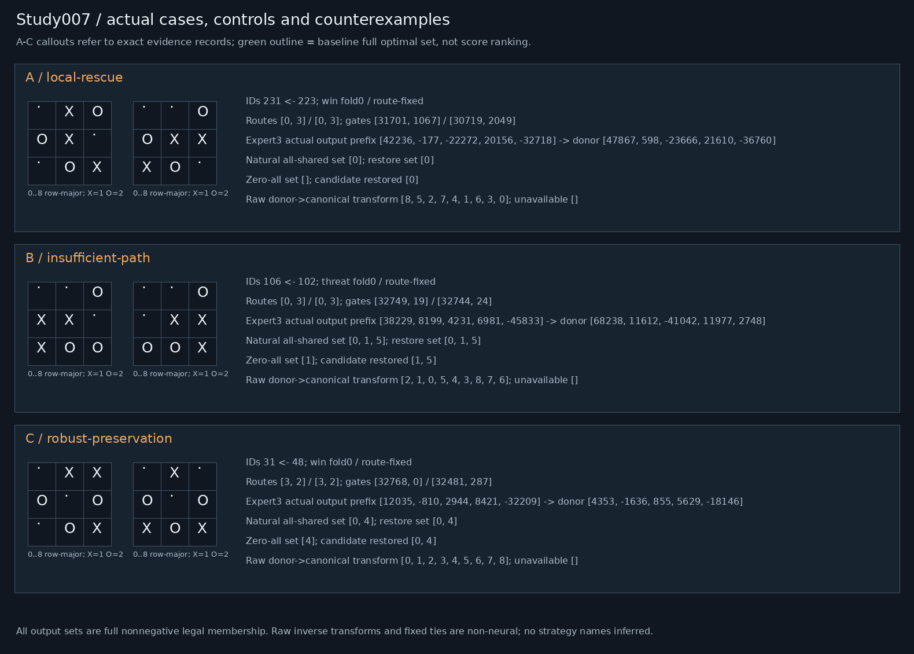

# Study007 — Bounded pathway preservation and local rescue

Frozen5195-byte packet SHA-256 `fe180f8a931f9d92d8aa39da337bc819d0dbe4e6d971edcba00324fbc18a91c1`. Host-only analysis. No deployed model/game changes.

## Gates and interpretation
Exact replay:627 actual-target fixtures,13167 complete stage vectors,5643 logit scalars. Composed complete-set/legal/tie outcomes exact on4520 raw boards. This reuses saved target evidence, not new target execution/performance. Additional unselected experts evaluated offline only; baseline observation placeholders are not measured zero activity. Selected zero gate remains a real executed expert.

Scores encode >=0 optimal-set membership, not categorical preferences or probabilities. Wrapper canonicalization, legal masking, full-set inverse and raw tie order are fixed non-neural. All finite boards were previously trained/audited;372/121/134 folds are probe/selection confirmation, not novel-domain generalization. Interventions are OOD and preserve native integer rounding, clamps and accumulation. No strategy labels inferred from damage.

## Declared circuit boundary
Candidate expert3 selected on training-only necessity contrast (must-block minus matched-neutral active error rates); control expert0 is the predeclared next cyclic ID, not post-hoc best control. Scope is a whole expert output vector after routing, with receiver residual/gates/head retained. It is NOT a full network circuit. Natural matches reuse study005's frozen legal one-mark relocations; preserve raw candidate identity/ply/side/geometry/fold, candidate active in both; gate Linf<=4096/32768. Route-fixed and naturally route-changing contrasts are reported separately. Both patch directions executed. Donor latent vectors are computed in their own canonical frames; no square-axis latent alignment is invented. Raw orbit outcomes use exact declared transforms. Unavailable donor experts are never substituted as observed zeros.

Candidate-only patch, shared-noncandidate natural corruption, all-shared patch and candidate restoration are compared with zero-noncandidate/zero-all/restoration controls. Identity and restoration algebra are exact. Rescue reports newly introduced failures too. Natural pathway transplantation is off-distribution; retaining one output path while zeroing another is a local preservation test only, not natural mediation or full-circuit sufficiency.

|Role/contract|Directed trials|Natural rescues|New damage|Zero rescues|Candidate preserved: empty|Candidate preserved: nonoptimal nonempty|
|---|---:|---:|---:|---:|---:|---:|
|candidate/route-changing|110|36|0|14|4|26|
|candidate/route-fixed|112|17|0|18|0|10|
|control/route-changing|68|6|0|19|0|7|
|control/route-fixed|64|6|0|8|0|6|

### Matching coverage (no post-hoc relaxation; cap24/stratum)
|Role|Contract|Task|Fold|Prior eligible relocation inventory|Accepted pairs|
|---|---|---|---:|---:|---:|
|candidate|route-fixed|win|0|90|5|
|candidate|route-fixed|win|1|18|3|
|candidate|route-fixed|win|2|15|1|
|candidate|route-fixed|threat|0|145|14|
|candidate|route-fixed|threat|1|17|3|
|candidate|route-fixed|threat|2|28|1|
|candidate|route-fixed|fork|0|167|22|
|candidate|route-fixed|fork|1|28|4|
|candidate|route-fixed|fork|2|36|3|
|candidate|route-changing|win|0|90|7|
|candidate|route-changing|win|1|18|2|
|candidate|route-changing|win|2|15|1|
|candidate|route-changing|threat|0|145|17|
|candidate|route-changing|threat|1|17|4|
|candidate|route-changing|threat|2|28|4|
|candidate|route-changing|fork|0|167|15|
|candidate|route-changing|fork|1|28|5|
|candidate|route-changing|fork|2|36|0|
|control|route-fixed|win|0|90|3|
|control|route-fixed|win|1|18|0|
|control|route-fixed|win|2|15|1|
|control|route-fixed|threat|0|145|8|
|control|route-fixed|threat|1|17|2|
|control|route-fixed|threat|2|28|2|
|control|route-fixed|fork|0|167|11|
|control|route-fixed|fork|1|28|3|
|control|route-fixed|fork|2|36|2|
|control|route-changing|win|0|90|4|
|control|route-changing|win|1|18|2|
|control|route-changing|win|2|15|0|
|control|route-changing|threat|0|145|15|
|control|route-changing|threat|1|17|0|
|control|route-changing|threat|2|28|3|
|control|route-changing|fork|0|167|6|
|control|route-changing|fork|1|28|2|
|control|route-changing|fork|2|36|2|

Full per-direction empty/nonoptimal/tie/full-set and raw-orbit outcomes, exact expert output vectors and restoration records are in outcomes.json. Counterexamples are retained in figure cases007 A-C; lack of support is unavailable evidence, not a null circuit effect.

## Reproduction and evidence
Run `OMP_NUM_THREADS=1 OPENBLAS_NUM_THREADS=1 PYTHONDONTWRITEBYTECODE=1 PYTHONPATH=/home/ai/falken9-strategy-study-003 /home/ai/falken-9/.venv/bin/python research678_run.py 007 --out <fresh-directory>`. This historical interpreter path supplies dependencies only. Local falken9/scripts imports must resolve inside the isolated snapshot. verification-study007.json records fresh-directory byte equality and preservation. Bundles exclude model binaries, ROMs, secrets, environments and caches; a hash-matching original packet and target fixtures are prerequisites. No external writes or notifications.
