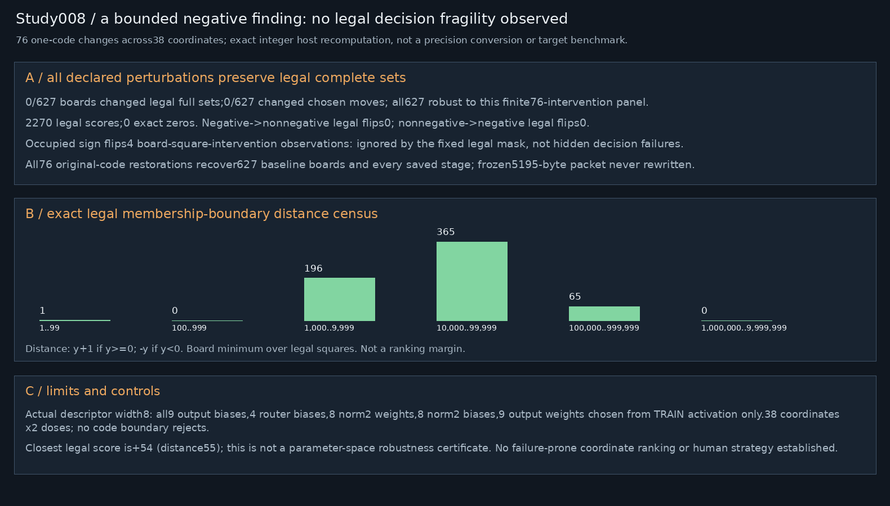
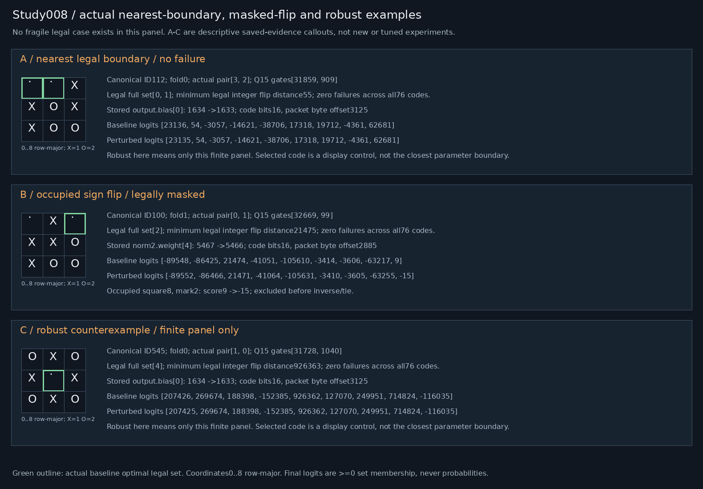

# Study008 — Exact integer decision-fragility

Frozen5195-byte packet SHA-256 `fe180f8a931f9d92d8aa39da337bc819d0dbe4e6d971edcba00324fbc18a91c1`. Host-only analysis. No deployed model/game changes.

## Gates and interpretation
Exact replay:627 actual-target fixtures,13167 complete stage vectors,5643 logit scalars. Composed complete-set/legal/tie outcomes exact on4520 raw boards. This reuses saved target evidence, not new target execution/performance. Additional unselected experts evaluated offline only; baseline observation placeholders are not measured zero activity. Selected zero gate remains a real executed expert.

Scores encode >=0 optimal-set membership, not categorical preferences or probabilities. Wrapper canonicalization, legal masking, full-set inverse and raw tie order are fixed non-neural. All finite boards were previously trained/audited;372/121/134 folds are probe/selection confirmation, not novel-domain generalization. Interventions are OOD and preserve native integer rounding, clamps and accumulation. No strategy labels inferred from damage.

## Exact sign fragility
2270 legal scores, 0 exact zeros. Membership-flip distance is y+1 for y>=0 and -y for y<0; this is not a ranking margin. Negative-to-nonnegative legal flips:0; nonnegative-to-negative legal flips:0; occupied flips ignored by legal mask:4. Counts sum board-square-intervention observations, not unique boards.

Predeclared all9 output biases, all4 router biases, all8 norm2 weights plus all8 norm2 biases; plus one output weight per row at the merged unit with maximal mean absolute TRAINING activation.38 coordinates,76 +/-1-code attempts;76 executed,0 boundary rejects. Each copy differs in exactly one stored code; all descriptors/exponents unchanged; original packet never rewritten. Full network recomputed and each original code restored with all-stage parity:76.

Any full-set change:0/627; any chosen-move failure:0/627; robust to ALL tested interventions:627/627. Raw-coordinate complete-set/tie outcomes evaluated separately, not canonical errors multiplied by8. Fragility is local to this finite panel; no implication of universal robustness, optimal bit width, or actual reduced-precision conversion.

|Coordinate/delta|Old -> new|Empty|Nonoptimal nonempty|Set changes|Optimal tie changes|Raw errors /4520|
|---|---|---:|---:|---:|---:|---:|
|output.bias:0:-1|1634 -> 1633|0|0|0|0|0|
|output.bias:0:+1|1634 -> 1635|0|0|0|0|0|
|output.bias:1:-1|915 -> 914|0|0|0|0|0|
|output.bias:1:+1|915 -> 916|0|0|0|0|0|
|output.bias:2:-1|-2758 -> -2759|0|0|0|0|0|
|output.bias:2:+1|-2758 -> -2757|0|0|0|0|0|
|output.bias:3:-1|-6053 -> -6054|0|0|0|0|0|
|output.bias:3:+1|-6053 -> -6052|0|0|0|0|0|
|output.bias:4:-1|-296 -> -297|0|0|0|0|0|
|output.bias:4:+1|-296 -> -295|0|0|0|0|0|
|output.bias:5:-1|-8029 -> -8030|0|0|0|0|0|
|output.bias:5:+1|-8029 -> -8028|0|0|0|0|0|
|output.bias:6:-1|-9588 -> -9589|0|0|0|0|0|
|output.bias:6:+1|-9588 -> -9587|0|0|0|0|0|
|output.bias:7:-1|-6604 -> -6605|0|0|0|0|0|
|output.bias:7:+1|-6604 -> -6603|0|0|0|0|0|
|output.bias:8:-1|8191 -> 8190|0|0|0|0|0|
|output.bias:8:+1|8191 -> 8192|0|0|0|0|0|
|router.bias:0:-1|449 -> 448|0|0|0|0|0|
|router.bias:0:+1|449 -> 450|0|0|0|0|0|
|router.bias:1:-1|-1346 -> -1347|0|0|0|0|0|
|router.bias:1:+1|-1346 -> -1345|0|0|0|0|0|
|router.bias:2:-1|482 -> 481|0|0|0|0|0|
|router.bias:2:+1|482 -> 483|0|0|0|0|0|
|router.bias:3:-1|362 -> 361|0|0|0|0|0|
|router.bias:3:+1|362 -> 363|0|0|0|0|0|
|norm2.weight:0:-1|6355 -> 6354|0|0|0|0|0|
|norm2.weight:0:+1|6355 -> 6356|0|0|0|0|0|
|norm2.weight:1:-1|5287 -> 5286|0|0|0|0|0|
|norm2.weight:1:+1|5287 -> 5288|0|0|0|0|0|
|norm2.weight:2:-1|5231 -> 5230|0|0|0|0|0|
|norm2.weight:2:+1|5231 -> 5232|0|0|0|0|0|
|norm2.weight:3:-1|6262 -> 6261|0|0|0|0|0|
|norm2.weight:3:+1|6262 -> 6263|0|0|0|0|0|
|norm2.weight:4:-1|5467 -> 5466|0|0|0|0|0|
|norm2.weight:4:+1|5467 -> 5468|0|0|0|0|0|
|norm2.weight:5:-1|6680 -> 6679|0|0|0|0|0|
|norm2.weight:5:+1|6680 -> 6681|0|0|0|0|0|
|norm2.weight:6:-1|5030 -> 5029|0|0|0|0|0|
|norm2.weight:6:+1|5030 -> 5031|0|0|0|0|0|
|norm2.weight:7:-1|6294 -> 6293|0|0|0|0|0|
|norm2.weight:7:+1|6294 -> 6295|0|0|0|0|0|
|norm2.bias:0:-1|-812 -> -813|0|0|0|0|0|
|norm2.bias:0:+1|-812 -> -811|0|0|0|0|0|
|norm2.bias:1:-1|-952 -> -953|0|0|0|0|0|
|norm2.bias:1:+1|-952 -> -951|0|0|0|0|0|
|norm2.bias:2:-1|-489 -> -490|0|0|0|0|0|
|norm2.bias:2:+1|-489 -> -488|0|0|0|0|0|
|norm2.bias:3:-1|-232 -> -233|0|0|0|0|0|
|norm2.bias:3:+1|-232 -> -231|0|0|0|0|0|
|norm2.bias:4:-1|-1360 -> -1361|0|0|0|0|0|
|norm2.bias:4:+1|-1360 -> -1359|0|0|0|0|0|
|norm2.bias:5:-1|-879 -> -880|0|0|0|0|0|
|norm2.bias:5:+1|-879 -> -878|0|0|0|0|0|
|norm2.bias:6:-1|891 -> 890|0|0|0|0|0|
|norm2.bias:6:+1|891 -> 892|0|0|0|0|0|
|norm2.bias:7:-1|-286 -> -287|0|0|0|0|0|
|norm2.bias:7:+1|-286 -> -285|0|0|0|0|0|
|output.weight:0,1:-1|-13105 -> -13106|0|0|0|0|0|
|output.weight:0,1:+1|-13105 -> -13104|0|0|0|0|0|
|output.weight:1,1:-1|4169 -> 4168|0|0|0|0|0|
|output.weight:1,1:+1|4169 -> 4170|0|0|0|0|0|
|output.weight:2,1:-1|24131 -> 24130|0|0|0|0|0|
|output.weight:2,1:+1|24131 -> 24132|0|0|0|0|0|
|output.weight:3,1:-1|4071 -> 4070|0|0|0|0|0|
|output.weight:3,1:+1|4071 -> 4072|0|0|0|0|0|
|output.weight:4,1:-1|-2347 -> -2348|0|0|0|0|0|
|output.weight:4,1:+1|-2347 -> -2346|0|0|0|0|0|
|output.weight:5,1:-1|7055 -> 7054|0|0|0|0|0|
|output.weight:5,1:+1|7055 -> 7056|0|0|0|0|0|
|output.weight:6,1:-1|-18043 -> -18044|0|0|0|0|0|
|output.weight:6,1:+1|-18043 -> -18042|0|0|0|0|0|
|output.weight:7,1:-1|6888 -> 6887|0|0|0|0|0|
|output.weight:7,1:+1|6888 -> 6889|0|0|0|0|0|
|output.weight:8,1:-1|1043 -> 1042|0|0|0|0|0|
|output.weight:8,1:+1|1043 -> 1044|0|0|0|0|0|

## Reproduction and evidence
Run `OMP_NUM_THREADS=1 OPENBLAS_NUM_THREADS=1 PYTHONDONTWRITEBYTECODE=1 PYTHONPATH=/home/ai/falken9-strategy-study-003 /home/ai/falken-9/.venv/bin/python research678_stage008.py --out <fresh-directory>`. This historical interpreter path supplies dependencies only. Local falken9/scripts imports must resolve inside the isolated snapshot. verification-study008.json records fresh-directory byte equality and preservation. Bundles exclude model binaries, ROMs, secrets, environments and caches; a hash-matching original packet and target fixtures are prerequisites. No external writes or notifications.

## Frozen preconfirmation descriptor correction
The initial plan incorrectly assumed16 norm2 weight coordinates; actual packet descriptor has width8 and expert hidden width4. Before ANY study008 intervention, the panel was amended to all8 norm2 weights plus all8 norm2 biases, preserving38 coordinates/76 attempts. `descriptor-amendment.json` binds the corrected source, tests and actual descriptor inventory. Original frozen source/manifests remain byte-for-byte. No outcome-based panel expansion or replacement.

## Zero-effect visual correction
All76 perturbations produced zero legal set or chosen-move failures. Generic original labels "fragile" and "failure-prone" were misleading and have been removed from the actual PNG/SVG figures. The original `examples.json` is retained as raw generated evidence; its legacy "fragile" label is NOT a finding. Revised figure metadata selects the actually nearest legal boundary, a real occupied-square sign flip removed by legal masking, and a robust counterexample, solely from already saved vectors. No new intervention or post-hoc panel expansion. `visual-amendment.json` binds this evidence-only correction.
