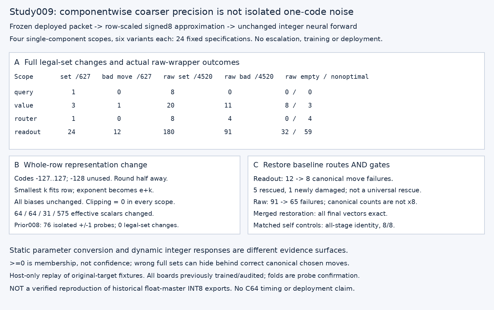
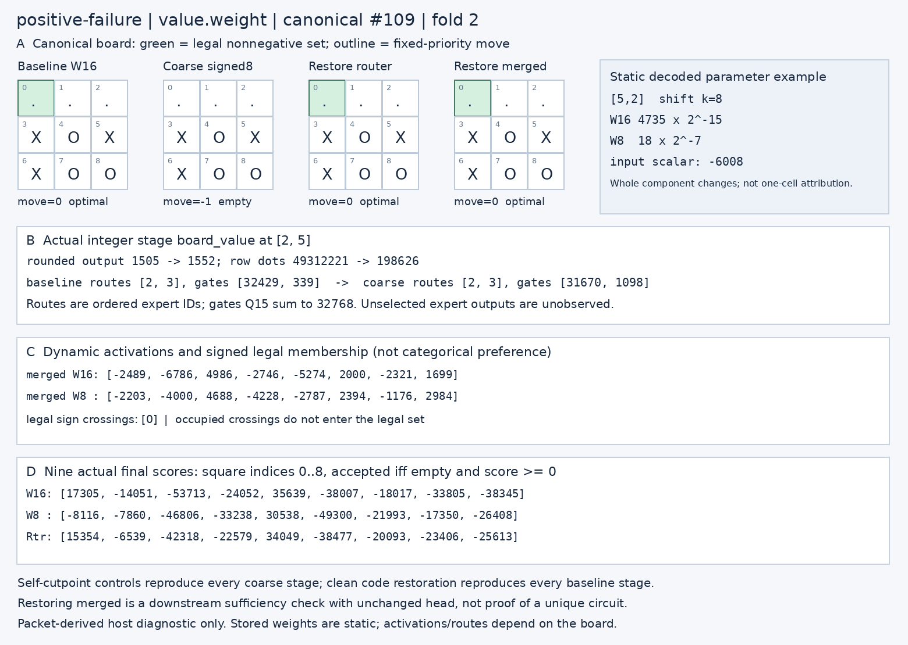
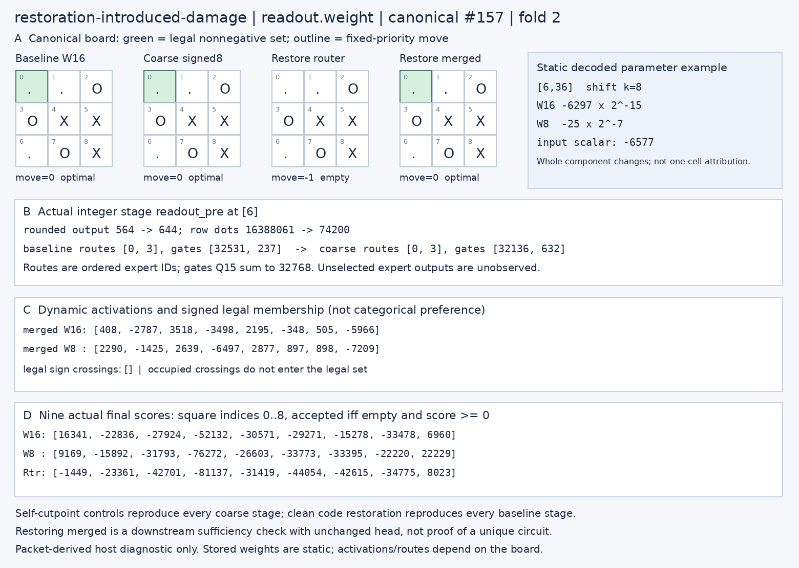
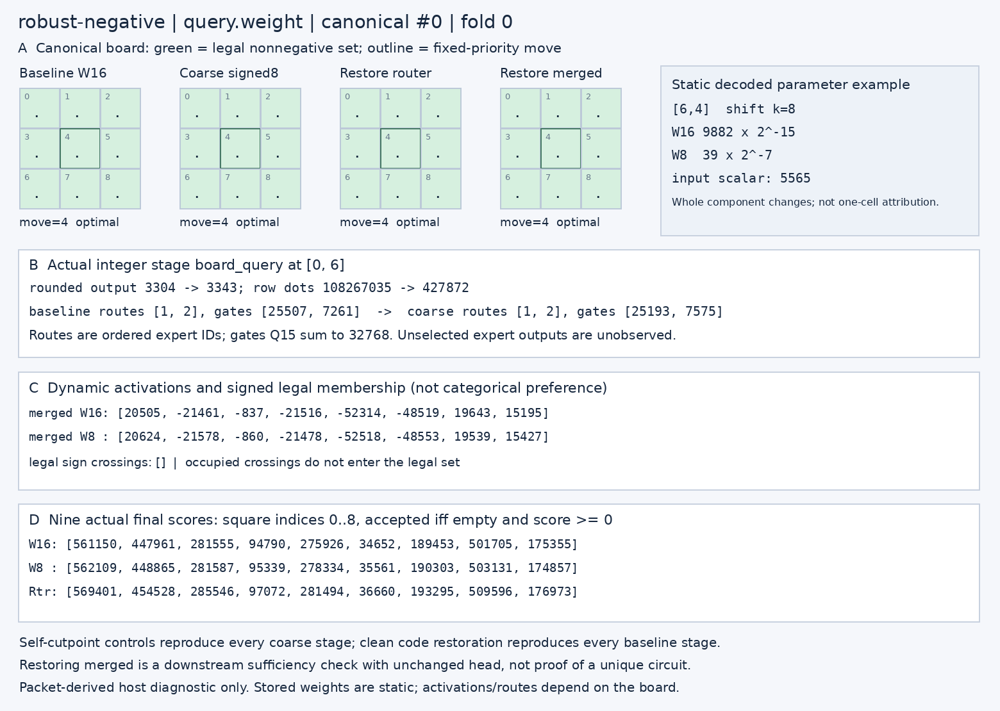
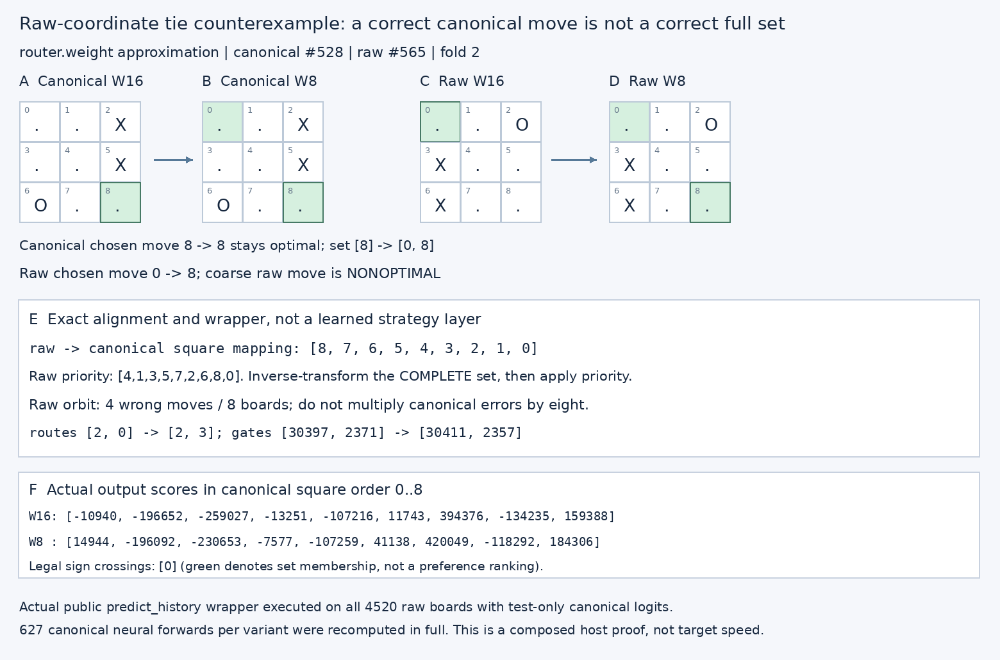

# Study009 — componentwise coarse-precision mechanisms

**Outcome:** the predeclared packet-derived signed8 panel changes complete legal sets in all four scopes. Value and readout approximations cause actual chosen-move failures; router also fails on raw-coordinate ties despite zero canonical chosen-move errors. This is distinct from the negative study008 one-code panel.

## Frozen question, boundary and provenance

- Authoritative deployed packet: 5195 bytes, SHA-256 `fe180f8a931f9d92d8aa39da337bc819d0dbe4e6d971edcba00324fbc18a91c1`. Source packet unchanged before/after every run; no float-master checkpoint imported.
- Baseline: 627 canonical fixtures, 13167 complete target-recorded stage-vector comparisons, 5643 logits, 4520 raw legal-set/inverse/tie paths exact. This is host replay of original target evidence, not new target execution.
- Design frozen in `experiment-study009.json` before new confirmation forwards. Four fixed scopes: query `[out8,in8]`, value `[out8,in8]`, router `[expert4,in8]`, readout `[out8,canonical_square9 × lane8]`. Key, projection, expert matrices, output head, embeddings, normalization and every bias stay exact. No combination search or larger damage doses.
- Six specifications per scope: plain approximation, baseline router-score restoration, self router-score control, baseline merged restoration, self merged control, clean code restoration. Exactly 24 specifications. All specified forwards were executed in full.
- All 1114 pre-existing files, including earlier studies, source/evidence ZIPs, caches and temporary source evidence, were snapshotted and remain byte-identical. No main checkout writes, training, publication or deployment.
- **NOT historical INT8 reproduction.** Historical conversion source uses effective float-master weights; this diagnostic starts from decoded deployed W16 code/exponent pairs. No exact historical candidate artifact/hash was verified, so nominal INT8 equality is not claimed.

## Exact representation contract

For each matrix row with exact effective parameters `c[j] × 2^e`, select the smallest integer `k >= 0` for which half-away rounded `c[j]/2^k` all fit `[-127,127]`. Store those signed8 codes and row exponent `e+k`; -128 is unused. All-zero rows use k=0. Clip defensively only after scale selection: actual clipping count is zero. Row exponents fit signed8. Biases keep the deployed native activation-unit handling, not a second exponent scaling.

The host materializes codes as INT64 tensors with descriptor `bits=8` to reuse the exact integer reference; this is logical signed8 parameter precision, not an INT8 host accumulator. `*-materialized009.json` contains every old/new scalar code and row exponent. `logical-code-bytes009.json` provides actual struct-packed signed8 code/exponent byte sequences as hex, with exact lengths; no complete candidate packet or deployment model binary is produced.

|Scope|Original payload incl. row exponents|Coarse payload incl. row exponents|Hypothetical packet bytes|Row exponents old → new|
|---|---:|---:|---:|---|
|query.weight|136|72|5131|`[-15, -15, -16, -15, -15, -14, -15, -15]` → `[-7, -7, -8, -7, -7, -6, -7, -7]`|
|value.weight|136|72|5131|`[-16, -15, -15, -15, -16, -15, -16, -15]` → `[-8, -7, -7, -7, -8, -7, -8, -7]`|
|router.weight|68|36|5163|`[-14, -15, -14, -14]` → `[-6, -6, -6, -6]`|
|readout.weight|1160|584|4619|`[-16, -15, -15, -16, -15, -15, -15, -15]` → `[-8, -7, -7, -8, -7, -7, -7, -7]`|

Original packet accounting: header18 + wrapper81 + descriptors/scales234 + parameter bytes2810 + LUT2052 =5195 bytes, zero alignment. Replacing only one matrix removes one byte per code, without changing shape/rank/exponent count/descriptor lengths. Packet-size rows are therefore exact layout arithmetic, but **hypothetical**, not serialized candidate sizes or measured peak RAM savings. JSON/NPZ sizes are host evidence storage, not the compact model footprint.

|Scope|Effective scalars changed|Max exact parameter error|Mean exact absolute error|Independent changed-layer output scalars|
|---|---:|---|---|---:|
|query.weight|64|113/16384|1121/524288|45144|
|value.weight|64|127/32768|6839/4194304|45144|
|router.weight|31|125/16384|2061/524288|2508|
|readout.weight|575|1/256|10625/6291456|5016|

Every selected row uses k=8 except router row1, which needs k=9 under the declared no-clipping symmetric codebook. The new lattice is spaced 256 or512 original W16 code units apart. This simultaneously changes many effective values rather than adding one W16 unit at one location. **Caveat:** study008 used a different coordinate/scope panel (output/router biases, norm2 affine and selected output weights). This is not a matched same-coordinate proof that multiplicity alone causes the difference, nor evidence that all one-code changes are harmless.

## Full-set and chosen-move outcomes

A final score `>=0` means set membership only. Mask occupied squares, inverse-transform the whole set, then apply fixed raw priority `[4,1,3,5,7,2,6,8,0]`. Scores are not probabilities, confidence, or categorical ranking preferences. Empty sets, nonoptimal nonempty choices, and changes between optimal choices are separate outcomes.

|Scope|Canonical set changes /627|Canonical bad move (empty + nonoptimal)|Raw set changes /4520|Raw bad move (empty + nonoptimal)|Optimal tie changes canonical/raw|
|---|---:|---:|---:|---:|---:|
|query.weight|1|0 (0 + 0)|8|0 (0 + 0)|0/0|
|value.weight|3|1 (1 + 0)|20|11 (8 + 3)|0/0|
|router.weight|1|0 (0 + 0)|8|4 (0 + 4)|0/0|
|readout.weight|24|12 (5 + 7)|180|91 (32 + 59)|2/17|

|Scope|Ordered route changes|Unordered pair-membership changes|Order-only changes|Gate-vector changes|Legal negative→nonnegative / nonnegative→negative|Occupied sign flips|
|---|---:|---:|---:|---:|---:|---:|
|query.weight|1|0|1|383|0/1|9|
|value.weight|3|2|1|414|1/2|14|
|router.weight|2|2|0|451|1/0|5|
|readout.weight|14|6|8|462|16/13|51|

Route order, route membership and changed gate values are deliberately distinct. A two-slot permutation is not a changed expert set; an unchanged expert set does not imply unchanged expert contributions. Unselected expert entries in dense diagnostic arrays are placeholders, not measured zeros or executed computations. No extra counterfactual expert evaluation beyond the normally selected top2 is used in study009.

## Fixed downstream restorations, with matched identity controls

Each contrast uses the **same 627 receiver boards** and their same4520 raw wrapper paths. At the router cut, substitute baseline rounded router scores immediately after router linear: this guarantees the baseline ordered expert pair and selected-score normalized Q15 gates. Receiver readout residual, norm2 inputs, selected expert recomputations and final head otherwise remain on the perturbed trajectory. At the merged cut, substitute baseline rounded/clamped merged vector immediately before unchanged final head. These are artificial hybrid/OOD restorations, not natural donors, deployable fixes, or natural mediation proofs.

For each component and each cutpoint, substituting its **own perturbed trajectory** at the identical cutpoint is the matched control; all21 saved stage arrays remain identical to the plain approximation. There are eight such self controls, plus four clean tensor-code/exponent restorations that reproduce all baseline stages. These controls establish substitution/indexing identity, not a capacity-matched alternative causal circuit.

|Scope|Router-restored canonical bad/set|Router-restored raw bad/set|Canonical chosen rescue / introduced|Raw chosen rescue / introduced|Canonical full sets restored / newly damaged|
|---|---:|---:|---:|---:|---:|
|query.weight|0/0|0/0|0 rescued / 0 introduced|0 rescued / 0 introduced|1/0|
|value.weight|0/1|0/4|1 rescued / 0 introduced|11 rescued / 0 introduced|2/0|
|router.weight|0/0|0/0|0 rescued / 0 introduced|4 rescued / 0 introduced|1/0|
|readout.weight|8/14|65/104|5 rescued / 1 introduced|34 rescued / 8 introduced|11/1|

Readout route/gate restoration is not uniformly beneficial: it rescues5 canonical failures while introducing1, yielding12→8 failures; raw34 rescued / 8 introduced yields91→65. Raw empty sets increase32→36 even while total wrong moves decline. Value router restoration removes its one canonical chosen failure but leaves one incorrect full set. Query and router full sets become exact with this cut. For the router-only approximation, restoring baseline router scores is mechanically equivalent to removing its only functional perturbation; that identity is not discovery of a special mediation pathway.

All four baseline-merged restorations reproduce all5643 final scores exactly and introduce no damage. This is the expected downstream sufficiency property of an unchanged deterministic head, not a uniquely informative strategy mechanism.

## Measured causal chain and counterexamples

Examples are selected by the frozen lowest-ID/category/fold rules, not a post-hoc expanded intervention search. `selection009.json` retains absent categories and full support counts. `cases009.json` binds each callout to complete parameters, stage values, routes/gates, logits, sets and raw alignment. An illustrated scalar is chosen from the largest measured stage delta and largest exact row-product error on that already-selected board: it illustrates the whole-component conversion and is **not** an isolated one-weight causal attribution.

### A. Value conversion: small local changes reach a legal sign crossing

Canonical#109, fold2: `[0, 0, 0, 1, 2, 1, 1, 2, 2]`. Example stored value weight `[5, 2]` changes `4735 × 2^-15` to `18 × 2^-7`. With actual input -6008, the complete row dot changes `49312221` to `198626` at its new scale; board-value `[2, 5]` becomes 1505→1552.

|Stage|Largest absolute scalar change|Exact before→after at that coordinate|
|---|---:|---|
|board_query `[0, 0]`|0|7189→7189|
|board_value `[2, 5]`|47|1505→1552|
|attention_probs `[0, 0]`|0|9996→9996|
|attended `[4, 5]`|47|1484→1531|
|projected `[1, 1]`|24|-336→-312|
|attention_residual `[1, 1]`|24|-379→-355|
|readout_pre `[3]`|57|-5442→-5385|
|readout_gelu `[0]`|14|20→34|
|norm2_output `[0]`|518|6995→7513|
|router_scores `[3]`|1293|8433→9726|
|gates `[0]`|759|32429→31670|
|merged `[1]`|2786|-6786→-4000|
|logits `[0]`|25421|17305→-8116|

Query and attention probabilities are unchanged for this value-only approximation. Changes propagate through V-weighted attention, projection/residual, readout, GELU and norm2 to router scores and gates. The route pair remains `[2, 3]`, but gates `[32429, 339]`→`[31670, 1098]`. The only accepted legal square0 changes 17305→-8116, emptying the set. Baseline router restoration gives square0=15354 and repairs the move while retaining the perturbed upstream trajectory. This establishes a contribution of the router-score/gate branch to this particular hybrid outcome, not that gates are the only affected path.

### B. Restoration can create a failure

Canonical#157, fold2, readout approximation: square0 baseline=16341, coarse=9169 remains accepted and correct. Restoring baseline router scores/gates makes square0=-1449 and the legal set empty. The expert pair remains `[0, 3]`: this counterexample is not explained by pair-membership replacement. Baseline gates are not guaranteed to be compatible with perturbed residual/norm2/expert activity.

### C. Changed activity need not cross any legal boundary

Canonical#0, fold0, query approximation: all nine legal scores remain nonnegative, the complete set is unchanged and fixed tie move remains4. Query, attention probabilities, readout, gates, merged vector and all logits change; no sign crosses zero. Static decoded codes are not dynamic activity, and changed neural activity alone is not policy damage.

### D. A canonical chosen move hides a wrong raw move

Canonical#528, router conversion: routes `[2, 0]`→`[2, 3]`; square0 score -10940→14944 adds a nonoptimal set member, but canonical chosen move8 remains optimal. Raw#565 uses transform `[8, 7, 6, 5, 4, 3, 2, 1, 0]` and raw priority instead; choice0→8 is nonoptimal. Actual orbit errors are4/8, not canonical errors×8.

## Fold support and tactical labels

The fixed folds have372/121/134 canonical boards. Every board was previously trained/audited; these are selection/probe confirmation folds, **not model-held-out boards or novel-domain generalization**. No component is selected by confirmation damage, and no empty category causes wider search.

|Scope|Variant|Fold0 set/bad|Fold1 set/bad|Fold2 set/bad|
|---|---|---:|---:|---:|
|query.weight|plain|1/0|0/0|0/0|
|query.weight|restore-baseline-router-scores|0/0|0/0|0/0|
|value.weight|plain|1/0|0/0|2/1|
|value.weight|restore-baseline-router-scores|0/0|0/0|1/0|
|router.weight|plain|0/0|0/0|1/0|
|router.weight|restore-baseline-router-scores|0/0|0/0|0/0|
|readout.weight|plain|16/6|2/2|6/4|
|readout.weight|restore-baseline-router-scores|8/4|1/1|5/3|

Board-level independent immediate-win/block/fork summaries are saved in `results009.json`; this panel is a numerical conversion study, not a search for tactical detectors. Original study007 unequal-support rescue counts remain qualified by its COMMON-SUPPORT007 supplement; no study009 contrast relies on those unmatched cohorts.

## Verification and reproduction

- Independent scalar quantizer: 736 codes, exact rational errors, minimal scale shifts, zero clipping.
- Changed-layer scalar oracle: 97812 outputs checked with Python scalar dot/round/scale/bias/clamp, separate from production tensor arithmetic.
- Independent downstream audit: norm2 120384 scalars; ordered routes 15048 boards; Q15 gates 30096 scalars; native mixture/residual 100320 scalars; final head 135432 scalars.
- Independent raw-frame alignment: 4520 boards; 108480 actual public `predict_history` calls in the audit, with 976320 raw membership checks. The runner separately executes the same public-wrapper gate. Both use TEST-ONLY saved logits from each exhaustive627-canonical neural recompute, so this is a composed host proof, not108480 repeated scalar neural forwards or a runtime bypass in the original network.
- No-op/self controls and clean code restoration pass every stage; baseline-merged vectors reproduce every final logit. Dense unselected expert slots remain explicitly unobserved.
- Full fresh deterministic regeneration into `study-009-reproduced` is byte-compared to `study-009-final`; deterministic ZIP contents and SHA-256 recorded in `verification-study009.json` and `FINAL-STUDY-009.json`.
- Five PNG/SVG pairs were rendered and visually inspected at native size; geometry/text bounds checked programmatically. One evidence-only caption was clarified from ambiguous “0 legal sets” to “0 legal-set changes”, and a misleading cross-pair arrow removed. Original renderer plus draft assets (12 archived files total) preserved in `study009-render-original-evidence.zip` with exact hashes; no experimental design or numerical outcome changed.

## Limits and completion

- This is one bounded panel, no increasing damage until failure. No key, projection, output-head or expert precision approximation; no combined-scope generalization; no universal bitwidth robustness guarantee.
- No training/deployment candidate was requested or created. The source5195-byte packet is unchanged. No ROM/model binaries, environments, secrets or private hosts are included in the source/evidence bundle.
- No new C64 run, cycle count, physical-device speed or memory-residency claim. All new inference is the host integer contract with INT64 accumulation and native rounding/clamps.
- Hybrid downstream restoration is intentionally OOD; identity controls validate implementation, not natural mediation. Merged restoration is mechanically sufficient because the final head is unchanged.
- Study008 remains a valid negative result on its finite ±1-code panel. Study009 independently shows that a coarser, many-value row representation can alter full legal sets and wrapper behavior. These conclusions are compatible.
- The measured forward case panels also provide an educational walkthrough and counterexamples; no separate optional experiment or purported additional discovery was added.
