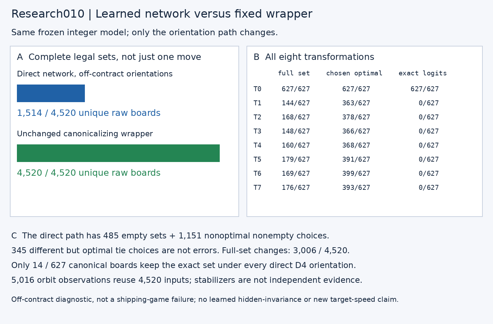
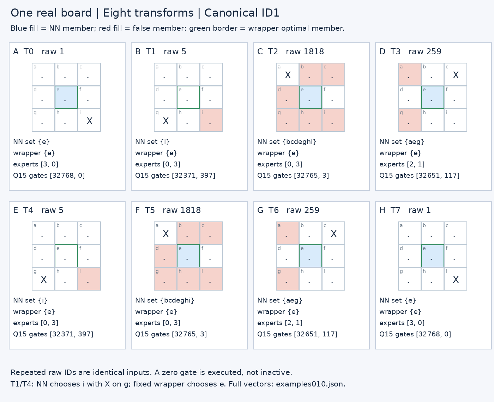

# Research010 — learned versus wrapper symmetry
> **Finding:** bypassing canonicalization leaves only **1,514 / 4,520** unique raw boards with the correct complete legal set; the unchanged canonicalizing wrapper gets **4,520 / 4,520**. This is an off-contract diagnostic of the canonical-trained network, not a shipping-game failure.

## Scope and boundaries

The 5,195-byte packet SHA-256 is `fe180f8a931f9d92d8aa39da337bc819d0dbe4e6d971edcba00324fbc18a91c1`. Parameters, tables, scales and integer arithmetic are frozen. These are CPU host studies, not new C64 timing/execution proofs. Baseline first reproduces **627 canonical boards, 13,167 saved actual-target stage vectors, 5,643 logit scalars**, and the composed **4,520 raw-board complete-set/inverse/tie contract**. Public wrapper calls replay those already verified canonical logits as TEST-ONLY fixtures; deployment always runs the neural core.

All boards were already trained/audited. There is no new held-out model-domain claim. Geometric tactical labels and the independent minimax solver are offline analysis only. Nonnegative logits indicate set membership, **not categorical confidence or ranking**. Independent tactical labels describe immediate geometry; on an already lost board an immediate-threat label need not imply one unique optimal blocking move.

No accepted C64 application, main checkout, model, packet, training run or release is changed. Research study010 is unrelated to accepted application010. All 1,258 files present at discovery, including every earlier study009 artifact, are hash-preserved. Tests use no cache writes; project imports are checked to resolve inside this snapshot.

## Predeclared finite experiment

`manifest010.json` / root `experiment-study010.json` were frozen before direct-orientation confirmation. All eight D4 transforms are applied to all 627 canonical boards. A transform maps original-square indices to destination indices. Direct inference deliberately skips canonicalization and uses frozen occupancy/absolute-position/side embeddings. We execute **4,520 deduplicated raw inputs**, then expand to **5,016 orbit observations**. Repeated orientations of symmetric boards do not create independent evidence. All 5,016 transform observations are also re-executed in per-transform batches to validate deduplication and all21 stages. A separate production-policy forward validates every direct logit without diagnostic hooks.

Full predicted legal sets are inverse-aligned for the main symmetry comparison. Chosen-move statistics are instead evaluated in each actual transformed/raw coordinate frame using the original fixed priority `ebdfhcgia`. We do **not** transform one canonical chosen move. Readout and expert latent units have no spatial axis. Attention scores/probabilities align both query and key axes; square feature tensors align only the square row.
## Exact unique-input outcomes

|Outcome|Direct network / 4,520|Fixed wrapper / 4,520|
|---|---:|---:|
|Complete legal set correct|1514|4520|
|Complete set differs|3006|0|
|Empty learned set|485|0|
|Nonoptimal nonempty choice|1151|0|
|Chosen move optimal|2884|4520|
|Different but optimal tie|345|0|

Empty sets and nonoptimal nonempty choices partition chosen errors: 485 + 1,151 = 1,636. A changed complete set can still yield one correct chosen move. Different optimal ties are not errors.

## All transformations, with repeated orbit observations

|Transform|Exact full sets /627|Chosen optimal /627|Exact aligned logits /627|Identical ordered routes /627|
|---|---:|---:|---:|---:|
|T0|627|627|627|627|
|T1|144|363|0|130|
|T2|168|378|0|84|
|T3|148|366|0|130|
|T4|160|368|0|166|
|T5|179|391|0|212|
|T6|169|399|0|156|
|T7|176|393|0|157|

Across the 5,016 observations: **1771** exact sets and **3245** different sets. Only **14 /627** boards preserve the complete set under all eight direct orientations. **0/627** preserve all nine aligned integer logits under all eight. This is observed output non-equivariance, not a claim about any particular learned hidden mechanism.

Orbit sizes: 1 unique inputs for 4 canonical boards, 2 unique inputs for 4 canonical boards, 4 unique inputs for 111 canonical boards, 8 unique inputs for 508 canonical boards. The size1 boards still have repeated identical inputs; their aligned logits can differ because coordinates are permuted even when the board is unchanged.

## Follow one real board

Callouts A–H are the predeclared first canonical ID showing a nonidentity full-set disagreement (ID1). The same X-in-a-corner position is passed directly through the network in four unique raw orientations. T1/T4 select i when X is on g; the correct wrapper set is {e}. T2/T5 keep a correct chosen e but include six nonoptimal squares, demonstrating why one selected move hides full-set damage. T0/T7 repeat the canonical occupancy input but do not establish hidden invariance. Full integer scores, expert IDs, gate slots, active/null masks and expert vectors are in `examples010.json` and `measurements010.npz`.

## Stage equality, not invented spatial semantics

|Stage|T0 equal boards|T1|T2|T3|T4|T5|T6|T7|
|---|---:|---:|---:|---:|---:|---:|---:|---:|
|attended|627|0|0|0|0|0|0|0|
|attention_probs|627|0|0|0|0|0|0|0|
|attention_residual|627|0|0|0|0|0|0|0|
|attention_scores|627|0|0|0|0|0|0|0|
|board_embedding|627|0|0|0|0|0|0|0|
|board_key|627|0|0|0|0|0|0|0|
|board_normalized|627|0|0|0|0|0|0|0|
|board_query|627|0|0|0|0|0|0|0|
|board_value|627|0|0|0|0|0|0|0|
|expert_hidden|627|4|11|4|37|26|21|48|
|expert_hidden_pre|627|4|11|4|37|26|21|48|
|expert_outputs|627|4|11|4|37|26|21|48|
|gates|627|35|35|32|71|52|54|90|
|logits|627|0|0|0|0|0|0|0|
|merged|627|4|11|4|37|26|21|48|
|norm2_output|627|4|11|4|37|26|21|48|
|projected|627|0|0|0|0|0|0|0|
|readout_gelu|627|4|11|4|37|26|21|48|
|readout_pre|627|4|11|4|37|26|21|48|
|router_scores|627|4|11|4|37|26|21|48|
|routes|627|130|84|130|166|212|156|157|

Expert equality serializes only executed expert IDs, active masks and observed values. A normally unselected expert is null/unobserved, not zero. The observed canonical ID1 executes expert0 with Q15 gate0: execution is not contribution. Routes/gates are compared in their real ordered slots, not spatially permuted.

## Verification, negative findings and interpretation limits

* Identity reproduces all21 baseline stage arrays exactly. Each of the eight permutations and inverses is tested on square rows, both attention axes and output squares; nonspatial vectors remain unpermuted.
* A production frozen policy independently matches 40,680 direct integer logit scalars. Per-transform reruns match 5,016 deduplicated observations and168 stage-array comparisons.
* Independent matrix-derived D4 transforms, reachability enumeration, minimax sets, axis-aware equality counts, raw-coordinate set/move metrics and4,520 fixed-wrapper reconstructions pass (`independent-audit010.json`).
* No hidden unit or expert is established as a symmetry detector. Canonicalized output agreement proves wrapper behavior, not network-learned rotational generalization.
* Absolute positional embeddings and global flattened readout permit orientation dependence structurally; this study does not causally apportion the measured effect between them.
* No post-hoc transform expansion, retraining or relaxed matching. The unfavorable direct-orientation results are retained.

## Reproduction and files

See root `README-REPRODUCTION1011.md`, `FINAL-STUDY-010.json`, `verification-study010.json`. Arrays retain exact integer traces; dense NPZ inactive expert zeros are storage placeholders only, never measured observations. JSON examples use explicit nulls. Figures are measured PNGs with selectable-text SVG counterparts; click any image. The model/ROM binaries and environment are excluded from the source/evidence bundle.
