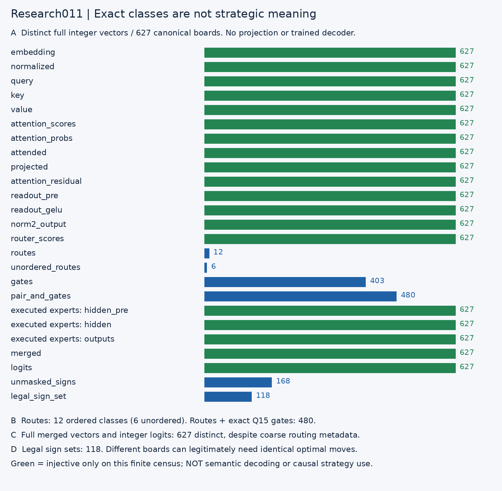
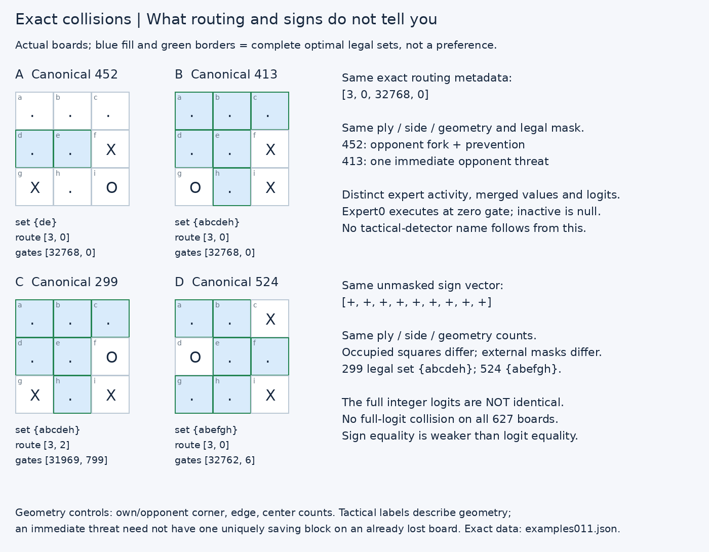

# Research011 — exact representation collisions and information retention

> **Finding:** full merged vectors and integer logits distinguish all **627** canonical boards; ordered routes distinguish only **12**, and routes plus exact gates distinguish **480**. Coarse routing metadata cannot uniquely identify the independent tactics or complete optimal sets. This does not imply the experts lack information.

## Scope and boundaries

The 5,195-byte packet SHA-256 is `fe180f8a931f9d92d8aa39da337bc819d0dbe4e6d971edcba00324fbc18a91c1`. Parameters, tables, scales and integer arithmetic are frozen. These are CPU host studies, not new C64 timing/execution proofs. Baseline first reproduces **627 canonical boards, 13,167 saved actual-target stage vectors, 5,643 logit scalars**, and the composed **4,520 raw-board complete-set/inverse/tie contract**. Public wrapper calls replay those already verified canonical logits as TEST-ONLY fixtures; deployment always runs the neural core.

All boards were already trained/audited. There is no new held-out model-domain claim. Geometric tactical labels and the independent minimax solver are offline analysis only. Nonnegative logits indicate set membership, **not categorical confidence or ranking**. Independent tactical labels describe immediate geometry; on an already lost board an immediate-threat label need not imply one unique optimal blocking move.

No accepted C64 application, main checkout, model, packet, training run or release is changed. Research study010 is unrelated to accepted application010. All 1,258 files present at discovery, including every earlier study009 artifact, are hash-preserved. Tests use no cache writes; project imports are checked to resolve inside this snapshot.

## Predeclared finite census

`manifest011.json` fixes25 stage scopes and exact serialization before confirmation. C-order signed little-endian int64 values include an exact shape prefix. SHA-256 selects candidate buckets; **full byte equality**, never digest equality alone, establishes classes. An independent shape+integer-tuple implementation verifies all partitions and13,100 stage classes. A unit test forces a hash collision to ensure unequal values stay separate.

Full expert observations serialize expert IDs in ascending ID order, execution masks and active values only. Per-expert populations include only boards where that expert actually executes. Route order and matching gate order are retained. Inactive observations are null; selected zero-gate execution remains an observation.

Independent labels: immediate own win, a single opponent threat when no own win, own fork after priority exclusions, opponent fork and fork prevention. Conditioning uses ply, side, and own/opponent corner/edge/center counts. The complete optimal-square set is independently solved offline. Exact equality can retain the information needed for an arbitrary finite lookup decoder without showing a simple semantic decoder or causal use. Unique embeddings are almost tautological because occupancy and positions are present.

## Full exact counts

`Duplicate boards` means all boards belonging to nonsingleton classes; `redundant boards` in JSON means population minus number of classes. Pair counts are unordered board pairs, not independent observations. A mixed class contains at least two different tactical tuples or complete optimal sets.

|Stage|Classes|Duplicate boards|Collision pairs|Mixed tactics|Mixed optimal sets|Controlled mixed tactics / sets|
|---|---:|---:|---:|---:|---:|---:|
|board_embedding|627|0|0|0|0|0 / 0|
|board_normalized|627|0|0|0|0|0 / 0|
|board_query|627|0|0|0|0|0 / 0|
|board_key|627|0|0|0|0|0 / 0|
|board_value|627|0|0|0|0|0 / 0|
|attention_scores|627|0|0|0|0|0 / 0|
|attention_probs|627|0|0|0|0|0 / 0|
|attended|627|0|0|0|0|0 / 0|
|projected|627|0|0|0|0|0 / 0|
|attention_residual|627|0|0|0|0|0 / 0|
|readout_pre|627|0|0|0|0|0 / 0|
|readout_gelu|627|0|0|0|0|0 / 0|
|norm2_output|627|0|0|0|0|0 / 0|
|router_scores|627|0|0|0|0|0 / 0|
|routes|12|627|25988|12|12|95 / 119|
|unordered_routes|6|627|42539|6|6|103 / 123|
|gates|403|281|6104|43|52|24 / 18|
|pair_and_gates|480|189|1617|31|38|16 / 17|
|executed_expert_hidden_pre|627|0|0|0|0|0 / 0|
|executed_expert_hidden|627|0|0|0|0|0 / 0|
|executed_expert_outputs|627|0|0|0|0|0 / 0|
|merged|627|0|0|0|0|0 / 0|
|logits|627|0|0|0|0|0 / 0|
|unmasked_signs|168|559|5976|75|90|21 / 37|
|legal_sign_set|118|578|11215|43|0|51 / 0|

Controlled counts refer to separate `(representation, control-stratum)` classes. One unconditioned class can split into many controlled classes, so controlled mixed-class counts need not be smaller. They are not a numerator over the unconditioned class denominator. Exact control-stratum class/population counts and per-tactic breakdowns are in `results011.json`.

## Actual collision counterexamples

* **A/B, canonical452/413:** identical ordered IDs `[3,0]` and exact gates `[32768,0]`, same ply/side/geometry counts, and even the same legal mask. Their independent tactical labels and full optimal sets differ. Distinct observed expert vectors, residuals and merged values carry information not present in router metadata. This is a direct counterexample to identifying a tactic from route+gate alone, not evidence against useful routing.
* **C/D, canonical299/524:** all nine unmasked logits are positive on both boards, but occupied squares differ. Legal masks create distinct final sets {abcdeh}/{abefgh}. Raw sign equality does not require legally masked outcome equality. Actual integer logits remain different.
* Exact full-logit collisions with different legal sets: **none on these627 boards**. The general warning about masks is illustrated by sign collisions, not by inventing an absent full-logit example.

## Applicable per-expert census

|Expert|Observed boards|Pre-GELU classes|Post-GELU classes|Output classes|Executed zero-gate boards|
|---|---:|---:|---:|---:|---:|
|0|301|301|291|291|41|
|1|258|258|249|249|22|
|2|355|355|355|355|36|
|3|340|340|340|340|9|

These populations sum to1,254 actual selected-expert executions, not2,508 observed four-expert activations. Expert0 has301 applicable boards and291 distinct post-GELU/output vectors; expert1 has258 and249. Expert2/3 remain injective within their applicable populations. Thus a full joint executed-expert signature can distinguish every board even when one expert collapses some inputs. No per-expert collapse is hidden by zero-filling inactive experts. Per-expert `first_*_pair` values index the accompanying `canonical_ids` list (local population coordinates), unlike the main stage examples, which use global canonical IDs.

## What the census establishes—and what it does not

1. Ordered route identity alone is necessarily coarse: top2 from4 admits12 orders and6 memberships; all are observed. Small route cardinality is architectural, not proof of strategic ignorance.
2. Router score vectors remain distinct on all627 boards. Top-k and quantized gates discard distinctions when viewed **alone**; the network still passes richer vectors to experts.
3. Exact merged/logit uniqueness is finite-domain information retention, not semantic decoding, hidden-unit strategy localization, generalization, or proof that all information is used causally.
4. Sign/mask conversion is intentionally many-to-one: several boards legitimately require the same full optimal set. A mixed tactical class in the final set is not a policy error.
5. No aesthetic2D embedding is used as evidence. All claims are exact equality checks on full integer values, with occupancy and applicable expert masks retained.
6. Reused canonical boards are not independent samples; there are no statistical p-values or held-out accuracy claims. No parameter intervention or deployment modification occurs.

## Controls, failures, reproducibility

The saved target baseline passes before the census. All25 full-vector partitions, all12 per-expert scopes, independent geometry and minimax labels, conditional counts, null masks,1,254 executions and22 collision examples pass independent checking. Full collision classes/IDs/hashes are retained in `classes011.json`; no post-hoc label or control relaxation occurs.

A first write attempt failed on NumPy integer JSON metadata. Its partial evidence is preserved in `study-011-attempt1-incomplete-json`, with the original execution log. A new regression test first reproduced the serialization error; a scalar-to-native JSON fix passes. The manifest, stage scopes and numerical measurements were not altered; a fresh final run completes.

See root `README-REPRODUCTION1011.md`, `FINAL-STUDY-011.json`, `verification-study011.json`, and click the figures for native SVG. Binaries/environments/secrets are excluded from bundles.
