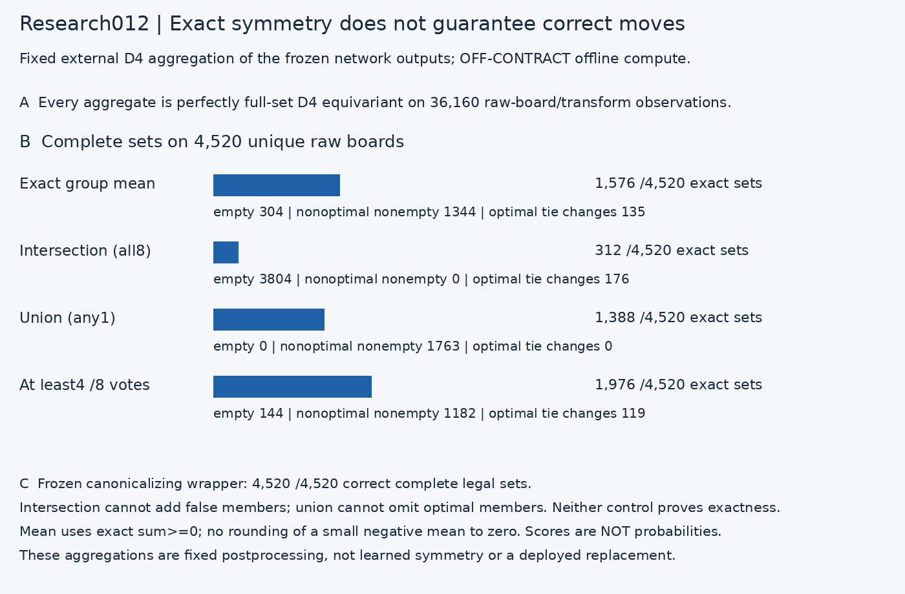
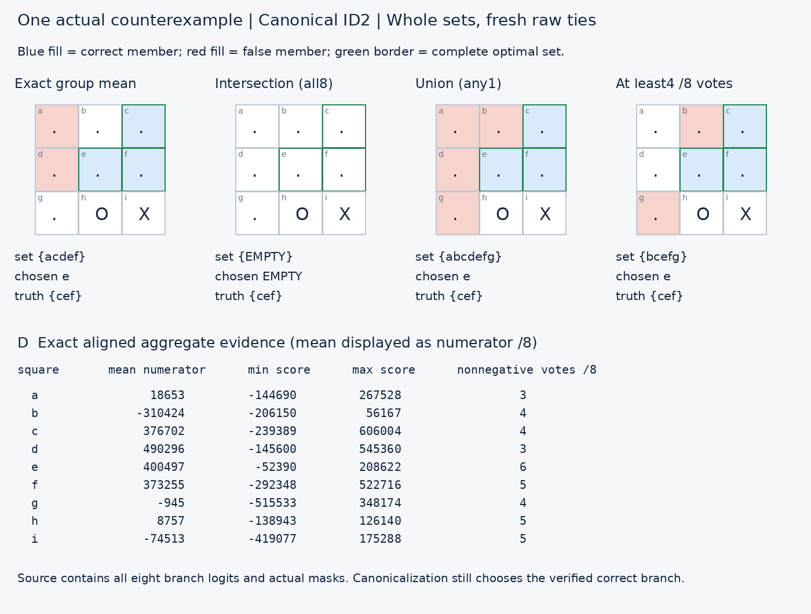

# Research012 — an equivariant external policy can still be wrong

**New bounded follow-up after verified010/011:** test whether imposing exact D4 output symmetry by group aggregation replaces the correctness supplied by canonicalization. It does not. This is four frozen offline postprocessing policies, not training, a deployed replacement, or learned network equivariance.

## Predeclared algorithms and source

`manifest012.json` / root `experiment-study012.json` fixes all four policies before aggregate outcomes. All8 D4 elements are equally weighted, including stabilizer repetitions. The source is the immutable010 trace SHA-256 `7d0e07c6e406925530a6b3feb1bf9422c536a9c168786c9bb5eaafef7679aad5`. This reuses4,520 measured direct network inputs expanded to5,016 canonical-orbit observations; there are **zero new neural forwards**. All boards were already trained/audited.

* Mean: exact sum of eight aligned integer logits is nonnegative. This tests the exact rational mean sign **without rounding**; no tiny negative mean can become a zero member.
* Intersection: all8 signs are nonnegative.
* Union: at least1 sign is nonnegative.
* Vote-at-least-half: at least4/8 signs are nonnegative; ties are included by preregistration.

The actual external legal mask and original raw-coordinate priority `ebdfhcgia` still apply. Nonnegative logits encode membership, not calibrated probabilities. Mean aggregation is a declared diagnostic algorithm, not a confidence average. It uses exact int64 host sums; no deployable accumulator/RAM/speed claim is made.

## Exact unique-raw outcomes

|Policy|Exact full sets /4520|Empty sets|Nonoptimal nonempty|Chosen optimal|Different optimal ties|False legal members|Missing optimal members|
|---|---:|---:|---:|---:|---:|---:|---:|
|mean-exact-sign|1576|304|1344|2872|135|3172|2028|
|intersection|312|3804|0|716|176|0|8018|
|union|1388|0|1763|2757|0|7036|0|
|vote-at-least-half|1976|144|1182|3194|119|3120|1052|

The fixed canonicalizing wrapper remains4,520/4,520 exact sets and correct raw ties. Every aggregate above is **exactly full-set equivariant**, exhaustively checked on36,160 raw-board/transform observations per policy. Symmetry is therefore insufficient for the complete tactical-policy contract. Equivariance is enforced by external averaging/logic; it was not learned by the network.

## Canonical counts are separate, not multiplied by8

|Policy|Exact sets /627|Empty sets|Nonoptimal nonempty choices|Chosen optimal /627|
|---|---:|---:|---:|---:|
|mean-exact-sign|236|42|180|405|
|intersection|56|512|0|115|
|union|208|0|237|390|
|vote-at-least-half|292|19|156|452|

## Exact constraints and controls

The eight branches include a canonicalized orientation with the correct full set. Consequently **intersection has no false legal members**, but can remove every valid member; **union omits no optimal members**, but can add nonoptimal members that the raw-coordinate tie later selects. Both theoretical constraints pass.

Order reversal and duplicating all8 branches to16 leave every policy unchanged (votes threshold scales to8/16). The single canonical branch recovers the baseline627 full sets. Independent audit recomputes each policy from all8 measured branches for **every4,520 raw input** instead of trusting canonical expansion, independently checks minimax/metrics and allD4 set equalities.

Chosen moves are freshly tied in actual raw coordinates. Transforming an old chosen move is not used as a substitute. The selected-move map itself need not be equivariant because fixed priority is coordinate dependent.

|Policy|Non-equivariant chosen-move observations /36160 (not a full-set symmetry failure)|
|---|---:|
|mean-exact-sign|4424|
|intersection|206|
|union|6956|
|vote-at-least-half|4533|

## Actual predeclared example

First canonical ID with a mean full-set disagreement: **2**. All branch logits, legal masks, exact sum/min/max/vote values and four full sets are retained in `examples012.json`; the figure is not a synthetic illustration. The separately declared first nonoptimal nonempty mean-choice example is retained if it exists; no panel is expanded to hunt for failures.

## Limits and stopping decision

No model bytes, stages, routes, gates or expert computations are changed. Original frozen source SHA-256 remains `fe180f8a931f9d92d8aa39da337bc819d0dbe4e6d971edcba00324fbc18a91c1`. Normally inactive expert observations remain unobserved in010/011; this study only consumes final measured logits. Neural stage restoration is not applicable because no neural parameter/stage is edited.

The result neither proves that every possible ensemble fails nor licenses a broader post-hoc ensemble search. It evaluates exactly the four declared policies on an already trained/audited domain. Their perfect imposed symmetry does not establish hidden-layer invariance, strategic component identities or new-domain generalization. It makes no target speed/RAM claim and does not run on or alter the accepted game.

This is the **one optional follow-up**. Stop here: no study013, larger aggregation panel, relaxed matching or retraining. See `FINAL-STUDY-012.json`, root verification/source bundle and `README-REPRODUCTION012.md`. Research010/011, all older evidence and accepted application010 remain untouched.
