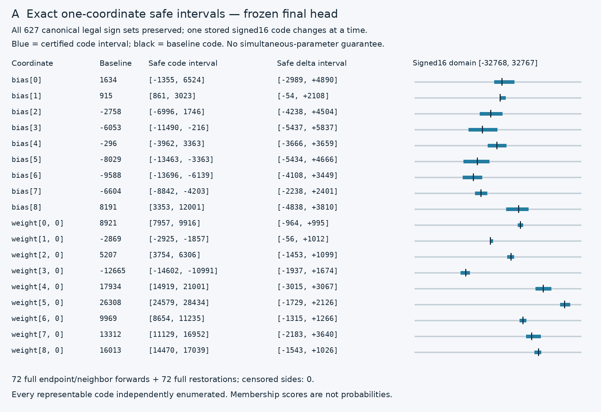
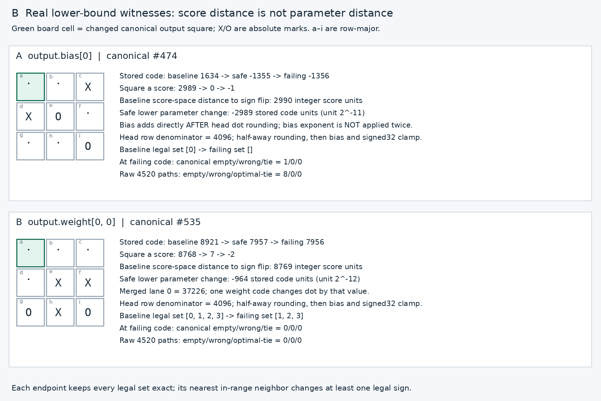

# Study013 — exact final-head coordinate robustness intervals

**Outcome:** exact, maximal signed16 code intervals were certified for all nine output biases and one descriptor-first weight per output row (column0). Every interval preserves all legally masked membership signs on627 canonical boards. The complete restored sets and raw-coordinate ties stay exact on4520 raw boards. This is a new parameter-space certificate, not a reranking of study008’s ±1 panel.

## Frozen design and novelty

Read studies008/009/010/011/012 before design. Study008 tested76 one-code attempts with no legal changes;009 changed many codes and row scales;010–012 tested symmetry and exact representations/ensembles. Here the question is the entire exact one-coordinate safe code interval, not a coarse conversion or score-space margin. Column0 is the lowest legal head input index chosen from actual descriptors, not from intervention damage. Study008 used column1; no coordinate replacement, outcome search, training or precision conversion occurs.

Manifest SHA-256: `3e91f9e6daa1e31e13a1bb8c55c7c9d0fab761ff45e86ac1de2ad565dbea1ed1`. Model SHA-256: `fe180f8a931f9d92d8aa39da337bc819d0dbe4e6d971edcba00324fbc18a91c1`. Model is5195 bytes, unchanged. `manifest013.json` was chmod444 before ANY confirmation forwards or interval outcome computation. All copied inputs and source hashes were bound before confirmation.

## Actual arithmetic and exact proof

The final head has shape[9,8], source weights/biases signed16 in[-32768,32767], output signed32. Merged inputs use the frozen Q11 activation contract. Row exponents are[-12,-12,-12,-12,-12,-13,-12,-12,-12]; biases carry exponent-11 but runtime adds their decoded codes directly in activation/score integer units after row dot rounding. A bias code changeδ therefore addsδ to the preclamp output, notδ/2048 to the integer score. Effective real bias change isδ×2^-11. A weight changeδ changes the pre-round dot byδ×merged[j], with effective weight changeδ×2^row_exponent.

Let D=2^(-row_exponent), R(a)=sign(a) floor((abs(a)+D/2)/D), and fixed bias b. Scores are clamp32(R(dot)+b). Clamping across the signed32 range preserves sign; no unclamped score is substituted for an output check. For an integer threshold t, the smallest dot giving R(dot)>=t is T(t)=tD-D/2 for t>0, and tD-(D-1)//2 for t<=0. For a weight code x, dot=other+merged[j]×x. A baseline member requires merged[j]×x>=T(-b)-other; a baseline nonmember requires the strict complement. For a bias code x, R(dot)+x>=0 iff x>=-R(dot). Intersect these integer half-lines over legal observations only, then intersect with signed16 source bounds. Occupied observations impose no policy constraints. Zero activation lanes impose a constant truth check, not a division.

Monotonic scalar rounding and affine one-coordinate dependence make each per-board feasible set a half-line (or whole domain), so the intersection is contiguous. Thus the two endpoints and nearest failing in-range codes, together with the exact inequalities, certify maximality. An independent verifier additionally enumerates EVERY signed16 code, with no shared threshold formula, and recovers exactly the same intervals. None are joint/multi-parameter or universal-input certificates.

|Coordinate|Old code|Exact safe code interval|Exact safe delta interval|Lower/upper censored|
|---|---:|---|---|---|
|output.bias[0]|1634|[-1355, 6524]|[-2989, 4890]|False/False|
|output.bias[1]|915|[861, 3023]|[-54, 2108]|False/False|
|output.bias[2]|-2758|[-6996, 1746]|[-4238, 4504]|False/False|
|output.bias[3]|-6053|[-11490, -216]|[-5437, 5837]|False/False|
|output.bias[4]|-296|[-3962, 3363]|[-3666, 3659]|False/False|
|output.bias[5]|-8029|[-13463, -3363]|[-5434, 4666]|False/False|
|output.bias[6]|-9588|[-13696, -6139]|[-4108, 3449]|False/False|
|output.bias[7]|-6604|[-8842, -4203]|[-2238, 2401]|False/False|
|output.bias[8]|8191|[3353, 12001]|[-4838, 3810]|False/False|
|output.weight[0, 0]|8921|[7957, 9916]|[-964, 995]|False/False|
|output.weight[1, 0]|-2869|[-2925, -1857]|[-56, 1012]|False/False|
|output.weight[2, 0]|5207|[3754, 6306]|[-1453, 1099]|False/False|
|output.weight[3, 0]|-12665|[-14602, -10991]|[-1937, 1674]|False/False|
|output.weight[4, 0]|17934|[14919, 21001]|[-3015, 3067]|False/False|
|output.weight[5, 0]|26308|[24579, 28434]|[-1729, 2126]|False/False|
|output.weight[6, 0]|9969|[8654, 11235]|[-1315, 1266]|False/False|
|output.weight[7, 0]|13312|[11129, 16952]|[-2183, 3640]|False/False|
|output.weight[8, 0]|16013|[14470, 17039]|[-1543, 1026]|False/False|

## Measured limiting boards

Figures use actual scores/codes and first declared bias/weight witnesses; they do not rank failure-prone coordinates. Exact limiting canonical IDs on BOTH sides, per-board inequalities and source-unit metadata are in `certificates013.json` / `constraints013.json`; every endpoint/neighbor output vector is in `forwards013.npz`.

A score-space distance to flip is y+1 for y>=0 and -y for y<0. That distance is in integer SCORE units. It is NOT the number of stored weight-code changes; head scaling, the board-specific merged lane, rounding and source code range intervene. Bias codes happen to add one integer score unit before clamping, but that identity does not transfer to weights. Membership scores are arbitrary signed set indicators, not probabilities, categorical preferences or calibrated confidence.

## Every endpoint and neighbor validation

|Coordinate/side/role|Code|Canonical set/empty/wrong/optimal-tie|Raw set/empty/wrong/optimal-tie|Occupied flips|
|---|---:|---|---|---:|
|bias-0-lower-endpoint|-1355|0/0/0/0|0/0/0/0|0|
|bias-0-lower-nearest-failure|-1356|1/1/0/0|8/8/0/0|0|
|bias-0-upper-endpoint|6524|0/0/0/0|0/0/0/0|0|
|bias-0-upper-nearest-failure|6525|1/0/0/0|8/0/0/0|0|
|bias-1-lower-endpoint|861|0/0/0/0|0/0/0/0|0|
|bias-1-lower-nearest-failure|860|1/0/0/1|8/0/0/8|0|
|bias-1-upper-endpoint|3023|0/0/0/0|0/0/0/0|6|
|bias-1-upper-nearest-failure|3024|1/0/1/0|8/0/8/0|6|
|bias-2-lower-endpoint|-6996|0/0/0/0|0/0/0/0|6|
|bias-2-lower-nearest-failure|-6997|1/0/0/1|4/0/0/1|6|
|bias-2-upper-endpoint|1746|0/0/0/0|0/0/0/0|9|
|bias-2-upper-nearest-failure|1747|1/0/1/0|8/0/4/0|9|
|bias-3-lower-endpoint|-11490|0/0/0/0|0/0/0/0|10|
|bias-3-lower-nearest-failure|-11491|1/0/0/1|8/0/0/4|10|
|bias-3-upper-endpoint|-216|0/0/0/0|0/0/0/0|14|
|bias-3-upper-nearest-failure|-215|1/0/0/0|8/0/4/0|14|
|bias-4-lower-endpoint|-3962|0/0/0/0|0/0/0/0|6|
|bias-4-lower-nearest-failure|-3963|1/1/0/0|8/8/0/0|6|
|bias-4-upper-endpoint|3363|0/0/0/0|0/0/0/0|4|
|bias-4-upper-nearest-failure|3364|1/0/1/0|4/0/4/0|4|
|bias-5-lower-endpoint|-13463|0/0/0/0|0/0/0/0|27|
|bias-5-lower-nearest-failure|-13464|1/0/0/1|8/0/0/8|27|
|bias-5-upper-endpoint|-3363|0/0/0/0|0/0/0/0|14|
|bias-5-upper-nearest-failure|-3362|1/0/0/0|8/0/4/0|14|
|bias-6-lower-endpoint|-13696|0/0/0/0|0/0/0/0|14|
|bias-6-lower-nearest-failure|-13697|1/0/0/0|8/0/0/0|14|
|bias-6-upper-endpoint|-6139|0/0/0/0|0/0/0/0|12|
|bias-6-upper-nearest-failure|-6138|1/0/1/0|8/0/4/0|12|
|bias-7-lower-endpoint|-8842|0/0/0/0|0/0/0/0|7|
|bias-7-lower-nearest-failure|-8843|1/0/0/0|8/0/0/4|7|
|bias-7-upper-endpoint|-4203|0/0/0/0|0/0/0/0|5|
|bias-7-upper-nearest-failure|-4202|1/0/0/0|8/0/4/0|5|
|bias-8-lower-endpoint|3353|0/0/0/0|0/0/0/0|17|
|bias-8-lower-nearest-failure|3352|1/0/0/0|8/0/0/0|17|
|bias-8-upper-endpoint|12001|0/0/0/0|0/0/0/0|9|
|bias-8-upper-nearest-failure|12002|1/0/1/0|8/0/4/0|9|
|weight-0-0-lower-endpoint|7957|0/0/0/0|0/0/0/0|0|
|weight-0-0-lower-nearest-failure|7956|1/0/0/0|8/0/0/0|0|
|weight-0-0-upper-endpoint|9916|0/0/0/0|0/0/0/0|0|
|weight-0-0-upper-nearest-failure|9917|1/0/0/0|8/0/0/0|0|
|weight-1-0-lower-endpoint|-2925|0/0/0/0|0/0/0/0|0|
|weight-1-0-lower-nearest-failure|-2926|1/0/0/1|8/0/0/8|0|
|weight-1-0-upper-endpoint|-1857|0/0/0/0|0/0/0/0|4|
|weight-1-0-upper-nearest-failure|-1856|1/0/0/0|4/0/0/0|4|
|weight-2-0-lower-endpoint|3754|0/0/0/0|0/0/0/0|4|
|weight-2-0-lower-nearest-failure|3753|1/0/0/0|8/0/0/0|4|
|weight-2-0-upper-endpoint|6306|0/0/0/0|0/0/0/0|5|
|weight-2-0-upper-nearest-failure|6307|1/0/0/0|8/0/0/0|5|
|weight-3-0-lower-endpoint|-14602|0/0/0/0|0/0/0/0|8|
|weight-3-0-lower-nearest-failure|-14603|1/0/0/0|4/0/0/1|8|
|weight-3-0-upper-endpoint|-10991|0/0/0/0|0/0/0/0|7|
|weight-3-0-upper-nearest-failure|-10990|1/0/0/0|8/0/3/0|7|
|weight-4-0-lower-endpoint|14919|0/0/0/0|0/0/0/0|3|
|weight-4-0-lower-nearest-failure|14918|1/0/1/0|8/0/8/0|3|
|weight-4-0-upper-endpoint|21001|0/0/0/0|0/0/0/0|6|
|weight-4-0-upper-nearest-failure|21002|1/0/0/1|8/0/0/8|6|
|weight-5-0-lower-endpoint|24579|0/0/0/0|0/0/0/0|8|
|weight-5-0-lower-nearest-failure|24578|1/0/0/1|8/0/0/8|8|
|weight-5-0-upper-endpoint|28434|0/0/0/0|0/0/0/0|11|
|weight-5-0-upper-nearest-failure|28435|1/0/0/0|8/0/0/0|11|
|weight-6-0-lower-endpoint|8654|0/0/0/0|0/0/0/0|10|
|weight-6-0-lower-nearest-failure|8653|1/0/0/0|8/0/0/0|10|
|weight-6-0-upper-endpoint|11235|0/0/0/0|0/0/0/0|8|
|weight-6-0-upper-nearest-failure|11236|1/0/0/0|8/0/0/0|8|
|weight-7-0-lower-endpoint|11129|0/0/0/0|0/0/0/0|9|
|weight-7-0-lower-nearest-failure|11128|1/0/0/0|8/0/0/0|9|
|weight-7-0-upper-endpoint|16952|0/0/0/0|0/0/0/0|5|
|weight-7-0-upper-nearest-failure|16953|1/0/0/0|8/0/4/0|5|
|weight-8-0-lower-endpoint|14470|0/0/0/0|0/0/0/0|9|
|weight-8-0-lower-nearest-failure|14469|1/0/0/0|8/0/0/0|9|
|weight-8-0-upper-endpoint|17039|0/0/0/0|0/0/0/0|2|
|weight-8-0-upper-nearest-failure|17040|1/0/0/0|8/0/0/0|2|

Each executed row is a fresh FULL integer neural forward over all627 inputs, not a cached-head replacement. Every upstream stage is byte/value equal to baseline; independent scalar head arithmetic matches all9 scores on all627 inputs. The original code is then restored and a second FULL forward verifies all21 stages plus full canonical/raw sets and fresh original-coordinate ties. Each copied candidate differs in exactly one stored scalar with descriptors/exponents fixed. Nothing is serialized as a deployable modified model.

**Occupied-only crossing inside the safe interval:** `bias-1-upper-endpoint`, code3023, canonical#31 board`[0, 1, 1, 2, 0, 2, 0, 2, 1]`, square1 is occupied; score-722→1386. It is masked out. All627 canonical and4520 raw complete legal sets remain exact despite6 occupied sign crossings.

**Raw tie counterexample:** `bias-3-upper-nearest-failure` has zero canonical chosen errors but0 raw empty and4 raw nonoptimal nonempty selections. Complete inverse restoration and fresh raw priority are necessary; canonical counts were not multiplied by8.

## Independent verification and reproducibility

* Full endpoint/neighbor forward batches: 72; full restoration batches: 72. Source-domain censored sides: 0. Censored neighbors are not executed or invented.
* Baseline matches saved010 traces: 13167 full stage vectors and5643 logit scalars. Saved010 traces previously matched actual-target fixtures; this is host revalidation, not new target execution.
* Independent exhaustive code/board membership evaluations: 297533440; independent full-head scalar outputs: 411939.
* Actual public `predict_history` calls: 655400. These replay TEST-ONLY canonical logits after complete neural recomputation, not a runtime bypass or that many repeated neural executions. Independent packet bytes, signed16 offsets, reachability, minimax, D4 canonical alignment, legal masking and raw tie metrics pass.
* Deterministic two fresh-directory runs must match every generated byte; final verification and source/evidence ZIP hashes appear in `FINAL-STUDY-013.json`. Source/evidence bundle excludes the model/ROM, environment, caches, credentials and private hosts. The hash-matching packet and copied baseline010/measurements010 data are prerequisites; no remote service is used.

## Limits, preservation and stop

All627 canonical boards were already trained/audited; there is no model-held-out, novel-domain or statistical generalization claim. Exact intervals apply to the studied legal finite domain and ONE coordinate at a time, with every other code/exponent/table/wrapper fixed. They do not certify a Cartesian box, combinations, upstream edits or actual lower-precision exports. Nearest-failure codes establish loss of a complete set, not necessarily a wrong chosen move; empty, nonoptimal nonempty and changes between equally optimal ties are separate. Endpoint censoring is source-code-domain truncation, not evidence of an unattainable fabricated failure.

The new isolated workspace is the only write target. All1492 discovery-time prior-study files and51 main packet/accepted application010 files are hash-checked before and after. Parent-owned main report may be concurrently integrated and is not claimed snapshotted or modified here. No training, GPU, game/runtime edits, service changes, deployment, publication, new C64 execution, timing or RAM claim. Stop after013; no further study spawned.

