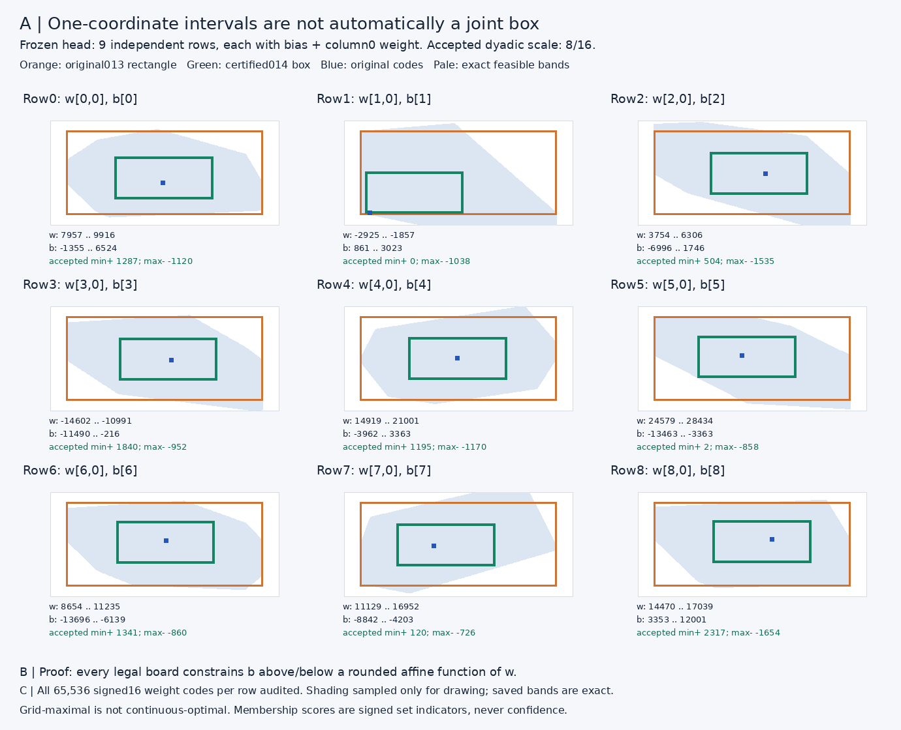
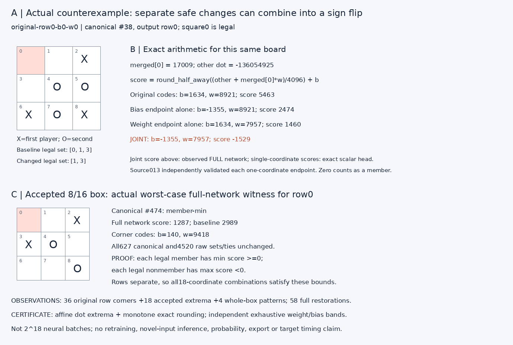

# Study014 — exact joint final-head robustness

**Outcome:** original013 Cartesian box is **unsafe**. The largest passing predeclared dyadic scale is **8/16**. This accepted18-coordinate box certifies **2522373614800652711731872849572328079552666036240711680000000 distinct integer parameter combinations** over every legal sign on627 canonical /4520 raw boards. Grid-maximal, not continuous-optimal.

## Frozen design and boundaries

Manifest SHA-256 `2cf56a0b55f45274fb8ae760ac9ef4891e6271652b2f008a2a965428426c3582`. Frozen model SHA-256 `fe180f8a931f9d92d8aa39da337bc819d0dbe4e6d971edcba00324fbc18a91c1`. Manifest was read-only before any new outcome computation. Nine bias codes and column0 weight codes are varied on isolated in-memory copies, descriptors/exponents and all other codes fixed. All boards were already trained/audited. This is a host finite-domain certificate, not model-held-out generalization or new target execution.

Predeclared panel: all36 original row corners; exact bands for all signed16 weight codes in each row; all17 scales0/16 through16/16 using delta truncation toward0;18 accepted row extremum witnesses (one lowest legal-member score and one highest legal-nonmember score per row, smallest canonical ID breaks ties); four accepted whole-box patterns(LL,LH,HL,HH). Each of58 candidates runs the complete627-board integer network, followed by a full original-code restoration and all-stage equality. No search beyond this frozen finite grid or further study.

## Arithmetic, exact constraints and proof

For row s, let a=merged[0], c=sum over lanes1..7 of merged[j]*W[s,j], w=W[s,0], b=output.bias[s], D=2^(-row exponent). Scores are clamp32(R(c+a*w)+b), where R(z)=sign(z)*floor((abs(z)+D/2)/D). Bias codes add directly AFTER rounding; their stored exponent-11 is not reapplied. Signed32 clamping preserves signs. A zero score is a member. The observed panel has no output saturation.

Exact joint feasible bias band at weight w: L(w)=max(-32768, max over legal members of -R(c+a*w)); U(w)=min(32767, min over legal nonmembers of -R(c+a*w)-1). L>U means no feasible bias. `joint-bands014.npz` retains both arrays for all65536 signed16 weights in each row. Each row is independent of all other final output rows and the final head cannot alter upstream merged vectors.

Equivalent **piecewise half-plane constraints**, with integer b,w: write h(b)=-D/2 if b<0 and h(b)=-(D-1)//2 if b>=0. A legal member requires a*w+D*b >= h(b)-c; a legal nonmember requires a*w+D*b <= h(b)-c-1. This follows from the exact smallest dot threshold for R(dot)>=-b; the branch at b=0 preserves half-away asymmetry. The accepted box need not remain within one bias branch: direct rounding extrema and the full bands handle both branches. Every legal-board a,c,member,D is saved in `constraints014.json`. Occupied squares impose no policy constraint.

For any row rectangle [wL,wU]x[bL,bU], per-board minimum=R(c+min(a*wL,a*wU))+bL and maximum=R(c+max(a*wL,a*wU))+bU. Monotone rounding makes these exact, not a linearized approximation. Require minimum>=0 for each baseline legal member and maximum<0 for each legal nonmember. Product safety follows by row separability: these inequalities hold simultaneously for ALL choices of ALL18 stored codes. The independent verifier separately enumerates EVERY weight code, computes bands board-by-board using quotient/remainder rounding (no shared014 core), and checks every bias in the accepted interval is contained in every band across the accepted weight range. It additionally directly scalar-evaluates four corners for every board at every scale. Thus certification is not inferred merely from the58 empirical network candidates.

## Grid certificate and accepted code box

|Scale|Safe|Rows failing|Smallest legal-member minimum|Largest legal-nonmember maximum|
|---|---|---|---:|---:|
|0/16|True|[]|54|-2109|
|1/16|True|[]|48|-1977|
|2/16|True|[]|41|-1843|
|3/16|True|[]|34|-1710|
|4/16|True|[]|27|-1564|
|5/16|True|[]|21|-1354|
|6/16|True|[]|14|-1145|
|7/16|True|[]|8|-935|
|8/16|True|[]|0|-726|
|9/16|False|[1, 5, 7]|-677|-158|
|10/16|False|[1, 2, 3, 5, 7]|-1356|641|
|11/16|False|[0, 1, 2, 3, 5, 6, 7]|-2035|1435|
|12/16|False|[0, 1, 2, 3, 4, 5, 6, 7, 8]|-2714|2233|
|13/16|False|[0, 1, 2, 3, 4, 5, 6, 7, 8]|-3394|3046|
|14/16|False|[0, 1, 2, 3, 4, 5, 6, 7, 8]|-4072|3972|
|15/16|False|[0, 1, 2, 3, 4, 5, 6, 7, 8]|-4751|4902|
|16/16|False|[0, 1, 2, 3, 4, 5, 6, 7, 8]|-5437|5833|

All larger declared scales fail; no continuous scale optimization, alternative center, asymmetric search or globally largest box claim. Nested boxes use original+sign(delta)*floor(abs(delta)*k/16).

|Row|Original bias interval|Accepted bias interval|Original column0 weight interval|Accepted weight interval|Accepted min+/max-|
|---|---|---|---|---|---|
|0|[-1355, 6524]|[140, 4079]|[7957, 9916]|[8439, 9418]|1287/-1120|
|1|[861, 3023]|[888, 1969]|[-2925, -1857]|[-2897, -2363]|0/-1038|
|2|[-6996, 1746]|[-4877, -506]|[3754, 6306]|[4481, 5756]|504/-1535|
|3|[-11490, -216]|[-8771, -3135]|[-14602, -10991]|[-13633, -11828]|1840/-952|
|4|[-3962, 3363]|[-2129, 1533]|[14919, 21001]|[16427, 19467]|1195/-1170|
|5|[-13463, -3363]|[-10746, -5696]|[24579, 28434]|[25444, 27371]|2/-858|
|6|[-13696, -6139]|[-11642, -7864]|[8654, 11235]|[9312, 10602]|1341/-860|
|7|[-8842, -4203]|[-7723, -5404]|[11129, 16952]|[12221, 15132]|120/-726|
|8|[3353, 12001]|[5772, 10096]|[14470, 17039]|[15242, 16526]|2317/-1654|

## Actual counterexample and proof witnesses

First declared failing candidate `original-row0-b0-w0`: canonical#38, board`[0, 0, 1, 0, 2, 2, 1, 2, 1]`, row0, a=17009, other=-136054925, D=4096. Baseline score5463; bias endpoint alone2474; weight endpoint alone1460; joint full-network score**-1529**. Baseline legal set`[0, 1, 3]`, changed`[1, 3]`. Separate endpoint scores are exact scalar calculations on the saved merged vector, consistent with013 endpoint confirmations; the joint score is from a new full neural forward.

Original failing corner batches: **31/36**. All failures and favorable corners are retained; no assumption that the original box had to fail. Accepted18 extremum batches and4 whole-box patterns have zero canonical/raw complete-set changes, empties, nonoptimal choices or optimal tie changes. Occupied-only sign crossings, where present, remain distinct in validation records.

Accepted row0 `member-min` witness canonical#474, board`[0, 0, 1, 1, 2, 0, 0, 0, 2]`, full-network score1287; matching exact extremum saved in `extrema014.npz`. Both sign directions for every row are retained with code endpoints, activations and actual network scores in `validations014.json`.

## Every observed full-network candidate

Counts are canonical/raw separately: set changes; empty sets; nonoptimal nonempty chosen moves; changes between equally optimal chosen moves. Raw sets are completely inverse-restored and ties freshly applied in original raw coordinates, not canonical errors multiplied by8.

|Candidate|Canonical set/empty/wrong/tie|Raw set/empty/wrong/tie|Occupied flips|
|---|---|---|---:|
|original-row0-b0-w0|2/0/0/0|12/0/0/0|0|
|original-row0-b0-w1|1/1/0/0|8/8/0/0|0|
|original-row0-b1-w0|6/0/0/0|40/0/0/0|0|
|original-row0-b1-w1|5/0/0/0|40/0/4/0|2|
|original-row1-b0-w0|1/0/0/1|8/0/0/8|1|
|original-row1-b0-w1|0/0/0/0|0/0/0/0|4|
|original-row1-b1-w0|1/0/1/0|8/0/8/0|6|
|original-row1-b1-w1|4/0/3/0|24/0/20/0|9|
|original-row2-b0-w0|4/1/0/1|24/8/0/1|13|
|original-row2-b0-w1|0/0/0/0|0/0/0/0|4|
|original-row2-b1-w0|0/0/0/0|0/0/0/0|7|
|original-row2-b1-w1|4/0/2/0|28/0/8/0|14|
|original-row3-b0-w0|9/1/0/3|54/8/0/14|21|
|original-row3-b0-w1|0/0/0/0|0/0/0/0|6|
|original-row3-b1-w0|2/0/1/0|12/0/8/0|8|
|original-row3-b1-w1|6/0/2/0|40/0/23/0|17|
|original-row4-b0-w0|3/0/0/3|20/0/0/20|5|
|original-row4-b0-w1|5/2/0/3|40/16/0/24|12|
|original-row4-b1-w0|5/0/5/0|36/0/36/0|2|
|original-row4-b1-w1|2/0/2/0|16/0/16/0|5|
|original-row5-b0-w0|4/1/0/2|28/8/0/10|32|
|original-row5-b0-w1|0/0/0/0|0/0/0/0|23|
|original-row5-b1-w0|1/0/0/0|8/0/4/0|14|
|original-row5-b1-w1|4/0/1/0|32/0/16/0|18|
|original-row6-b0-w0|7/1/0/0|56/8/0/2|23|
|original-row6-b0-w1|1/0/0/1|8/0/0/4|9|
|original-row6-b1-w0|1/0/1/0|8/0/4/0|7|
|original-row6-b1-w1|3/0/0/0|24/0/0/0|18|
|original-row7-b0-w0|2/0/0/1|16/0/0/8|16|
|original-row7-b0-w1|1/0/0/0|8/0/0/4|7|
|original-row7-b1-w0|2/0/0/0|16/0/4/0|8|
|original-row7-b1-w1|1/0/0/0|8/0/4/0|10|
|original-row8-b0-w0|2/0/0/0|16/0/0/0|21|
|original-row8-b0-w1|1/0/0/0|8/0/0/0|12|
|original-row8-b1-w0|1/0/1/0|8/0/4/0|11|
|original-row8-b1-w1|2/0/0/0|16/0/0/0|11|
|accepted-row0-member-min|0/0/0/0|0/0/0/0|0|
|accepted-row0-nonmember-max|0/0/0/0|0/0/0/0|0|
|accepted-row1-member-min|0/0/0/0|0/0/0/0|0|
|accepted-row1-nonmember-max|0/0/0/0|0/0/0/0|5|
|accepted-row2-member-min|0/0/0/0|0/0/0/0|5|
|accepted-row2-nonmember-max|0/0/0/0|0/0/0/0|4|
|accepted-row3-member-min|0/0/0/0|0/0/0/0|7|
|accepted-row3-nonmember-max|0/0/0/0|0/0/0/0|10|
|accepted-row4-member-min|0/0/0/0|0/0/0/0|6|
|accepted-row4-nonmember-max|0/0/0/0|0/0/0/0|0|
|accepted-row5-member-min|0/0/0/0|0/0/0/0|18|
|accepted-row5-nonmember-max|0/0/0/0|0/0/0/0|9|
|accepted-row6-member-min|0/0/0/0|0/0/0/0|14|
|accepted-row6-nonmember-max|0/0/0/0|0/0/0/0|11|
|accepted-row7-member-min|0/0/0/0|0/0/0/0|2|
|accepted-row7-nonmember-max|0/0/0/0|0/0/0/0|6|
|accepted-row8-member-min|0/0/0/0|0/0/0/0|6|
|accepted-row8-nonmember-max|0/0/0/0|0/0/0/0|6|
|accepted-all-b0-w0|0/0/0/0|0/0/0/0|65|
|accepted-all-b0-w1|0/0/0/0|0/0/0/0|45|
|accepted-all-b1-w0|0/0/0/0|0/0/0/0|31|
|accepted-all-b1-w1|0/0/0/0|0/0/0/0|52|

## Independent audit, reproduction and preservation

* Actual full integer batches:117 =1 baseline +58 candidates +58 restorations; 73359 full board executions. Baseline reproduces all21 saved010 stages; each restoration recovers every stage, legal set and raw tie.
* Independent full-head scalar comparisons: 332937. Independent65536-code row census: 589824 row-weight codes and148766720 applicable board/weight rounding constraints. No infeasible band is silently treated as a safe interval.
* Independent packet descriptor/signed16 offsets, reachable-board enumeration, minimax, D4 alignment, legal masks and raw ties pass. Actual public predict_history calls: 528840; TEST-ONLY wrapper fixture replays freshly recomputed neural outputs, not that many neural forwards or a deployed bypass.
* Every project import originates inside this workspace; the existing dependency interpreter is borrowed only. All86 files in013,1492 files in003 and51 main frozen model/runtime/application files are hashed before and after, with exact prior-source file-list equality. Parent-owned mutable documentation is deliberately excluded from main preservation. No prior root or main files were modified.
* Two fresh full runs must reproduce every generated byte, including NPZ timestamps, figures and this report; final comparison and bundle identities are recorded in `verification014.json` and `FINAL-STUDY-014.json` at workspace root. `README-REPRODUCTION014.md` supplies exercised commands. Source/evidence ZIP excludes the frozen packet, environments, ROMs and private credentials; its exact packet hash remains a prerequisite.

## Limits and stop

Finite-domain frozen-head policy membership only; no new boards, training, export/deployment, GPU, target execution, timing or RAM claim. Scores are arbitrary signed optimal-set indicators, never categorical confidence. Boxes constrain only these18 decoded signed16 codes with all other tensors, exponents, tables and wrapper fixed. This proves all combinations inside the accepted grid box, not arbitrary joint edits, a universal-input result, or continuous/global optimality. Stop after014; no further study or retraining.
