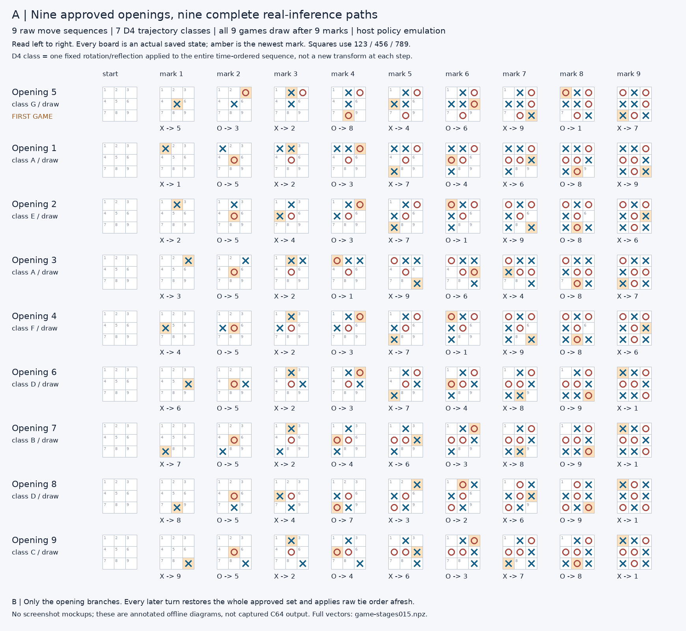
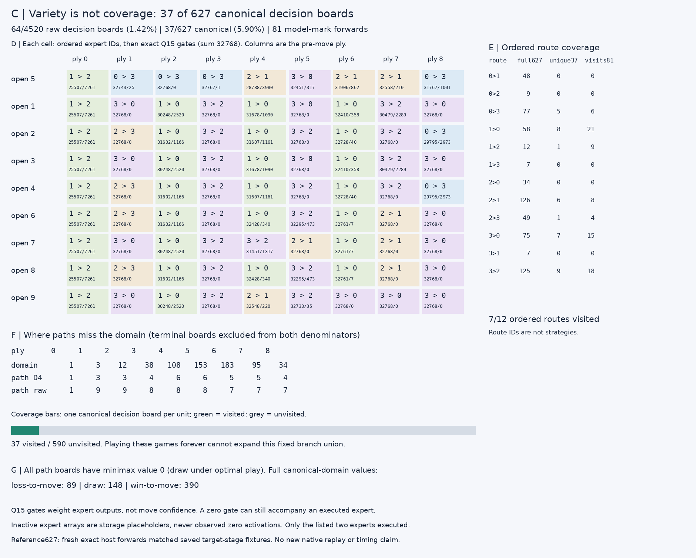
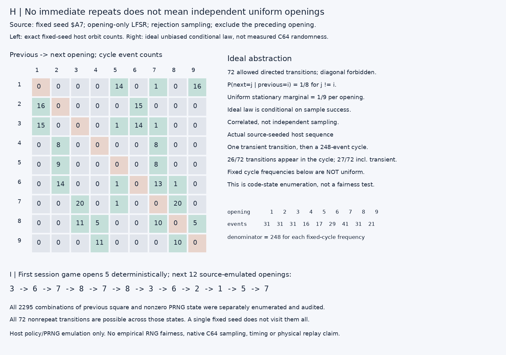

# Study015 — what continuous self-play actually explores

**Nine approved openings produce nine raw sequences but only seven symmetry-equivalent trajectory classes. Every game draws in nine marks. Across all branches, only 37/627 canonical and 64/4520 raw nonterminal decision boards are visited. Continuous replay is variety, not exhaustive validation.**

## Frozen scope and accepted source

Manifest SHA-256 `561c1dcea70868e22185096252b00cddc54732893eda739f35e01d1d2e26b0e2` was written before opening membership or new trajectory outcomes were calculated. Frozen packet: 5,195 bytes, SHA-256 `fe180f8a931f9d92d8aa39da337bc819d0dbe4e6d971edcba00324fbc18a91c1`. Application010 and model bytes are unchanged. Only the isolated study015 workspace is written; the active report is excluded from preservation because another worker owns it. No training, weight ablation, install, GPU, service, publication, browser or physical replay. This is **host policy emulation**, not new native C64 evidence. All 627 canonical / 4,520 raw boards were already trained/audited; no new model-held-out generalization.

Source discovery confirms the opening-only scope: `graphical_game.asm:195–221` resets the session then marks later games; `:306–343` performs `policy_request`, then `auto_resolve_opening`, remembers the opening and commits. `wrapper.asm:119–129` validates history, canonicalizes, executes the full neural forward and restores the entire set. `auto_demo.asm:33–129` samples only mode0/history-length0/later-game calls and excludes the preceding approved opening if another exists. The frozen application010 listing contains the same call order and raw tie loop. This is source-bound host emulation, not a newly executed binary-equivalence proof.

The empty-board forward actually executed first; its full signed scores were:

`[561150, 447961, 281555, 94790, 275926, 34652, 189453, 501705, 175355]`

All nine legal signs are nonnegative. These are independent optimal-set membership scores, not categorical preferences. Every branch then executes a **fresh full neural forward for every AI mark**: 81 game forwards, plus one empty-board discovery forward and 627 fresh reference-domain forwards. No saved policy, minimax fallback or logits cache chooses a mark. The domain reference is evaluated after the games. Offline minimax is read only after neural selection to audit it.

First session game: **5 → 3 → 2 → 8 → 4 → 6 → 9 → 1 → 7**. Later games sample only the opening; continuation always uses ordinary fresh raw-coordinate ties. The tie order is **5,2,4,6,8,3,7,9,1** (one-based). Entire recommended sets are inverse-restored and legally masked before this tie order is applied.

## Complete trajectory census

|Opening|Sequence, raw one-based|D4 class|Outcome / marks|
|---:|---|---|---|
|1|1 → 5 → 2 → 3 → 7 → 4 → 6 → 8 → 9|A|draw / 9|
|2|2 → 5 → 4 → 3 → 7 → 1 → 9 → 8 → 6|E|draw / 9|
|3|3 → 5 → 2 → 1 → 9 → 6 → 4 → 8 → 7|A|draw / 9|
|4|4 → 5 → 2 → 3 → 7 → 1 → 9 → 8 → 6|F|draw / 9|
|5 (first)|5 → 3 → 2 → 8 → 4 → 6 → 9 → 1 → 7|G|draw / 9|
|6|6 → 5 → 2 → 3 → 7 → 4 → 8 → 9 → 1|D|draw / 9|
|7|7 → 5 → 2 → 4 → 6 → 3 → 8 → 9 → 1|B|draw / 9|
|8|8 → 5 → 4 → 7 → 3 → 2 → 6 → 9 → 1|D|draw / 9|
|9|9 → 5 → 2 → 4 → 6 → 3 → 7 → 8 → 1|C|draw / 9|

A D4-equivalent trajectory requires one fixed board rotation/reflection for the whole ordered sequence, preserving ply and player. It is not just matching final boards, treating all corners as one opening, or separately canonicalizing each time step. Raw-coordinate tie priority breaks trajectory equivariance even though the restored complete sets are equivariant. Thus three opening geometries (center/edge/corner) expand into seven full-path classes. There are 70 distinct raw states including six terminal states; decision-domain coverage excludes those terminal states. No terminal forward is fabricated.

## Route and domain coverage

|Ordered expert IDs|Full627 boards|Unique path canonical boards|Game-step visits (81)|
|---|---:|---:|---:|
|[0, 1]|48|0|0|
|[0, 2]|9|0|0|
|[0, 3]|77|5|6|
|[1, 0]|58|8|21|
|[1, 2]|12|1|9|
|[1, 3]|7|0|0|
|[2, 0]|34|0|0|
|[2, 1]|126|6|8|
|[2, 3]|49|1|4|
|[3, 0]|75|7|15|
|[3, 1]|7|0|0|
|[3, 2]|125|9|18|

Unique-board coverage and repeated visits are distinct denominators. The nine empty-board requests execute the same ordered route nine times but cover only one canonical board. Q15 gates sum to32768 and weight the two executed expert outputs; they are not confidence in a square. A selected expert with zero gate still executes. Inactive expert storage slots are unobserved placeholders, not measured zero activations. `game-stages015.npz` retains all 21 stages per game mark, including full logits, attentions, routes, both gates and selected expert paths. `domain-stages015.npz` retains the same stages on all627 reference boards.

|Pre-move ply|Full canonical domain|Unique canonical on paths|Unique raw on paths|
|---:|---:|---:|---:|
|0|1|1|1|
|1|3|3|9|
|2|12|3|9|
|3|38|4|8|
|4|108|6|8|
|5|153|6|8|
|6|183|5|7|
|7|95|5|7|
|8|34|4|7|

Full canonical minimax values, for side to move: `{'-1': 89, '0': 148, '1': 390}`. Path values: `{'0': 37}`. Optimal self-play never enters already-winning or already-losing positions, leaving important response cases unexercised. Even repeated route IDs do not establish that all boards or numerical states on those routes were covered.

## The opening sampler: conditional law versus fixed source orbit

Under an **ideal unbiased candidate-source abstraction**, conditional on a successful bounded sample, the nine-opening no-repeat transition matrix has diagonal0 and every off-diagonal probability **1/8**. Its stationary marginal is **1/9** per raw opening; opening geometry has stationary masses1/9 center,4/9 edge,4/9 corner. Neither statement implies independent openings. The first game is deterministic rather than a stationary draw. The rejection threshold removes modulo bias under that ideal abstraction; a bounded9-attempt guard reports failure instead of manufacturing a square.

The actual source does not draw independent random bytes. It resets an8-bit LFSR to `$A7`; it is not seeded by elapsed time, audio or activity. Exact host enumeration finds one transient transition then a **248-event deterministic joint-state cycle**. This cycle uses **26/72** structurally allowed directed transitions (**27/72** including the transient). Its opening event counts, for screen squares1..9, are `[31, 31, 31, 16, 17, 29, 41, 31, 21]`; divide by248 for the orbit limiting frequencies. These are code-state enumeration counts, **not empirical hardware sampling or an RNG fairness test**, and they are visibly not the ideal1/9 marginal. Restarting an unchanged session resets to the same seed.

Separately, every previous-opening/nonzero-LFSR-state combination was enumerated:9×255=2,295 states. All72 off-diagonal transitions are possible across this state census, immediate repeats never occur, and the finite guard is not exhausted for these accepted nine-opening states. The nine neural branch games cover all possible continuation shapes; no need to rerun a continuation for each previous opening because no later turn consults that previous-opening state. The source seeded orbit is not9 independently chosen openings, nor an exhaustive nonrepeating schedule.

The game guide’s “uniformly” wording should therefore be read as the rejection-sampler’s intended conditional selection rule, **not a demonstrated fairness property of this fixed deterministic LFSR**. No release or documentation edits were made by this study; this qualification is reported as a finding.

## Independent audit and reproducibility

The separate auditor imports no production packet decoder, wrapper, minimax or neural arithmetic. It independently decodes the packet, uses arbitrary-size Python integers for the entire forward, reconstructs all21 stages at all81 game steps and all627 reference boards, constructs D4 from coordinate geometry, validates first-equal canonical transform choice, inverse-restores whole sets, reapplies raw tie priority, independently enumerates4,520 raw/627 canonical nonterminal boards and solves minimax. Every game-step complete set and chosen move is optimal. It also reconstructs all2,295 sampler state transitions and the fixed-seed cycle. Tests include failure-first missing implementation checks and independent rerun. The one development correction was removal of a false sorted-order assumption for the existing canonical fixture; set equality plus the fixture’s actual row order is now used. This changes no scope or outcomes.

## Why self-play is not learning, and cannot replace full auditing

Self-play is **not learning**: model parameter bytes, scales and lookup tables remain frozen; no optimizer, feedback update or search is run in gameplay. The computer repeatedly evaluates that same network on new boards. The PRNG only resolves the opening tie of later games. Nine draws are an understandable live demonstration, not a proof that every defensive response, winning conversion, canonical inverse or tie case works. These paths miss590 of627 canonical decision boards and4,456 of4,520 raw boards. Exhaustive finite-domain policy auditing remains necessary.

No model is bundled in the source/evidence ZIP. To reproduce, place the separately hash-verified frozen packet at `artifacts/flexible-integer/q11-w16-a32-early-interp/model.f9j` and follow `README-REPRODUCTION015.md`. No new C64/native execution, gameplay timings, physical hardware compatibility, RNG fairness or generalization is claimed. Study015 stops here; no016 is started.
