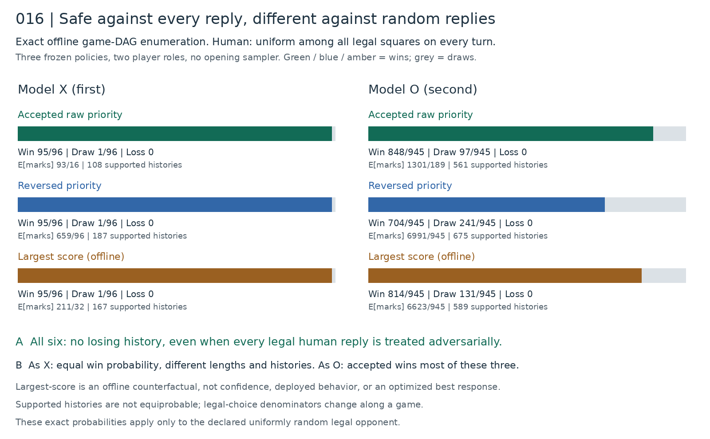
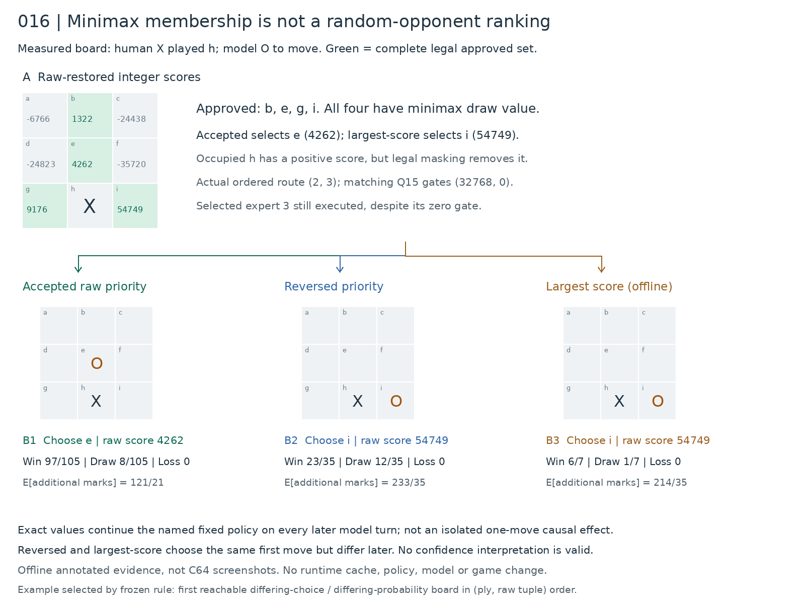

# Study016 — Fixed safe ties against a uniformly random legal opponent

**Conclusion.** All three predeclared policies are loss-free against every legal human reply from the empty board, as either role. Against the specific uniformly random legal opponent, they have identical win probability as X, but different win probabilities as O. The accepted priority wins most often among these three as O; no search for an optimal exploitative policy was performed.

## Frozen design and numerical scope

The manifest was frozen before outcomes: exactly two roles and three policies. Accepted raw priority is `ebdfhcgia`; reversed priority is `aigchfdbe`; largest-score selects the greatest raw-restored integer score within the **legal nonnegative approved set**, resolving equal scores with accepted priority. Largest-score is an **offline counterfactual**, not confidence, not deployed behavior, and not a proposed runtime change. There is no opening randomness in human play.

The opponent independently selects uniformly among all currently empty legal squares at each human turn. Play stops at the first win or full board. Complete ordered histories have probability equal to the product of reciprocal human branching counts, not equal mass per history. All results are exact rational enumeration, not sampled matches or native-game replay.

## Exact outcomes and lengths

| Model | Fixed policy | Win | Draw | Loss | Expected terminal marks | Supported complete histories (W/D/L) |
|---|---|---:|---:|---:|---:|---:|
| X | Accepted raw priority | 95/96 | 1/96 | 0 | 93/16 | 108 (104/4/0) |
| X | Reversed priority | 95/96 | 1/96 | 0 | 659/96 | 187 (183/4/0) |
| X | Largest score (offline) | 95/96 | 1/96 | 0 | 211/32 | 167 (163/4/0) |
| O | Accepted raw priority | 848/945 | 97/945 | 0 | 1301/189 | 561 (464/97/0) |
| O | Reversed priority | 704/945 | 241/945 | 0 | 6991/945 | 675 (434/241/0) |
| O | Largest score (offline) | 814/945 | 131/945 | 0 | 6623/945 | 589 (458/131/0) |

Expected terminal marks means total X+O marks from the empty board, including the terminal move. Per-state additional-mark expectations are retained in each DAG file. Fewer marks does not itself imply a stronger worst-case policy.

## A measured branching counterexample

At raw board `.......X.` (X at h), O’s legal approved set is `{b,e,g,i}`. Their raw integer scores are b=1322, e=4262, g=9176, i=54749. Accepted chooses e; reversed and largest-score choose i. All are minimax-optimal with draw value, yet continuing each declared policy yields different random-opponent outcomes: accepted win 97/105, reversed 23/35, largest-score 6/7. Every loss probability is zero. The largest positive score is not the greatest measured full-policy win probability. These are **policy-continuation** comparisons: reversed and largest-score share the first move but diverge later, so the figure does not attribute their whole difference to that first move.

The example is selected by the manifest’s fixed ordering (ply then raw tuple), preferring the first reachable model decision board where declared choices and conditional win probabilities differ. No extra policy or posthoc outcome panel was added. The raw positive score on occupied h is correctly removed by legal masking.

## Reachability and routes

| Role | Policy | Raw decisions, all turns /4520 | Canonical decisions, all turns /627 | Raw model decisions | Canonical model decisions | Model history-prefix visits | Ordered routes |
|---|---|---:|---:|---:|---:|---:|---:|
| X | Accepted raw priority | 120 | 59 | 92 | 42 | 141 | 8 |
| X | Reversed priority | 180 | 62 | 135 | 46 | 255 | 11 |
| X | Largest score (offline) | 200 | 83 | 152 | 63 | 227 | 12 |
| O | Accepted raw priority | 455 | 141 | 327 | 97 | 756 | 8 |
| O | Reversed priority | 674 | 160 | 476 | 113 | 927 | 9 |
| O | Largest score (offline) | 716 | 153 | 515 | 110 | 798 | 8 |

Across all six panels the union is 1546 raw / 343 canonical decision boards (both turns), and 1139 raw / 263 canonical model decision boards. Denominators 4520/627 cover all legal reachable nonterminal boards, including boards not reached by any tested policy. Counts exclude terminal boards; terminal counts are retained in results016.json.

Each result panel retains ordered route IDs, unique raw/canonical model-board counts and history-prefix multiplicities. Canonical route counts collapse board symmetry; raw counts do not. Routes are ordered expert IDs, not move probabilities. Expert gate values are Q15 computation weights, not confidence. Inactive expert stage placeholders in the NPZ are not measured activations.

| Role / policy | Ordered route | Raw model boards | Canonical model boards | Model prefix visits |
|---|---|---:|---:|---:|
| X / accepted | (0, 1) | 29 | 14 | 57 |
| X / accepted | (0, 2) | 7 | 3 | 8 |
| X / accepted | (0, 3) | 22 | 9 | 31 |
| X / accepted | (1, 2) | 1 | 1 | 1 |
| X / accepted | (2, 0) | 2 | 1 | 4 |
| X / accepted | (2, 1) | 28 | 12 | 37 |
| X / accepted | (3, 0) | 1 | 1 | 1 |
| X / accepted | (3, 2) | 2 | 1 | 2 |
| X / reversed | (0, 1) | 2 | 1 | 2 |
| X / reversed | (0, 3) | 5 | 3 | 5 |
| X / reversed | (1, 0) | 4 | 3 | 5 |
| X / reversed | (1, 2) | 5 | 2 | 5 |
| X / reversed | (1, 3) | 3 | 1 | 4 |
| X / reversed | (2, 0) | 2 | 1 | 3 |
| X / reversed | (2, 1) | 43 | 12 | 98 |
| X / reversed | (2, 3) | 2 | 2 | 2 |
| X / reversed | (3, 0) | 7 | 2 | 19 |
| X / reversed | (3, 1) | 3 | 1 | 9 |
| X / reversed | (3, 2) | 59 | 18 | 103 |
| X / largest_score | (0, 1) | 10 | 5 | 18 |
| X / largest_score | (0, 2) | 2 | 1 | 2 |
| X / largest_score | (0, 3) | 44 | 19 | 66 |
| X / largest_score | (1, 0) | 3 | 2 | 3 |
| X / largest_score | (1, 2) | 1 | 1 | 1 |
| X / largest_score | (1, 3) | 3 | 1 | 3 |
| X / largest_score | (2, 0) | 15 | 7 | 24 |
| X / largest_score | (2, 1) | 37 | 12 | 67 |
| X / largest_score | (2, 3) | 11 | 4 | 14 |
| X / largest_score | (3, 0) | 7 | 3 | 7 |
| X / largest_score | (3, 1) | 3 | 1 | 3 |
| X / largest_score | (3, 2) | 16 | 7 | 19 |
| O / accepted | (0, 1) | 14 | 6 | 19 |
| O / accepted | (0, 3) | 17 | 9 | 24 |
| O / accepted | (2, 0) | 13 | 6 | 15 |
| O / accepted | (2, 1) | 48 | 17 | 93 |
| O / accepted | (2, 3) | 21 | 8 | 37 |
| O / accepted | (3, 0) | 58 | 14 | 146 |
| O / accepted | (3, 1) | 4 | 2 | 8 |
| O / accepted | (3, 2) | 152 | 35 | 414 |
| O / reversed | (0, 1) | 14 | 5 | 25 |
| O / reversed | (0, 2) | 8 | 1 | 28 |
| O / reversed | (0, 3) | 50 | 13 | 112 |
| O / reversed | (2, 0) | 24 | 6 | 58 |
| O / reversed | (2, 1) | 105 | 26 | 177 |
| O / reversed | (2, 3) | 35 | 10 | 53 |
| O / reversed | (3, 0) | 82 | 16 | 140 |
| O / reversed | (3, 1) | 4 | 1 | 4 |
| O / reversed | (3, 2) | 154 | 35 | 330 |
| O / largest_score | (0, 1) | 14 | 5 | 19 |
| O / largest_score | (0, 3) | 34 | 10 | 50 |
| O / largest_score | (2, 0) | 28 | 6 | 39 |
| O / largest_score | (2, 1) | 107 | 24 | 155 |
| O / largest_score | (2, 3) | 43 | 11 | 52 |
| O / largest_score | (3, 0) | 103 | 19 | 113 |
| O / largest_score | (3, 1) | 4 | 1 | 4 |
| O / largest_score | (3, 2) | 182 | 34 | 366 |

## Neural binding and independent verification

One actual production whole-network CPU batch binds **627 distinct canonical boards once each per run**, retaining every stage and all nine logits. These expand to 4520 raw boards using complete inverse sets and raw-restored scores; tie priority is reapplied in raw coordinates. The branch enumerator uses validated neural outputs only as an **offline analysis cache**. A branch traversal is not a neural forward. Nothing installs a cache or changes deployed inference. Reproduction and tests repeat the binding in distinct runs; those repeats are not additional unique-domain coverage.

A separately decoded arbitrary-integer scalar network independently recomputed all 627 boards, matching 13167 stage arrays / 533577 integer entries, and independently checked geometry, full-set restoration, minimax membership and all three raw ties across 4520 boards. The independent audit imports no production decoder, neural forward, study DP or wrapper functions. The scalar implementation was copied unchanged from study015 and its source hash is locked.

Primary exact rational recursive DAG DP is independently checked with a bottom-up Fraction DP. A third explicit complete-history traversal enumerates every legal human reply without memoization, sums rational leaf mass and length, verifies support counts and route reachability, and searches for a loss witness. All six have zero loss leaves and nonzero draw support, so worst-case value from the empty board is a draw. The offline minimax oracle audits neural membership **after** move selection; it never chooses deployed or counterfactual moves.

The all-domain audit contains losing states that cannot occur from the empty board under these safe policies. We do not claim that a policy can avoid defeat from an already forced-loss board. We also do not claim new held-out model generalization: all 4520 raw / 627 canonical boards were previously trained/audited.

## Evidence and reproducibility

- `domain016.npz`: real full neural stage observations and canonical board axis.
- `raw-bindings016.json`: every raw board, selected canonical transform, full logits, approved set, choices, route and gates.
- `dag-<role>-<policy>016.json`: reachable decisions, legal supported edges, history-prefix counts, exact per-state probabilities, lengths and complete-history counts. Role 1 is X, 2 is O.
- `example016.json`: measured branching board and exact named-policy continuation values.
- `independent-audit016.json`: separate packet/forward/geometry/minimax/DP/tree verification.
- `figure-metadata016.json`: annotation semantics and source axes.
- Root `manifest016.json`, source locks, RED/GREEN logs, preservation inventories and final verification bind the experiment.

Frozen packet: 5195 bytes, SHA256 `fe180f8a931f9d92d8aa39da337bc819d0dbe4e6d971edcba00324fbc18a91c1`. The source/evidence bundle excludes the packet, runtime binaries, checkpoints, secrets and private endpoints; supply the accepted packet separately for reproduction. No training, installs, GPU, export, publication, services, native/game/model edits or follow-up studies. Main protected files and all discovered prior studies are preservation-checked; mutable parent-owned documentation is excluded.

**Scope limit:** These probabilities describe only the declared uniformly random legal-human model. The accepted policy’s advantage here is not a claim of general playing strength, learned exploitability ranking or optimal exploitation of weak play. Study ends at016.

## Execution notes

Matplotlib was unavailable; final PNG/SVG rendering uses existing Pillow and explicit SVG, with no installs or panel changes. The conservative initial main inventory also caught one concurrently parent-updated mutable research report, `artifacts/operations/research/parent-study015-verification.json`. Its original hashes remain disclosed in `preservation-exceptions016.json`; it is explicitly excluded as parent-owned documentation. All other inventoried protected main files and every file in prior isolated studies are verified unchanged. Study016 made no main-repository writes.
